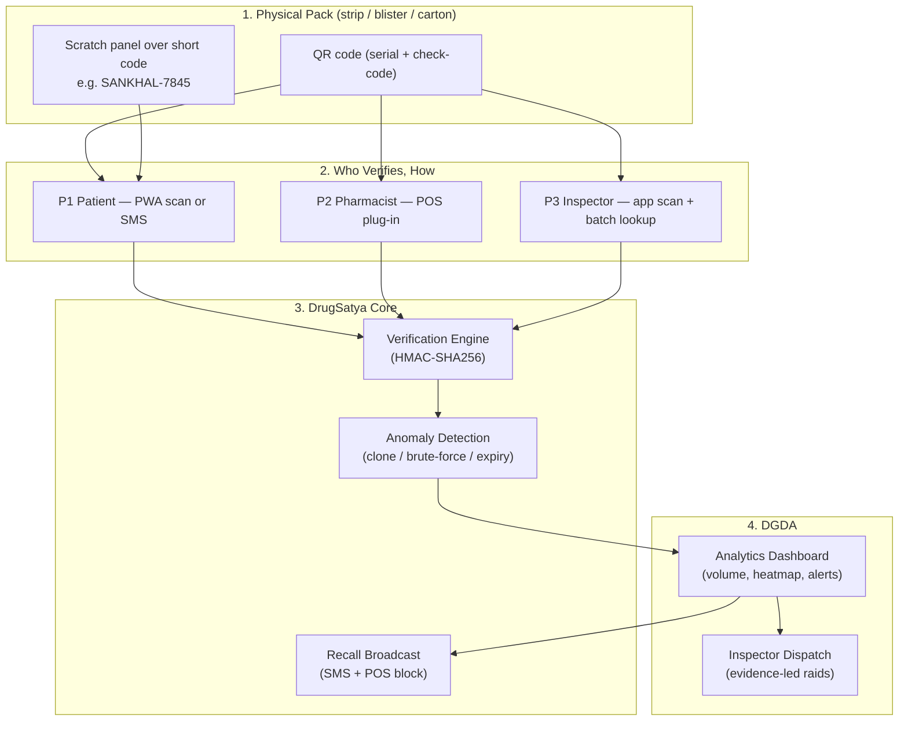

# 🔄 Application Flow — DrugSatya Pack Verification

## Module 13 — Drug Verify: Scan / SMS Journeys, Verification Lifecycle & Edge-Case Handling

---

## Table of Contents

- [Personas](#personas)
- [System Interaction Overview](#system-interaction-overview)
- [Journey 1: Patient Verifies a Pack via PWA (QR Scan)](#journey-1-patient-verifies-a-pack-via-pwa-qr-scan)
- [Journey 2: Patient Verifies via Scratch-to-SMS (Offline, Feature Phone)](#journey-2-patient-verifies-via-scratch-to-sms-offline-feature-phone)
- [Journey 3: Pharmacist POS Verification at Point of Sale](#journey-3-pharmacist-pos-verification-at-point-of-sale)
- [Journey 4: DGDA Inspector Field Verification & Batch Lookup](#journey-4-dgda-inspector-field-verification--batch-lookup)
- [Journey 5: Manufacturer QA Registers a Batch & Generates Serials](#journey-5-manufacturer-qa-registers-a-batch--generates-serials)
- [Journey 6: Cloned-Code Anomaly Detected → DGDA Alert](#journey-6-cloned-code-anomaly-detected--dgda-alert)
- [Journey 7: Batch Recall Broadcast (SMS + POS Block)](#journey-7-batch-recall-broadcast-sms--pos-block)
- [Pack Verification Lifecycle (State Machine)](#pack-verification-lifecycle-state-machine)
- [The Offline Flow in Detail (Scratch-to-SMS)](#the-offline-flow-in-detail-scratch-to-sms)
- [Edge Cases & Exception Handling Matrix](#edge-cases--exception-handling-matrix)
- [Flow Summary Table](#flow-summary-table)

---

## Personas

| # | Persona | Context & Constraints | Primary Channel |
|:---:|:---|:---|:---|
| **P1** | **Rahim, 34 — patient at a pharmacy** (Keraniganj) | Buys antibiotics for his child; shared household smartphone or a basic feature phone; 26% rural smartphone use (GSMA 2024); cannot judge a blister by eye; worried about fakes after reading about Mitford raids | PWA if smartphone; **SMS if not** |
| **P2** | **Nusrat, 41 — pharmacist** (Mirpur retail) | Not a registered pharmacist (only **7.56%** of surveyed pharmacies have one — PMC 2025); stocks 2,000+ SKUs; fears unknowingly selling fakes; wants a 1-second check at the counter | POS plug-in |
| **P3** | **Kamal, 38 — DGDA field inspector** (Dhaka zonal office) | Runs inspection drives (880+ illegal facilities closed 2024; ~1,027 unlicensed — DGHS); needs evidence-grade proof before seizure; GPS-tagged audit trail | Inspector app (Android) |
| **P4** | **Farhana, 29 — manufacturer QA officer** (Dhaka pharma exporter) | Registers batches, prints serials, faces brand sabotage by counterfeiters; must keep India-market compliance (Jul 2026 QR mandate) for the same product line | Manufacturer portal (web) |
| **P5** | **DGDA enforcement desk officer** (HQ, Dhaka) | Approves recalls, watches the verification heatmap, dispatches Kamal; needs one-click batch takedown | DGDA dashboard (web) |

---

## System Interaction Overview



---

## Journey 1: Patient Verifies a Pack via PWA (QR Scan)

Rahim buys "Napa Extend"-type strips... — no brand names; a generic **Demo-Amox 500mg strip** from the pharmacy counter.

```mermaid
sequenceDiagram
    autonumber
    actor P as Patient (P1)
    participant PWA as DrugSatya PWA (React)
    participant API as DrugSatya API (FastAPI)
    participant DB as Registry (PostgreSQL 16)
    participant RED as Redis (rate limit / cache)

    P->>PWA: Opens app (or scans via camera shortcut)
    P->>PWA: Scans QR on strip
    PWA->>PWA: Decodes serial + check-code (offline parse)
    PWA->>API: GET /api/v1/scan/{serial}
    API->>RED: Rate-limit check (per IP / per token)
    API->>DB: Lookup serial; recompute HMAC-SHA256
    DB-->>API: Batch N-123 | Exp 2027-08 | Mfr: Demo Pharma | Status: ACTIVE
    API-->>PWA: 200 GENUINE + batch metadata + DGDA MRP (if capped)
    PWA-->>P: Screen: "আসল ✓ Genuine — Batch N-123 — Exp 2027-08"
    PWA->>API: Fire-and-forget scan log (hashed device id, no PII)
```

**Step details:**
1. PWA works offline for *parsing*; the verdict needs connectivity (cached last-known block list shown if offline, stamped `UNVERIFIED_OFFLINE`).
2. Verdict screen shows: GENUINE/SUSPECT, batch, expiry, manufacturer, and — for the ~160 DGDA price-capped drugs — the fixed MRP with a `দাম বেশি` (price is high) one-tap flag.
3. If SUSPECT: full-screen warning in Bangla + English, one-tap "Report to DGDA" (geolocation opt-in), and "Do not consume" instruction.

**Timing target:** QR decode → verdict in **< 2 seconds** on 3G [illustrative].

---

## Journey 2: Patient Verifies via Scratch-to-SMS (Offline, Feature Phone)

Rahim's mother uses a basic handset. No internet, no app — the 2010 Nigeria/Ghana pattern, rebuilt for 2026.

```mermaid
sequenceDiagram
    autonumber
    actor M as Patient's mother (P1, feature phone)
    participant GW as SMS Gateway (mock in demo)
    participant API as DrugSatya SMS Webhook (FastAPI)
    participant DB as Registry (PostgreSQL 16)
    participant SMS as Outbound SMS (Bangla)

    M->>M: Scratches foil → reveals "SANKHAL-7845"
    M->>GW: SMS: SANKHAL-7845 to shortcode (e.g. 16299 [illustrative])
    GW->>API: POST /api/v1/sms/webhook (MSISDN hashed on receipt)
    API->>API: Normalize code; HMAC validate; expiry & recall check
    API->>DB: Lookup serial; write scan event (hashed MSISDN only)
    alt GENUINE
        API-->>GW: Reply payload
        GW-->>M: "[DrugSatya যাচাই] কোড SANKHAL-7845: আসল ✓ ব্যাচ N-123 • মেয়াদ 2027-08 • প্রস্তুতকারক: ডেমো ফার্মা"
    else SUSPECT / unknown / recalled
        API-->>GW: Reply payload + DGDA ticket ref
        GW-->>M: "সতর্কতা: এই কোডটি সন্দেহজনক। সেবন বন্ধ করুন ও DGDA-কে জানান। হটলাইন: 16263 | Ref: RPT-2291"
    end
```

**Invariants:** no balance deducted for the reply [operator SLA, illustrative]; MSISDN never stored raw; verdict payload identical to PWA.

---

## Journey 3: Pharmacist POS Verification at Point of Sale

Nusrat scans the strip of an antibiotic before billing. Mandatory-verify class: **antibiotics**.

```mermaid
sequenceDiagram
    autonumber
    actor N as Pharmacist (P2)
    participant POS as POS Plug-in (web component)
    participant API as DrugSatya API
    participant CACHE as Local Block List (signed, hourly sync)
    participant DB as Registry
    participant DGDA as DGDA Dashboard

    N->>POS: Scans QR on antibiotic strip (or types SANKHAL-7845)
    POS->>CACHE: Offline check: is batch in recalled/clone list?
    alt Offline hit (blocked)
        CACHE-->>POS: BLOCK: "এই ব্যাচটি প্রত্যাহার করা হয়েছে" (this batch has been recalled)
        POS-->>N: Sale blocked; red banner; log queued for sync
    else Not blocked locally
        POS->>API: POST /api/v1/pos/verify {serial, pos_id, drug_class: ANTIBIOTIC}
        API->>DB: Verify serial + expiry + recall status
        alt GENUINE
            API-->>POS: 200 GENUINE (Batch N-123, Exp 2027-08, MRP Tk 240)
            POS-->>N: Green tick; sale proceeds; verification logged
        else SUSPECT / RECALLED
            API-->>POS: 409 SUSPECT (reason: CLONE_ALERT / NOT_REGISTERED / EXPIRED / RECALLED)
            POS-->>N: Red block; "বিক্রি করবেন না" (do not sell); suspect event pushed
            API->>DGDA: Suspect event + geolocation + POS id
        end
    end
    Note over POS,DB: Antibiotics / insulin / vaccines / oncology = mandatory verify; other classes = optional soft check
```

**Edge behaviour:** POS never hard-fails the sale on *network* error for non-mandatory classes (soft warning only); for mandatory classes, network failure falls back to cached block list + stamped `UNVERIFIED_OFFLINE`, and a manager override is logged (accountability without blocking urgent care).

---

## Journey 4: DGDA Inspector Field Verification & Batch Lookup

Kamal raids a Mitford wholesale depot. Every strip on the seized shelf is scanned in under a minute per box.

```mermaid
sequenceDiagram
    autonumber
    actor K as DGDA Inspector (P3)
    participant APP as Inspector App (Android)
    participant API as DrugSatya API
    participant DB as Registry
    participant DGDA as DGDA Case System

    K->>APP: Login (DGDA SSO); select raid site (GPS auto-tag)
    K->>APP: Batch-scan mode: scan 50 strips sequentially
    APP->>API: POST /api/v1/inspect/batch-scan {serials[], gps, site_ref}
    API->>DB: Bulk verify; compute anomaly flags per serial
    DB-->>API: Per-serial verdicts + batch-level risk score
    API-->>APP: Report: 44 GENUINE / 6 SUSPECT (same serial on all 6 → CLONE_ALERT)
    K->>APP: Tap SUSPECT → "SEIZE — evidence photo + GPS + seal no."
    APP->>DGDA: Case file created: BATCH-N-123, photos, counts, GPS
    DGDA-->>K: Case ID + recall-eligibility prompt to HQ desk
```

**Batch lookup** (single pack, no scan): type batch no. → dossier (manufacturer licence, registration no., production/expiry, scan count, anomaly history) — the difference between a hunch and a lawful seizure.

---

## Journey 5: Manufacturer QA Registers a Batch & Generates Serials

Farhana's QA team releases Batch N-123 of Demo-Amox 500mg.

```mermaid
sequenceDiagram
    autonumber
    actor F as Manufacturer QA (P4)
    participant PORTAL as Manufacturer Portal (web)
    participant API as DrugSatya API
    participant CRYPTO as Serial Factory (HMAC-SHA256)
    participant DB as Registry
    participant PRINT as Print Partner / In-house Press

    F->>PORTAL: Login (manufacturer credential + DGDA licence no.)
    F->>PORTAL: New batch form: product, batch no. N-123, mfg 2026-11, exp 2027-08, qty 10,000
    PORTAL->>API: POST /api/v1/batches (idempotent; batch_no unique per product)
    API->>CRYPTO: Generate serials: HMAC(key, mfr|prod|batch|seq) → base32 short code
    CRYPTO-->>API: 10,000 serials (checksum-validated; collision check)
    API->>DB: Insert batch + serial hashes (plain serials never stored; only hashes + check-codes)
    API-->>PORTAL: Print file (CSV/PDF: serial ↔ check-code ↔ QR payload) + manifest
    PORTAL-->>F: Manifest with SHA-256; download for press run
    F->>PRINT: Print 10,000 strips (QR + scratch foil)
    PRINT-->>PORTAL: Print confirmation (qty, date, press id) → batch status: DISTRIBUTED
```

**Controls:** serials are generated, never typed; DGDA key rotation yearly; print files expire in 72h; partial print runs reconcile against manifest (unprinted serials are voided, auditable).

---

## Journey 6: Cloned-Code Anomaly Detected → DGDA Alert

A counterfeiter photocopies a genuine QR onto 4,000 fake strips. Each fake scans the *same serial*.

```mermaid
sequenceDiagram
    autonumber
    participant SCAN as Scan Events (PWA/SMS/POS)
    participant AN as Anomaly Engine (Redis streams + worker)
    participant DB as Registry
    participant DASH as DGDA Dashboard
    actor DESK as DGDA Desk Officer (P5)

    SCAN->>AN: Stream of scan events (serial, ts, channel, geo-hash)
    AN->>AN: Sliding-window counter per serial (1h / 24h / 30d)
    AN->>DB: Threshold check: serial scanned > 500 times [illustrative] in 30d across > 50 geo-hashes
    AN->>DB: Flag batch N-123 → anomaly_level: CLONE_ALERT
    AN->>DASH: Push alert: heatmap spike; affected districts; first-seen timestamp
    DASH->>DESK: Red banner + SMS to duty officer
    DESK->>DESK: Reviews evidence: same serial, 12 districts, 3 weeks — printer's genuine stock can't do that
    DESK->>DESK: Decision: field verification (Journey 4) → recall (Journey 7) if confirmed
```

**False-positive guard:** one viral genuine pack scanned by many in one area (e.g., a hospital ward) looks similar — the engine requires **geographic dispersion + volume**, not volume alone; inspector confirmation is mandatory before recall.

---

## Journey 7: Batch Recall Broadcast (SMS + POS Block)

Confirmed clone. DGDA issues recall for Batch N-123.

```mermaid
sequenceDiagram
    autonumber
    actor DESK as DGDA Desk Officer (P5)
    participant API as Recall Service
    participant DB as Registry
    participant SMS as SMS Gateway
    participant POS as All POS Terminals (block list)
    participant APP as Inspector App
    actor PHARM as Pharmacies (5,000 nationwide [illustrative])

    DESK->>API: POST /api/v1/recalls {batch: N-123, reason: CLONE_CONFIRMED, scope: DIVISION_DHAKA}
    API->>DB: batch.status = RECALLED; serials flagged; recall_id issued
    par Broadcast channels
        API->>SMS: SMS blast to pharmacy registry phones: "প্রত্যাহার: ব্যাচ N-123 (Demo-Amox 500) — বিক্রি বন্ধ করুন"
        SMS-->>PHARM: Delivery receipts → reach metric
    and
        API->>POS: Push block entry (signed) — all terminals sync ≤ 5 min [illustrative]
        POS-->>API: ACK per terminal → coverage %
    and
        API->>APP: Recall banner + seizure target list for inspectors
    end
    API-->>DESK: Broadcast report: SMS reach 94%, POS ACK 4,812/5,000, inspectors notified
    Note over API,PHARM: Post-recall scans of Batch N-123 keep logging → residual-circulation metric for DGDA
```

**Bangla SMS:** `প্রত্যাহার: ব্যাচ N-123 (ডেমো-অ্যামক্স ৫০০) — বিক্রি ও সেবন বন্ধ করুন। বিস্তারিত: 16263` — keep under 2 SMS segments [illustrative].

---

## Pack Verification Lifecycle (State Machine)

```mermaid
stateDiagram-v2
    [*] --> PRINTED: Press run confirmed (Journey 5)
    PRINTED --> DISTRIBUTED: Manifest reconciled; batch released to market

    DISTRIBUTED --> VERIFIED_OK: Scan/SMS matches HMAC + not expired + not recalled
    DISTRIBUTED --> VERIFIED_SUSPECT: Mismatch / expired / never-registered / clone-flag

    VERIFIED_OK --> VERIFIED_OK: Re-scan (count++ — drives clone detection)
    VERIFIED_OK --> VERIFIED_SUSPECT: Batch later flagged (clone alert / new recall)

    VERIFIED_SUSPECT --> DISTRIBUTED: DGDA clears false positive (grace period)
    VERIFIED_SUSPECT --> RECALLED: DGDA recall order (Journey 7)

    VERIFIED_OK --> RECALLED: Recall issued after clean scans
    RECALLED --> [*]: Block list permanent; residual scans monitored
```



**State notes:**
- `PRINTED → DISTRIBUTED` is the only manufacturer-writable transition; everything downstream is system/DGDA-writable (separation of duties).
- A pack is never "un-recalled"; a false positive is resolved by returning the *batch* to DISTRIBUTED with an annotation, not by editing individual packs.
- `VERIFIED_SUSPECT` never auto-recalls — human (DGDA desk) confirmation required, protecting against mass false-positive takedowns.

---

## The Offline Flow in Detail (Scratch-to-SMS)

For the **74% of rural households without internet on the device in hand** (57.4% have it at home, BBS Jan–Mar 2026) and every feature-phone user:

1. **Locate** the scratch panel beside the batch print on the strip/carton.
2. **Scratch** gently — foil must break cleanly (factory defect rate target < 0.5% [illustrative]; unreadable panels → treat as suspect, call 16263).
3. **SMS** the revealed code to the shortcode — GSM-7, no internet, no app, no balance needed for the reply.
4. **Read** the Bangla/English reply (see Journey 2 for exact strings).
5. **Act**: GENUINE → proceed; SUSPECT → do not consume; hand the strip back or call **16263**; the report is auto-logged with the code (no name, no address, no PII).
6. **IVR fallback** for low-literacy users: call 16263 → press 4 (DrugSatya) → *"আপনার কোডটি বলুন"* → code heard → verdict read aloud in Bangla → reference number for follow-up.

**Why not app-only?** Nigeria/Ghana proved scratch-SMS reaches the last mile; India's QR is smartphone-first and excludes exactly the rural poor who buy the most unregulated generics. DrugSatya keeps both doors open from day one — SMS is the floor, PWA is the ceiling.

---

## Edge Cases & Exception Handling Matrix

| # | Scenario / Edge Case | Failure Mode / Threat | System Defense & Protocol |
|:---:|:---|:---|:---|
| 1 | **Scratched-off / unreadable panel** (torn foil, print smudged) | Customer cannot reveal code; pharmacist cannot verify | Panel unreadable ⇒ treated as **SUSPECT** at POS; for SMS channel, reply: `সতর্কতা: কোড পড়া যায়নি — 16263-এ কল করুন`; factory QC target < 0.5% defective panels [illustrative] |
| 2 | **Duplicate code re-used many times** (same serial scanned 500×) | Photocopied QR on bulk fakes; serial exhausted in one district | Volume **+ geographic dispersion** threshold [illustrative: 500 scans / 30d / > 50 geo-hashes] ⇒ `CLONE_ALERT`; batch flagged; inspector dispatched; recall if confirmed (Journeys 6–7) |
| 3 | **Expired pack** | Genuine but expired medicine sold quietly | Expiry checked from batch record on every verification; reply includes `মেয়াদোত্তীর্ণ` (expired) warning; POS blocks sale of mandatory-class expired stock |
| 4 | **Genuine pack fails database (sync lag)** | Manufacturer registered batch yesterday; DGDA registry replica lags; false SUSPECT | Read-your-writes for 24h on primary; replicas lag ≤ 5 min [illustrative SLA]; false-positive grace: POS offers "verify again in 10 min" + helpline **16263**; manufacturer sync SLA with late-upload penalty |
| 5 | **Never-registered serial** (guessed/fabricated) | HMAC mismatch or unknown code | Instant SUSPECT; repeated attempts from one MSISDN rate-limited ([illustrative] 5/10 min) and flagged for brute-force review |
| 6 | **Recalled batch scanned after recall** | Residual stock in circulation | Verdict: `RECALLED — বিক্রি/সেবন বন্ধ`; every post-recall scan is logged as residual-circulation telemetry for DGDA |
| 7 | **SMS gateway outage / shortcode down** | Feature-phone users locked out | USSD session fallback (`*16263#` [illustrative]); IVR via 16263; PWA unaffected; gateway multi-telco failover (GP/Robi/BL/Teletalk) |
| 8 | **Shared/borrowed phone — privacy** | Family sees verdict; MSISDN linkage fear | No PII stored; MSISDN SHA-256+salt hashed, rotated salt quarterly; verdicts carry no drug name beyond class; screen auto-clears |
| 9 | **POS offline for days** | Block list stale; recalled pack sold | Block list TTL 72h; beyond that, mandatory-class sales require manager override (logged); sync on reconnect reconciles all offline verdicts |
| 10 | **Counterfeit with valid QR but missing scratch panel** | Fake skips foil cost | POS checklist includes panel presence; missing panel on mandatory-class strip ⇒ block; awareness campaign teaches "no foil = no trust" |
| 11 | **Manufacturer prints fewer serials than manifest** (skimming genuine codes for fakes) | Insider diversion of genuine serials | Print reconciliation is mandatory; mismatch voids unprinted serials automatically; DGDA audits manifest vs press log quarterly |
| 12 | **Citizen scans a pack twice — expects different answer** | Confusion; "changed my verdict" complaint | Same input ⇒ same verdict (deterministic HMAC); second scan counted (feeds clone detection); FAQ in PWA |
| 13 | **Wrong shortcode / phishing SMS** | Fake "DrugSatya" gateway harvesting codes | Official shortcode only via DGDA/BTRC announcement; SMS replies signed with sender ID `DRUGSATYA`; publicised in awareness drive |
| 14 | **Returned/refund pack re-shelved** | Recalled stock re-enters sale | Recall blocks at POS regardless of shelf re-labelling; inspector spot-checks post-recall |

---

## Flow Summary Table

| Journey | Actor | Channel | Time Target | Offline? | Output / Side-Effect |
|:---:|:---|:---|:---|:---:|:---|
| 1 | Patient (P1) | PWA QR scan | < 2 s [illustr.] | Parse only | GENUINE/SUSPECT screen; scan logged (no PII) |
| 2 | Patient (P1) | SMS shortcode (Bangla reply) | < 10 s [illustr.] | **Yes (full)** | SMS verdict; optional DGDA ticket on SUSPECT |
| 3 | Pharmacist (P2) | POS plug-in | < 1 s [illustr.] | Block-list only | Sale proceeds / blocked; suspect event → DGDA |
| 4 | Inspector (P3) | Inspector app + batch lookup | seconds per strip | Partial | Seizure case file with GPS + photos |
| 5 | Manufacturer QA (P4) | Web portal | minutes per batch | No | Batch registered; 10,000 HMAC serials; manifest |
| 6 | System + DGDA desk (P5) | Anomaly engine → dashboard | near-real-time | n/a | `CLONE_ALERT`; heatmap spike; inspector dispatch |
| 7 | DGDA desk (P5) | Recall broadcast | < 1 hr to POS block [illustr.] | n/a | Batch recalled; SMS reach; POS ACK coverage |
