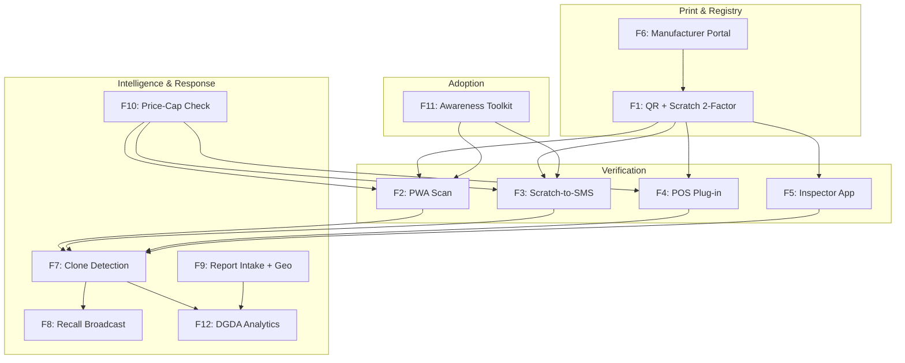

# ⚡ Functional Specifications & Feature Catalog — Module 13

## DrugSatya — Pack-Level Drug Authenticity Verification (Drug Verify)

> Bangla: **DrugSatya — ঔষধ যাচাই** ("Satya" / সত্য = truth). Scan or SMS to know in 2 seconds if it is genuine.

---

## Table of Contents

- [Functional Architecture Overview](#functional-architecture-overview)
- [Feature 1: Pack-Level QR + Scratch Panel (Two-Factor)](#feature-1-pack-level-qr--scratch-panel-two-factor)
- [Feature 2: Consumer Scan via PWA](#feature-2-consumer-scan-via-pwa)
- [Feature 3: Scratch-to-SMS Verification (Bangla Reply)](#feature-3-scratch-to-sms-verification-bangla-reply)
- [Feature 4: Pharmacist POS Verification Plug-in](#feature-4-pharmacist-pos-verification-plug-in)
- [Feature 5: DGDA Inspector App with Batch Lookup](#feature-5-dgda-inspector-app-with-batch-lookup)
- [Feature 6: Manufacturer Batch Registration Portal](#feature-6-manufacturer-batch-registration-portal)
- [Feature 7: Cloned-Code / Re-use Anomaly Detection](#feature-7-cloned-code--re-use-anomaly-detection)
- [Feature 8: Batch Recall Broadcast (SMS + POS Block)](#feature-8-batch-recall-broadcast-sms--pos-block)
- [Feature 9: Counterfeit Report Intake with Geolocation](#feature-9-counterfeit-report-intake-with-geolocation)
- [Feature 10: Price-Cap Check (~160 DGDA-Fixed Essentials)](#feature-10-price-cap-check-160-dgda-fixed-essentials)
- [Feature 11: Awareness Campaign Toolkit](#feature-11-awareness-campaign-toolkit)
- [Feature 12: Verification Analytics for DGDA Enforcement](#feature-12-verification-analytics-for-dgda-enforcement)
- [Feature Priority & Compliance Matrix](#feature-priority--compliance-matrix)
- [Out of Scope](#out-of-scope)

**Invariants**: no patient data (scans store hashed MSISDN only) · offline-tolerant (SMS floor, PWA ceiling) · DGDA owns registry + recalls · tech always paired with enforcement + awareness (Nigeria/Ghana lesson).

---

## Functional Architecture Overview

---

## Feature 1: Pack-Level QR + Scratch Panel (Two-Factor)

**What**: Each strip/carton carries (a) printed **QR** (full serial + check-code) and (b) a tamper-evident **scratch foil** hiding a short code, e.g. `SANKHAL-7845`. Both derive from one HMAC-SHA256 serial — `HMAC(key, mfr_id | product_id | batch_id | serial_no)` — **never a plain sequential ID**.

**Why**: A QR alone is photocopied trivially; the foil binds verification to **physical possession of an unopened pack** — the Sproxil/mPedigree anti-clone primitive hardened with crypto + a second channel. India's 2026/2028 mandate validates QR-on-pack as policy; the foil covers feature-phone users (26% rural smartphone use — GSMA 2024) a QR-only regime excludes.

**How**: serials generated in F6; DGDA-held HMAC key (annual rotation, key-version in serial header); QR payload `drugsatya://v1/{serial}/{check}`; scratch code = 8 base32 chars (40 bits — brute force infeasible at 5 tries/10 min/MSISDN); foil = destructible vinyl, VOID-reveal; factory defect target < 0.5% [illustrative]; missing/re-stuck foil ⇒ SUSPECT at POS; print reconciliation auto-voids unprinted serials.

**Edge cases**: torn/illegible foil (→ SUSPECT + 16263) · damaged QR, intact foil (→ SMS path works) · swapped QR (→ check-code mismatch ⇒ SUSPECT) · valid QR + fake foil with spent codes (→ SUSPECT + clone alert) · print-run shortfall (→ remainder voided, audit) · dual-language packs (same code, localised foil).

## Feature 2: Consumer Scan via PWA

**What**: React **PWA** (installable, offline shell): scan QR → 2-sec verdict — GENUINE (batch, expiry, mfr, MRP if capped) or SUSPECT (do-not-consume + one-tap report).

**Why**: Urban 41% / rural 26% smartphone use (GSMA 2024); zero-install, 2G/3G-tolerant. Mirrors Jan Aushadhi Sugam learnings (Rs 20,000+ crore saved / 9 yrs, parliamentary reply).

**How**: jsQR/ZXing camera scan; manual entry fallback; Bangla/English toggle; verdict = green/red full field + batch/expiry/mfr + `দাম বেশি` (price too high) flag for the ~160 capped drugs; SUSPECT screen lists actions (don't consume · return to pharmacy · call **16263**); offline → cached batches stamped `UNVERIFIED_OFFLINE`; scan log = hashed device token only; WCAG 2.2 AA; Bangla screen-reader verdicts; auto-clears in 30s (shared phones).

**Edge cases**: camera denied (→ manual entry) · glare/damaged QR (→ retry + torch) · expired pack (→ `মেয়াদোত্তীর্ণ` red banner) · report flow (→ F9, geo opt-in) · low-end Android (< 3s cold start [illustrative]) · rescanned genuine pack (→ counted → clone detection input).

## Feature 3: Scratch-to-SMS Verification (Bangla Reply)

**What**: SMS the scratched code to the shortcode → instant Bangla/English verdict. No smartphone, no internet, no balance [operator SLA, illustrative]. The **NAFDAC 2010 / mPedigree 2014** pattern rebuilt with 16263 integration.

**Why**: Feature phones dominate rural retail; household phones shared (73.4% ownership vs 26% rural individual use — GSMA 2024 / BBS 2026). SMS is universal reach with zero learning curve. BD pilots (Panacea/Renata SMS 2777, 2016; CDrug, 2017 — status [uncertain], no DGDA mandate found) proved behaviour, never scaled — this institutionalises it under DGDA.

**How**: inbound webhook → MSISDN **immediately SHA-256+salt hashed** (raw never persisted); replies (GSM-7/Unicode):
- GENUINE: `[DrugSatya যাচাই] কোড SANKHAL-7845: আসল ✓ ব্যাচ N-123 • মেয়াদ 2027-08 • প্রস্তুতকারক: ডেমো ফার্মা`
- SUSPECT: `সতর্কতা: এই কোডটি সন্দেহজনক। সেবন বন্ধ করুন ও DGDA-কে জানান। হটলাইন: 16263 | Ref: RPT-2291`
- EXPIRED: `সতর্কতা: এই ব্যাচের মেয়াদ শেষ (2026-03)। সেবন করবেন না।`

USSD `*16263#` [illustrative, pending BTRC]; IVR for low literacy (*"আপনার কোডটি বলুন"* — say your code → spoken verdict); ~Tk 0.10–0.25/SMS [illustrative] on manufacturer fee; ASCII-safe fallback for ancient handsets (`ASOL` / `SANDHJOHOK`); multi-telco failover (GP/Robi/BL/Teletalk).

**Edge cases**: wrong code (→ `কোডটি সঠিক নয়` + retry) · gateway down (→ USSD/IVR) · > 5 attempts/10 min per MSISDN (→ rate-limit + brute-force flag) · spam to shortcode (→ filter, no reply cost) · roaming MSISDN (→ accepted, same hashing).

## Feature 4: Pharmacist POS Verification Plug-in

**What**: Lightweight **POS plug-in** (JS snippet for billing suites, or standalone Android): scan QR / type code → 200 ms verdict → sale proceeds or **blocked**. **Mandatory-verify classes**: antibiotics, insulin, vaccines, oncology — India's 2026/2028 classes.

**Why**: The 3-second sale is the point of maximum risk. Only **7.56%** of Dhaka pharmacies have a registered pharmacist (PMC 2025) — the check must live in the machine, mirroring India's risk-class mandate and Module 11 (AMR Lens).

**How**: offline signed **block list** (recalled/clone-flagged; hourly sync; 72h TTL); flow = scan → local block check → API verify → green tick or red block (`বিক্রি করবেন না`) + suspect event + geo-hash → DGDA; network failure on mandatory class ⇒ cached verdict stamped `UNVERIFIED_OFFLINE` + logged manager override; non-mandatory ⇒ soft warning; prescription-only class without digital Rx (Module 03) ⇒ amber stewardship banner (**not** a block); receipt prints verification ref on demand.

**Edge cases**: recalled pack (→ hard block, no override) · expired mandatory-class stock (→ block) · POS offline > 72h (→ manager override + reconcile on reconnect) · ignored block (→ logged → DGDA mystery audit) · clock skew (→ server timestamps) · rush-hour queue (< 1s p95 [illustrative]) · stolen terminal (→ cert revocation).

## Feature 5: DGDA Inspector App with Batch Lookup

**What**: Android app for DGDA field officers: camera batch-scan of seized stock + **batch lookup** (type batch no. → dossier) + one-tap `SEIZE` with GPS + photos + seal no. → case file to DGDA.

**Why**: 2024 saw **880+** illegal facilities closed, **~1,027** unlicensed (DGHS) — enforcement will exists but is undirected; a scan-derived case file makes raids prosecutable.

**How**: DGDA SSO + RBAC (inspector / zonal / HQ); batch dossier = mfr + licence no., registration, mfg/exp, scan count, anomaly level, prior seizures, recall status; batch-scan mode = rapid sequential scan, auto-tally, same serial repeated ⇒ auto `CLONE_ALERT`; seizure = photo + GPS + seal → case → recall-eligibility prompt to HQ (F8); offline capture, sync on connectivity.

**Edge cases**: no network at site (→ offline capture) · disputed seizure (→ immutable audit + photo chain-of-custody) · device lost (→ MDM wipe + revoke) · mfr disputes data (→ exportable dossier + DGDA arbitration) · forged inspector ID (→ SSO + per-case PIN).

## Feature 6: Manufacturer Batch Registration Portal

**What**: Web portal: DGDA-licensed manufacturers register batches (licence, batch no., dates, qty) → receive print file of **HMAC-signed serials** + manifest; press confirmation closes batch.

**Why**: Trust starts at the press — without mandatory registration no serial verifies; India's mandate already obligates BD exporters to print machine-readable marks, so one print run serves both markets.

**How**: onboarding via DGDA licence check → product master (links Module 03 registry) → batch creation (unique batch_no; idempotency keys) → serial factory (HMAC-SHA256 → base32; collision check; manifest CSV/PDF + SHA-256) → print reconciliation (short prints ⇒ unprinted serials auto-void after 30d) → fee per batch (India model; donor bridge year 1 [illustrative Tk 2,000–5,000]).

**Edge cases**: duplicate batch no. (→ rejected + alert) · licence suspended mid-batch (→ batch frozen, DGDA notified) · key rotation (→ old batches still verify via key version) · wrong product mapping (→ quarantine + review) · export-only batch (→ CDSCO co-recognition [proposed]).

## Feature 7: Cloned-Code / Re-use Anomaly Detection

**What**: Streaming engine counting scans per serial across time + geography; flags **cloned codes** (same serial scanned hundreds of times across districts) and brute-force guessing.

**Why**: Physical cloning is the counterfeiter's only scalable attack on a crypto serial. Detection converts every fake scan into intelligence — operationalising the Nigeria/Ghana failure lesson (tech without enforcement pairing).

**How**: Redis Streams + worker; sliding windows 1h/24h/30d; per-serial counters + HyperLogLog geo-hashes; rule [illustrative, tunable]: > **500 scans / 30d** AND > **50 distinct geo-hashes** ⇒ `CLONE_ALERT` (volume alone insufficient — hospital wards legitimately re-scan genuine packs); secondary rules: expiry-burst scans; one MSISDN guessing; post-recall residual scans; single-POS anomaly (one till "verifying" 300×/day); output → DGDA heatmap + duty-officer SMS; confirmed clone → F8 recall; false positive → cleared with audit annotation.

**Edge cases**: ward re-scans (→ geo-dispersion defeats) · shared family phone (→ low dispersion, fine) · viral genuine batch (→ inspector review, never auto-recall) · alert storm during recall (→ dedup + cooldown) · serial rotation (→ cross-batch correlation by print run/distributor) · retention 90d raw / aggregate forever [illustrative].

## Feature 8: Batch Recall Broadcast (SMS + Pharmacy POS Block)

**What**: One-click DGDA recall: batch → RECALLED ⇒ (a) SMS blast to pharmacies in scope, (b) POS block list push (≤ 5 min [illustrative]), (c) inspector banner + target list, (d) residual-scan monitoring.

**Why**: A recall is only as fast as its slowest channel. Paper notices take weeks; SMS + POS propagates in minutes — containment vs a poisoned market; India's mandate needs exactly this machinery.

**How**: trigger = DGDA desk (post-F7 + field confirmation) or mfr self-report (DGDA-approved); scope = national/division/district/distributor; reasons = CLONE_CONFIRMED / CONTAMINATION / MISLABEL / EXPIRY_ERROR; SMS: `প্রত্যাহার: ব্যাচ N-123 (ডেমো-অ্যামক্স ৫০০) — বিক্রি ও সেবন বন্ধ করুন। বিস্তারিত: 16263` + delivery receipts → reach %; POS: signed block entry; terminals ACK → coverage (e.g. 4,812/5,000 [illustrative]); residual scans tracked weekly until ≈ 0.

**Edge cases**: partial vs full-batch recall · mfr disputes (→ DGDA arbitration; recall stands pending review) · SMS undelivered (< 80% reach [illustrative] → IVR + inspector sweep) · POS offline (→ block on reconnect; hotline interim) · lab clears sample (→ annotated un-recall + block lifted + audit) · post-recall re-labelling (→ POS blocks regardless of shelf).

## Feature 9: Counterfeit Report Intake with Geolocation

**What**: One-tap suspect report — photo (optional), strip close-up, GPS (opt-in), batch no. → DGDA ticket with geolocation; clusters feed the enforcement heatmap. **Anonymous by default; no PII.**

**Why**: 160M unpaid inspectors if reporting is one tap (mTrac, Uganda — 52,946 reporters, US$400k recovered — SDSN TReNDS 2018); matches 16263's complaint habit (DGHS SMS complaints since 2012; 4,694 in 2017, +427%).

**How**: entry = PWA SUSPECT screen / SMS keyword `FAKE <code>` [illustrative] / POS block event / inspector seizure — one queue; ticket = serial + geohash-6 (k-anonymity ≥ 25 [illustrative]) + channel; desk SLA 48h [illustrative]; clustering DBSCAN; ≥ 10 reports/30d [illustrative] ⇒ priority inspection zone; reporter (opt-in hashed MSISDN) gets closure SMS: `ধন্যবাদ — রিপোর্ট #RPT-2291 নিষ্পত্তি হয়েছে।`; heatmap = public aggregate (division-level) + inspector street-level layer.

**Edge cases**: malicious reports (→ rate limit + pattern block) · no GPS (→ manual area) · foil glare false SUSPECT (→ desk clears) · duplicates by serial (→ dedupe) · report on recalled batch (→ auto-linked, no new ticket) · pharmacist whistleblower fear (→ fully anonymous; outlet hashed).

## Feature 10: Price-Cap Check (~160 DGDA-Fixed Essentials)

**What**: On any of the **~160 DGDA price-capped essential drugs**, every channel shows the **fixed MRP**; above-cap price ⇒ amber flag + log; one-tap `দাম বেশি` report aggregates to DGDA.

**Why**: Retail rose **7–140%** while mill-gate stayed flat (Financial Express 2024); only ~160 drugs are capped. Jan Aushadhi Sugam proves transparency saves (Rs 20,000+ crore / 9 yrs). Extends DGDA's existing price-verification pilot to the scan moment, free.

**How**: MRP master synced monthly (fallback Module 06 price table); shown on PWA verdict, POS receipt, SMS (`সর্বোচ্চ খুচরা মূল্য: Tk XXX (DGDA নির্ধারিত)`); POS compares billing price vs cap ⇒ mismatch ⇒ amber flag + DGDA audit log (**sale allowed** — price power is DGDA's, not the POS's); citizen `দাম বেশি` one-tap → per-drug/district aggregates; scope stated plainly ("priced cap only for 160 drugs"); interop with Module 03/06 `MedicationKnowledge`-style MRP field.

**Edge cases**: stale cap list (→ monthly sync + version stamp) · per-pack-size caps (→ per-SKU) · parallel imports (→ origin flag, exempt) · `দাম বেশি` spam (→ aggregates only) · cap missing (→ "no DGDA cap — market price" honestly shown) · SMS length (→ MRP line only for capped drugs).

## Feature 11: Awareness Campaign Toolkit

**What**: Ready-to-launch DGDA/NGO/pharmacist toolkit — Bangla posters, 30-sec video, pharmacist 60-second card, 16263 call-centre script, clinic wall chart, pilot-pharmacy tent cards.

**Why**: Tech without awareness is shelfware — Nigeria/Ghana scaled only after heavy NAFDAC consumer campaigns (2010–2014). A phone-sharing culture (73.4% households) means speaking to **families and counter staff**, not app users.

**How**: CC-BY assets, Bangla-first; poster — *"ফোয়েলটি ঘষুন — কোডটি এসএমএস করুন — ২ সেকেন্ডে জানুন ওষুধ আসল কিনা"* (scratch the foil — SMS the code — know in 2 sec if the medicine is genuine); signage — *"এই দোকানে সব ওষুধ যাচাইকৃত"* (all medicines verified here); targets = pilot pharmacies, BAPS/BPSA, zonal drug offices, UHCs, mosques/markets; NGOs (icddr,b, BRAC, WHO-SEARO) localise freely; measurement = n≥400/division awareness survey [illustrative] + scan-rate lift per wave — fuel for the mandate case.

**Edge cases**: fatigue (→ rotate creatives quarterly) · panic amplification ("all medicine is fake" — **never**; tone = empowerment) · brand damage from rumour (→ DGDA clarification protocol) · low literacy (→ pictograms + voice IVR) · rural print (→ UHC + union parishad) · toolkit misuse (→ official logo + help-line watermark).

## Feature 12: Verification Analytics for DGDA Enforcement

**What**: DGDA dashboard — verifications/day by channel & division, fake-report heatmap, clone-alert feed, post-recall residual curves, pharmacy scorecards, exportable case evidence packs.

**Why**: DGDA cannot inspect 107,000–174,000 pharmacies uniformly (estimates vary); it must inspect where data points. 2024's 880+ closures prove will — this proves **direction** — and it's how BD measures the mandate honestly (India regulates; BD verifies).

**How**: panels = live counters · district heatmap (reports + blocks + clone alerts) · top-flagged batches · recall-effectiveness curve · pharmacy adopter leaderboard · PDF/CSV evidence pack (case no., GPS cluster, audit refs); RBAC HQ/zonal/inspector; PDPO 2025-aligned — aggregates only; breach alert (division SUSPECT rate > 8% [illustrative]) ⇒ daily digest SMS to duty officer; headline KPIs surfaced: verifications/day · % pre-sale verified · # suspect reports · repeat-scan alerts · recall reach · enforcement actions informed.

**Edge cases**: POS gaming (→ cross-check audits) · empty districts (→ show "no data", never a fake zero) · outage (→ read replica; SMS digest continues) · over-enforcement optics (→ published methodology + appeal path) · press misread (→ pre-briefed one-pager) · retention 90d raw / ∞ aggregate [illustrative].

---

## Feature Priority & Compliance Matrix

| ID | Feature | Pri | Standard | User | Offline |
|:---|:---|:---:|:---|:---|:---:|
| **F-DV-01** | Pack QR + scratch 2-factor | P0 | HMAC-SHA256; base32; foil spec | Manufacturers | Physical |
| **F-DV-02** | PWA scan | P0 | React PWA; jsQR/ZXing; WCAG 2.2 AA | Citizens | Cache only |
| **F-DV-03** | Scratch-to-SMS (Bangla) | P0 | GSM-7/Unicode; shortcode; USSD/IVR | Feature-phone users | **Full** |
| **F-DV-04** | POS plug-in | P0 | Signed block list; < 1s p95 [illustr.] | Pharmacists | 72h TTL |
| **F-DV-05** | Inspector app + lookup | P0 | DGDA SSO; RBAC; GPS chain-of-custody | Inspectors | Partial |
| **F-DV-06** | Manufacturer portal | P0 | Licence verify; idempotency; SHA-256 manifest | Mfr QA | No |
| **F-DV-07** | Clone anomaly detection | P1 | Redis Streams; HyperLogLog | DGDA/system | n/a |
| **F-DV-08** | Recall broadcast | P0 | Signed push; SMS receipts | DGDA desk | n/a |
| **F-DV-09** | Report intake + geo | P1 | DBSCAN; k-anonymity ≥ 25 [illustr.] | Citizens/pharmacists | No |
| **F-DV-10** | Price-cap check (~160) | P1 | DGDA MRP sync; Module 03/06 interop | All channels | MRP cache |
| **F-DV-11** | Awareness toolkit | P1 | CC-BY; Bangla-first | DGDA/NGOs | n/a |
| **F-DV-12** | DGDA analytics | P1 | Aggregates; PDPO 2025; PDF/CSV export | DGDA HQ/zonal | Read replica |

---

## Out of Scope

1. **No AI/image-recognition authentication** of packs — photos can't beat a high-quality print; verification is cryptographic (HMAC) + physical (foil) only.
2. **Does NOT replace laboratory testing** — assay/dissolution/sterility stays with DGDA labs; DrugSatya triages *which* packs to test, never declares a chemical pass/fail.
3. **No clinical efficacy / bioequivalence judgement** — a GENUINE verdict proves provenance, not therapeutic equivalence.
4. **No hard block on non-mandatory classes** — flag + log only; pharmacists and DGDA decide.
5. **No pricing authority** — displays DGDA caps, logs above-cap sales; DGDA sets prices.
6. **No patient data / prescriptions / Health ID linkage** — anonymous by design; consent required for any future recall follow-up.
7. **No diversion prevention** (theft/re-boxing of genuine stock) — detects duplicate *codes*, not re-boxed genuine strips.
8. **No coverage of unregulated stalls without POS** — SMS/PWA works anywhere; enforcement follows reports.
9. **Not in v1**: medical devices, blood, diagnostics (identical mechanics; registry pending mandate extension).
10. **No prevalence-fall guarantee** — measurable only via a commissioned third-party study (gate for national scale-up); the module guarantees **detection, traceability, enforcement targeting** — nothing more, nothing less.
