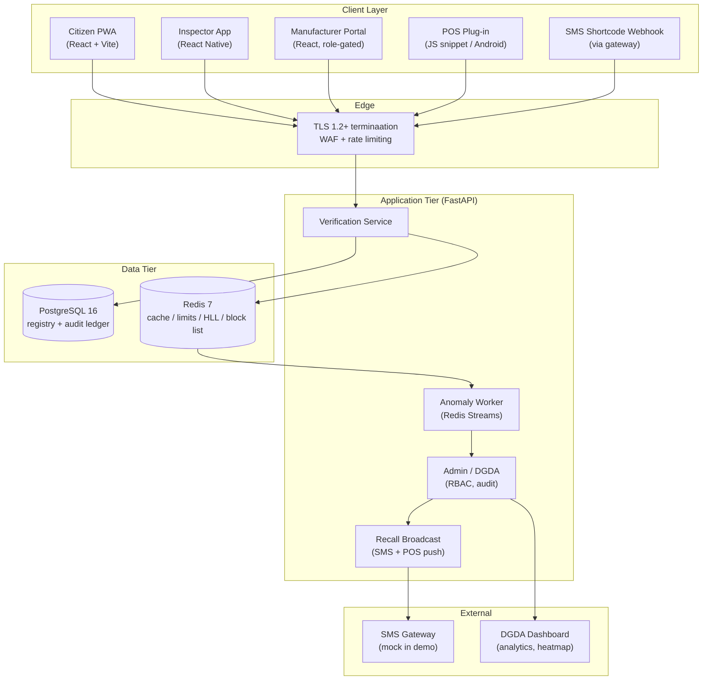

# 🛠️ Technical Architecture & Implementation Blueprint — Module 13

## DrugSatya — Pack-Level Drug Authenticity Verification (Drug Verify)

> Bangla name: **DrugSatya — ঔষধ যাচাই** ("Satya" / সত্য = truth). Verification in 2 seconds, on any phone.

---

## Table of Contents

- [Technology Stack](#technology-stack)
- [System Topology](#system-topology)
- [Database Architecture & Entity-Relationship Model](#database-architecture--entity-relationship-model)
- [Serial Cryptography: HMAC-Signed Serials (No Plain Sequential IDs)](#serial-cryptography-hmac-signed-serials-no-plain-sequential-ids)
- [FHIR Note: No Patient Data, No FHIR Needed](#fhir-note-no-patient-data-no-fhir-needed)
- [REST API Contracts](#rest-api-contracts)
- [Security, Privacy & Audit](#security-privacy--audit)
- [Rollout Roadmap: 48h Demo → Pilot → DGDA Phased Mandate](#rollout-roadmap-48h-demo--pilot--dgda-phased-mandate)
- [Risk Register & Mitigations](#risk-register--mitigations)
- [The 3-Minute Demo Script](#the-3-minute-demo-script)
- [High Availability & Operations](#high-availability--operations)

---

## Technology Stack

| Layer | Choice | Rationale |
|:---|:---|:---|
| **Citizen PWA** | React 19 + Vite + Tailwind, installable, offline shell | Matches platform stack (modules 01–09); < 1 MB bundle target [illustrative]; QR via jsQR/ZXing; Bangla font (Noto Sans Bengali) |
| **Inspector App** | React Native (Android-first) | DGDA field officers use mid-range Android; offline capture + sync |
| **Manufacturer Portal** | React + Tailwind (same codebase, role-gated) | Single frontend, 3 surfaces (citizen / inspector / manufacturer) |
| **Backend** | **FastAPI (Python 3.12)** + Uvicorn/Gunicorn | Async I/O for SMS webhooks + scan bursts; OpenAPI-native docs for DGDA integration |
| **Primary DB** | **PostgreSQL 16** (+ pgcrypto, pg_trgm) | Registry, serials (hashes), audit ledger; partitioning on `scan_event` by month |
| **Cache / Rate-limit / Streams** | **Redis 7** (Streams, HyperLogLog, TTL cache, signed block list) | Sub-ms verdict path; anomaly counters; POS block distribution |
| **SMS Gateway** | **Mock gateway in demo** (JSON webhook simulator); production: operator aggregator with Bangla Unicode support + multi-telco failover (GP / Robi / Banglalink / Teletalk) | Bangladesh's reality; offline floor for feature phones |
| **Offline fallback** | **SMS shortcode** (e.g. `DRUGSATYA` / numeric shortcode via BTRC [illustrative]) + **USSD** `*16263#` session [illustrative] + **IVR** via Shasthya Batayon **16263** (Bangla prompts) | Zero-data verification; mirrors NAFDAC 2010 / Sproxil scratch-SMS design |
| **QR generation** | `qrcode` lib; error-correction level M; payload `drugsatya://v1/{serial}/{check}` | Any phone camera decodes |
| **Serial crypto** | **HMAC-SHA256** (DGDA-held key, HSM/KMS); serials truncated base32; **no plain sequential IDs anywhere** | Unguessable; tamper-evident; print-manifest auditable |
| **Observability** | OpenTelemetry + Grafana/Loki; uptime SLO 99.5% [illustrative] | DGDA ops handover |
| **Hosting** | BD sovereign cloud / Jessore Software Tech Park secondary; BDIX peering | Latency + data sovereignty; mirrors 04-icu-beds DR posture |

---

## System Topology



---

## Database Architecture & Entity-Relationship Model

```mermaid
erDiagram
    MANUFACTURER ||--|{ PRODUCT : licenses
    PRODUCT ||--|{ BATCH : produces
    BATCH ||--|{ PACK_SERIAL : contains
    BATCH ||--o{ SCAN_EVENT : logs
    PACK_SERIAL ||--o{ SCAN_EVENT : scanned_as
    SCAN_EVENT ||--o| REPORT : escalates_to
    MANUFACTURER {
        uuid id PK
        string dgda_licence_no UK
        string name
        string division
        string contact_hash
        boolean licence_valid
        timestamp created_at
    }
    PRODUCT {
        uuid id PK
        uuid manufacturer_id FK
        string dgda_registration_no
        string brand_name
        string generic_name
        string dosage_form
        boolean is_price_capped
        decimal mrp_bdt
    }
    BATCH {
        uuid id PK
        uuid product_id FK
        string batch_no
        date mfg_date
        date exp_date
        int declared_qty
        string status
        timestamp registered_at
        timestamp distributed_at
    }
    PACK_SERIAL {
        uuid id PK
        uuid batch_id FK
        string serial_hash UK
        string check_code UK
        boolean voided
        timestamp created_at
    }
    SCAN_EVENT {
        bigint id PK
        uuid batch_id FK
        string serial_hash
        string channel
        string msisdn_hash
        string geo_hash
        string verdict
        timestamp scanned_at
    }
    REPORT {
        uuid id PK
        bigint scan_event_id FK
        string report_ref UK
        string geo_hash
        string channel
        string status
        timestamp created_at
    }
```



**Notes:**
- `PACK_SERIAL.serial_hash` = SHA-256(serial) — plain serials exist only in the manufacturer's print file, never server-side; `check_code` is the 8-char HMAC fragment printed under foil.
- `SCAN_EVENT.msisdn_hash` — SHA-256(salt ‖ MSISDN); raw MSISDN never persisted; salt rotated quarterly; PDPO 2025-aligned.
- `BATCH.status` ∈ `REGISTERED → DISTRIBUTED → RECALLED | VOID_SHORT_PRINT`.
- Partition `SCAN_EVENT` monthly; expected pilot volume ~50k events/month [illustrative]; nationwide ~10–30M/month at scale [illustrative].

---

## Serial Cryptography: HMAC-Signed Serials (No Plain Sequential IDs)

```text
serial      = base32( HMAC-SHA256(DGDA_key, mfr_id | product_id | batch_id | seq_128bit) )[0:16]
check_code  = base32( HMAC-SHA256(DGDA_key, serial) )[0:8]     // printed under scratch foil
qr_payload  = "drugsatya://v1/" + serial + "/" + check_code
```

- **128-bit random component** per serial — not `seq 1..10000`; unguessable by enumeration.
- **Verification**: recompute both; compare constant-time (`hmac.compare_digest`); check expiry + recall + void flag.
- **No sequential leakage**: print order reveals nothing; manifest reconciliation detects insider skimming.
- **Key custody**: DGDA HSM/KMS; annual rotation with key-version byte in serial header (old batches still verify).
- **Short-code physics**: 8 chars base32 = 40 bits — brute force infeasible at 5 tries / 10 min / MSISDN rate limit; plus any mismatch increments anomaly counter (F7).
- **Clone economics**: counterfeiter must copy *spent* codes; clone detection triggers at > 500 scans / 30d across > 50 geo-hashes [illustrative, tunable].

---

## FHIR Note: No Patient Data, No FHIR Needed

DrugSatya stores **zero clinical data** — no diagnosis, no prescription, no Health ID linkage — making it the **lowest-privacy-risk module** in the platform and deliberately FHIR-free for its core transactions.

- **No FHIR resources** are required for verification, recall, or reporting.
- **Optional interoperability**: for the ~160 price-capped drugs, the verdict payload may look up a `MedicationKnowledge` resource (the same pattern used by Module 03's DGDA registry and Module 06's price/stock display) to render the DGDA MRP — read-only, cached, no patient context.
- **AuditEvent-style ledger**: internal audit trail mimics FHIR `AuditEvent` semantics (actor, action, entity, timestamp) but is a private schema — not exposed as FHIR API.
- **Consent**: none required for anonymous verification; explicit opt-in only for recall follow-up SMS to chronic patients (Health ID-linked, Module 07 pattern) — **not in v1 scope**.
- **PDPO 2025**: health data = sensitive personal data; we hold none; scan logs are aggregates + salted hashes.

---

## REST API Contracts

| Method & Path | Purpose | Auth / Rate Limit | Response (abbreviated) |
|:---|:---|:---|:---|
| `POST /api/v1/verify` | SMS/web verdict for a code (`{check_code}`) | Public; 5 req/10 min/MSISDN-hash | `{verdict: GENUINE\|SUSPECT\|EXPIRED\|RECALLED, batch, exp, mrp?, ref}` |
| `GET /api/v1/scan/{serial}` | PWA QR verdict | Public; 30 req/min/IP | `{verdict, batch_no, exp_date, mfr_name, mrp_bdt?, recall_status}` |
| `POST /api/v1/pos/verify` | POS plug-in verify (mandatory classes) | POS device cert; 120 req/min | `{verdict, block: bool, reason?, offline_cache_valid_until}` |
| `POST /api/v1/sms/webhook` | Inbound SMS from gateway | Gateway signature (HMAC) | `{reply_sent: true}` + Bangla reply queued |
| `POST /api/v1/batches` | Manufacturer registers batch | Manufacturer + DGDA licence scope | `{batch_id, serial_count, manifest_sha256, print_file_url}` |
| `POST /api/v1/batches/{id}/print-confirm` | Close batch after press run | Manufacturer | `{status: DISTRIBUTED, voided_serials}` |
| `GET /api/v1/batches/{batch_no}` | Inspector batch dossier | DGDA SSO (inspector+) | `{licence, product, dates, scan_count, anomaly_level, prior_seizures}` |
| `POST /api/v1/inspect/batch-scan` | Bulk verify during raid | DGDA SSO | `{genuine: 44, suspect: 6, clone_alert: true}` |
| `POST /api/v1/recalls` | Issue batch recall | DGDA desk role only | `{recall_id, sms_queued, pos_push_targets}` |
| `POST /api/v1/reports` | Citizen/POS counterfeit report | Public; 3 req/day/MSISDN-hash [illustr.] | `{report_ref, status: RECEIVED}` |
| `GET /api/v1/analytics/summary` | DGDA dashboard aggregates | DGDA HQ / zonal | `{verifications_today, suspect_rate, heatmap[], clone_alerts[]}` |
| `GET /api/v1/price-cap/{dgda_reg_no}` | MRP for capped drug | Public | `{mrp_bdt, cap_version, effective_from}` |
| `GET /api/v1/health` | Liveness/readiness | Internal | `{status, db, redis, sms_gateway}` |

**Conventions**: JSON only; `snake_case`; ISO-8601 UTC; errors as `{error: {code, message_bn, message_en}}`; idempotency keys on all POSTs; OpenAPI 3.1 at `/docs` (DGDA can integrate without reverse-engineering).

---

## Security, Privacy & Audit

1. **HMAC-signed serials** — no sequential IDs; proofs are offline-verifiable by DGDA auditors with the public check-code rule; forged serials fail at HMAC step.
2. **Rate limiting per MSISDN** (hashed): `verify` 5/10 min; `reports` 3/day [illustrative]; SMS gateway throttles upstream; POS device certs revocable.
3. **No PII with scans**: `msisdn_hash = SHA-256(salt ‖ msisdn)`; salt quarterly rotation; geo stored only as geohash-6 (~1.2 km cell) with k-anonymity ≥ 25 [illustrative]; IPs not logged beyond WAF transient.
4. **TLS 1.2+**; HSTS; cert pinning on inspector app; signed POS block lists (ed25519 signature verified offline).
5. **RBAC**: citizen (none) / pharmacist POS device / inspector / zonal / DGDA desk / manufacturer admin / auditor (read-only). Segregation of duties: manufacturer cannot mark RECALLED; DGDA cannot generate serials.
6. **Immutable audit ledger** (`recall_audit`, append-only, hash-chained): every state change (register → distribute → recall → clear) carries actor, role, timestamp, prev-hash — tamper-evident, exportable as court evidence.
7. **Key management**: DGDA HSM; serial key annual rotation; SMS gateway API key in vault; no secrets in repo/CI logs.
8. **Abuse handling**: brute-force watch (F7), report spam filter, POS override alerts, recall DDoS guard (recall endpoint desk-only + step-up auth).
9. **PDPO 2025**: data minimisation by design; DPIA filed before pilot [proposed]; breach notification ≤ 72h to DGDA + affected (only hashed contacts exist → notification via public bulletin).
10. **Retention**: raw scan events 90 days [illustrative]; aggregates indefinite; report photos (if any) 24 months or case closure + 5 years for prosecution files.

---

## Rollout Roadmap: 48h Demo → Pilot → DGDA Phased Mandate

### Phase 0 — 48-Hour Hackathon Demo (buildable)

- **Synthetic registry**: 3 synthetic manufacturers (Demo Pharma A/B/C), **3 demo products × 2 batches × 10,000 HMAC-signed serials** = 60,000 serials generated; PostgreSQL seed + Redis warm.
- **Working slice**: PWA scan (camera on any phone) + foil-scratch reveal UI + mock SMS gateway (webhook simulator prints Bangla reply to console/screen) + POS web plug-in + DGDA mock dashboard (verification volume, fake-report heatmap over Dhaka divisions, clone-alert feed with a demo serial scanned "501 times").
- **Demo data**: 2 genuine batches + 1 planted "cloned" batch + 1 expired batch — every verdict path exercised in the 3-minute script.
- **Team split** (3): (1) serial factory + registry + API; (2) PWA + POS plug-in; (3) dashboard + SMS mock + demo script/rehearsal.

### Phase 1 — Pilot (Month 0–3)

- **1 real manufacturer** (opt-in, export-oriented — natural India-mandate alignment) + **20 pharmacies** (10 Dhaka metro, 10 district towns) + DGDA observer seat.
- KPIs baseline: verifications/day, % pre-sale verified, suspect reports, clone alerts fired, POS ACK rate; weekly review with DGDA; **false-positive rate target ≤ 0.5%** [illustrative].
- Awareness: counter tent cards + pharmacist 60-second training; 16263 script updated; press pre-brief (honest framing — detection, not eradication).

### Phase 2 — DGDA Phased Mandate (Month 4–24, mirrors India 2026/2028)

| Step | Scope | India Anchor |
|:---:|:---|:---|
| **2a** | **Top-50 DGDA essential drugs** QR-mandated on **new print runs** (not recall of existing stock) | India Jul 2026 (vaccines/cancer/narcotics) |
| **2b** | **Antibiotics / antimicrobials** mandatory | India 2028 |
| **2c** | Full ~160 **price-capped** essentials + price-check display enforced | — |
| **2d** | All registered essential drugs; export co-recognition with CDSCO [proposed] | India complete |

- Fee model: per-batch manufacturer fee funds SMS + ops (India model); donor bridge year 1; DGDA mandate via gazette notification; 2017 HC Rx-print order as legal precedent.
- Gate to each step: third-party audit of pilot KPIs + pharmacy compliance ≥ 70% [illustrative] + DGDA sign-off.

---

## Risk Register & Mitigations

| # | Risk | Likelihood / Impact | Mitigation |
|:---:|:---|:---:|:---|
| R1 | **Cloning — photocopied QR / re-used codes** | High / High | HMAC-signed serials (unguessable); clone detection (> 500 scans/30d & geo-dispersion [illustr.]) → DGDA alert; foil tamper evidence; void-on-print-shortfall; inspector field verification |
| R2 | **Low scan rates — citizens don't bother** | High / Medium | Awareness toolkit (F11); counter tent cards; 16263 IVR; POS makes verification *default-free* (pharmacist scans anyway); mandate on new print runs creates ubiquity; Nigeria/Ghana lesson: awareness preceded scale |
| R3 | **Manufacturer non-compliance / cost pushback** | Medium / High | Phased mandate (top-50 first); per-batch fee transparent & capped; India 2026/2028 gives exporters no choice anyway; DGDA licence renewal conditioned on registration; early-adopter branding |
| R4 | **False positives — genuine pack says SUSPECT (sync lag / print defect)** | Medium / Medium | Read-your-writes 24h; replica lag ≤ 5 min [illustr.]; grace period: "recheck in 10 min" + helpline **16263**; manufacturer sync SLA + penalty; defective-foil rate target < 0.5% [illustr.]; rapid DGDA clear workflow with audit note |
| R5 | **SMS gateway cost / shortcode non-allocation** | Medium / Medium | Donor-funded year 1; fee-per-batch covers run-rate; USSD/IVR fallback; multi-telco failover; demo uses mock gateway |
| R6 | **Enforcement capacity overwhelmed by alerts** | Medium / Medium | Prioritised queue (clone + high-volume clusters first); 880+ closures/2024 show capacity exists; data *targets* it; zonal RBAC; weekly triage |
| R7 | **Privacy backlash (scan = surveillance fear)** | Low / High | No PII; anonymous by design; publish DPIA; k-anonymity; salt rotation; comms: "we never know who you are or what you bought" |
| R8 | **Counterfeiters print fake foils with spent codes** | High / Low-Med | Spent codes verify as SUSPECT (feature, not bug); POS blocks; consumer education "foil scratched ≠ proof — verify the code" |
| R9 | **Recall broadcast failure (SMS undelivered / POS offline)** | Low / High | POS signed block list (72h TTL, mandatory override logging); SMS delivery receipts; below 80% reach [illustr.] → IVR + inspector sweep; drill quarterly |
| R10 | **Over-claiming impact (political pressure)** | Medium / Medium | Public KPI definitions; no prevalence claims without commissioned study; Nigeria/Ghana cautionary tale documented in README; DGDA comms pre-briefed |
| R11 | **Key compromise (DGDA HSM breach)** | Low / Critical | HSM + dual-control rotation; serial re-issue protocol; per-batch key versioning; breach drill; audits |
| R12 | **Gray-market imports bypass registry** | Medium / Medium | Customs pairing (proposed); imported packs carry parallel-import label + DGDA verification sticker; spot-check at ports |

---

## The 3-Minute Demo Script

**Setting**: Pharmacy counter in Dhaka; projector shows PWA + DGDA dashboard; a genuine strip (Batch N-123) and a fake strip (cloned QR) are on the table.

| Time | Action on Screen | Script (spoken) |
|:---:|:---|:---|
| **0:00** | Title: "Tk 600 crore of fake medicine. Tk 18,000 crore market." | "Every year, roughly **Tk 600 crore** of counterfeit medicine moves through Bangladesh's **Tk 18,000 crore** pharma market — chalk and dye under trusted brand names. Today, a pharmacist has no way to check. A patient has no way to check. We fix that in 2 seconds." |
| **0:20** | Camera scans genuine strip → green screen | "At the counter, the pharmacist scans. **আসল ✓ — Genuine. Batch N-123, Exp 2027-08, Demo Pharma.** The QR costs nothing extra — printed with the pack." |
| **0:45** | Feature phone: SMS the scratched code → Bangla reply on screen | "No smartphone? Same answer by SMS, in Bangla: **কোড SANKHAL-7845: আসল ✓ ব্যাচ N-123**. Works on a Tk 1,500 handset, no internet, no app — the same scratch-SMS that Nigeria ran since 2010." |
| **1:10** | Scan fake strip → red SUSPECT screen; one-tap "Report to DGDA" | "Now the fake. Same QR photocopied onto chalk-and-dye strips. **SUSPECT — do not consume. Report sent to DGDA** — with GPS, no name, no phone number stored. The report is already in the queue." |
| **1:35** | POS demo: antibiotic blocked at sale; receipt shows block ref | "For antibiotics, insulin, vaccines and cancer drugs — the exact classes India mandated for July 2026 and 2028 — the POS **blocks the sale**. Only 7.56% of Dhaka pharmacies have a registered pharmacist; the machine is the pharmacist." |
| **2:00** | DGDA dashboard: verification counter climbing; heatmap spikes in 3 districts; clone alert: "Batch N-123 scanned 501× — CLONE_ALERT" | "On the DGDA screen: every scan is an anonymous probe. This batch spiked across 3 districts — **cloned code alert** — and the inspector gets a case file, not a rumour. Recall goes out by SMS and POS block in under an hour." |
| **2:30** | Honest caveat slide: "No independent proof prevalence fell in Nigeria — tech + enforcement + awareness, or it fails." | "One honest caveat: Nigeria spent a decade proving this works technically — and never proved prevalence fell, because they under-funded enforcement and awareness. We don't repeat that. The tech is half; the mandate and the campaign are the other half." |
| **2:45** | The ask | "Our ask: **DGDA mandates QR on the top-50 essential drugs**, phased like India — 2026 for critical classes, 2028 for antimicrobials — and lets us pilot with 1 manufacturer and 20 pharmacies this quarter. Tk 600 crore of fakes stops at the counter — not at the ICU." |
| **3:00** | End card: "DrugSatya — সত্য. Every strip tells the truth." | "DrugSatya — সত্য. Every strip tells the truth." |

**Demo fallback plan**: if camera/Wi-Fi fails → pre-recorded capture + live SMS simulator; if dashboard down → static screenshots; judges' phones can SMS the demo shortcode live.

---

## High Availability & Operations

- **SLO**: 99.5% verify-path availability [illustrative]; SMS path degrades gracefully (PWA shows cached block list; POS offline mode).
- **Backups**: nightly PG basebackup + WAL archive; restore drill quarterly; serial registry is reconstructable from manufacturer manifests (defense in depth).
- **DR**: Jessore secondary site; RPO ≤ 5 min, RTO ≤ 30 min [illustrative]; BDIX anycast failover.
- **Capacity**: verification reads are cache-heavy (Redis 95%+ hit target [illustrative]); PG write path only on scan log insert — batched 100/txn.
- **Compliance**: PDPO 2025 DPIA before pilot; DGDA data-sharing MoU; annual third-party security audit; open-source the verification client (not the DGDA key) for public trust.
- **Handover**: DGDA ops runbook; 2 DGDA engineers embedded during pilot; full source + docs escrowed.
