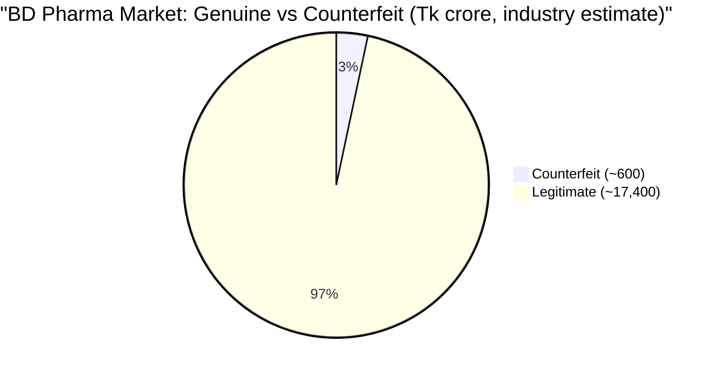
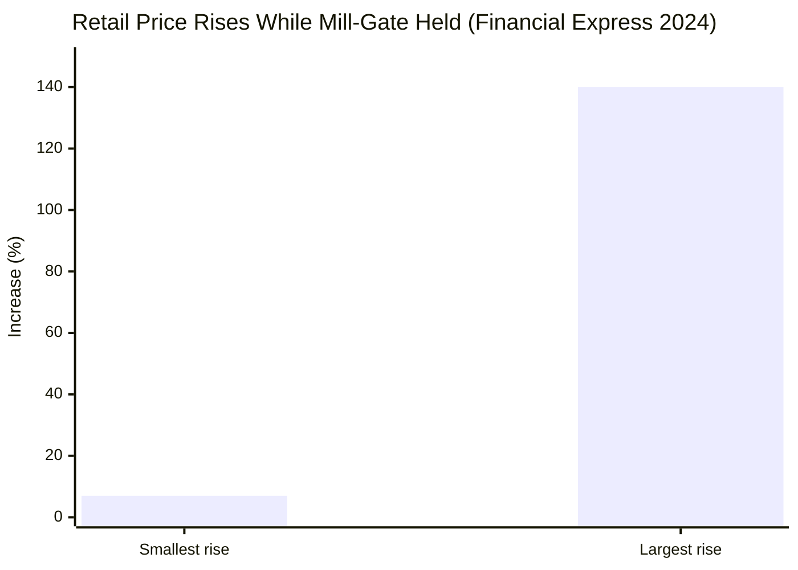
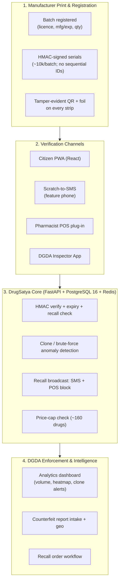
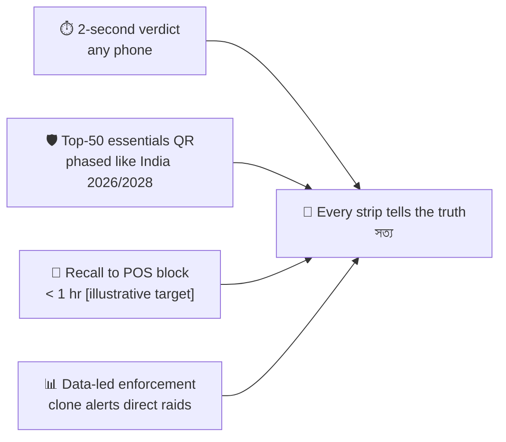

# 💊 DrugSatya — Pack-Level Drug Authenticity Verification

## Module 13 — Drug Verify: Tamper-Evident QR + Scratch-Code Authentication

> **Tagline**: Every medicine strip carries a tamper-evident QR + scratch code; scan or SMS to know in 2 seconds if it is genuine — protecting the Tk 18,000 crore market and the patients in it.

**Bangla**: **DrugSatya — ঔষধ যাচাই** ("Satya" / সত্য = truth). যে ঔষধ সত্য কিনা, ২ সেকেন্ডে যাচাই করুন।
**English subtitle**: Drug Verify · **Owner**: DGDA (proposed) · **Hackathon fit**: the health minister cited "QR codes and digital tracking in medicine supply chains" at the launch ([BSS](https://www.bssnews.net/news/436268)).

---

## Table of Contents

- [Problem Statement](#problem-statement)
- [International Precedent & Lessons](#international-precedent--lessons)
- [System Architecture & Vision](#system-architecture--vision)
- [Capability Deep-Dives](#capability-deep-dives) (1–5)
- [Comparative Benchmark](#comparative-benchmark)
- [Stakeholder Matrix](#stakeholder-matrix)
- [Success Metrics & National Targets](#success-metrics--national-targets)
- [Cross-Module References](#cross-module-references)
- [Sources & Data Notes](#sources--data-notes)

---

## Problem Statement

Bangladesh runs a genuine pharmaceutical success story — a Tk 18,000 crore market exporting globally — undermined by a parallel counterfeit economy. Patients, pharmacists and regulators have **no practical, offline-capable, 2-second way to tell a genuine strip from a chalk-and-dye fake** before it is consumed. Every failure mode lands on the same 3-second moment: the pharmacy counter.

> [!CAUTION]
> **The scale of the fake market**: an estimated **~Tk 600 crore of counterfeit medicine** circulates in the **Tk 18,000 crore** market (industry estimate; year not shown). Fake factories in Mitford / Keraniganj / Tongi make chalk-and-dye paracetamol, cephalosporins and steroids ([The Daily Star](https://www.thedailystar.net/frontpage/know-your-medicine-1243567)).

### The Crisis in Numbers

| Indicator / Metric | Ground Statistic | Source & Context |
|:---|:---:|:---|
| **Counterfeit market size** | **~Tk 600 crore** (of Tk 18,000 crore) | Industry estimate, year not shown — *Daily Star* |
| **DGDA price-fixed essential drugs** | **~160 only** | *Financial Express* 2024 ([link](https://www.thefinancialexpress.com.bd/trade/yawning-gap-between-mill-gate-and-retail-medicine-prices)) |
| **Retail price inflation (mill-gate stable)** | **7–140%** in months | Same source |
| **Antibiotics sold without Rx** | **~45%** (246 Dhaka pharmacies) | PMC 2025 ([PMC12744235](https://www.ncbi.nlm.nih.gov/pmc/articles/PMC12744235/)) |
| **Pharmacies with registered pharmacist** | **7.56%** | Same PMC 2025 study |
| **Antibiotics bought without Rx** | **50.9%** (327/642) | icddr,b 2022 ([DOAJ](https://doaj.org/article/b2563a5093494395a07298723c0c4801)) |
| **Spent abroad on treatment** | **~US$5bn/yr; ~482,000 → India 2024** | UNB Dec 2025 (DCCI) — fear of fake drugs cited |
| **Unauthorised facilities closed (2024)** | **880+** | *Daily Star* 2024 ([link](https://www.thedailystar.net/views/editorial/news/dghs-raids-illegal-clinics-expose-the-rot-health-sector-3035386)) |
| **Facilities without valid licences** | **~1,027** | DGHS 2024 ([link](https://online91.thedailystar.net/opinion/editorial/news/rein-errant-clinics-diagnostic-centres-4135366)) |
| **Licensed pharmacies (estimates vary)** | **107,000–174,000** | Quote the range, never a point |
| **Rural smartphone use vs household ownership** | **26% vs 73.4%** | GSMA 2024 ([TBS](https://www.tbsnews.net/node/1013061)); BBS Jan–Mar 2026 ([Dhaka Tribune](https://www.dhakatribune.com/bangladesh/415972/bbs-survey-over-57%25-of-bangladeshi-households-now)) — phones shared |
| **India QR mandate** | **Jul 2026** (vaccines/cancer/narcotics); **2028** antimicrobials | *Daily Pioneer* ([link](https://www.dailypioneer.com/news/qr-codes-made-mandatory-on-vaccines-antimicrobials-cancer-and-narcotic-drugs-to-curb-counterfeits)) |





**Fakes × no-Rx sales compound each other.** ~45% of antibiotics move without prescription; only 7.56% of pharmacies have a registered pharmacist; DGDA caps ~160 drugs while retail rose 7–140%. A fake antibiotic is a double failure — inert product **and** unmonitored antimicrobial exposure (link: Module 11, AMR Lens — planned).

**Why now**: (1) minister's launch-speech ask (QR tracking); (2) India's mandate pressures BD exporters — one print run can serve both markets; (3) 2017 High Court order mandated printed/legible prescriptions — legal precedent for print/QR mandates ([Daily Star](https://www.thedailystar.net/node/1342969)); (4) **no DGDA QR mandate found to date** — early pilots (Panacea Live + Renata SMS 2777, 2016; CDrug, 2017) faded; status [uncertain] ([Dhaka Tribune 2016](https://www.dhakatribune.com/feature/health-wellness/973/a-panacea-for-counterfeit-medicines)); (5) ~US$5bn/yr leakage abroad — authenticity is a trust intervention, not just anti-crime; (6) 880+ illegal closures (2024) prove enforcement will exists — verification aims it.

---

## International Precedent & Lessons

Nigeria/Ghana ran the closest analogue: **Sproxil / mPedigree** scratch-and-SMS authentication. NAFDAC introduced it in **2010**, made it **mandatory for imported anti-malarials in 2014**; vendors report **10M users in 4 years** — company-reported ([PCWorld](https://www.pcworld.com/article/435515/mobile-technology-offers-option-to-combat-fake-drugs-in-west-africa.html); [SciTePress 2015](https://www.scitepress.org/PublishedPapers/2015/52152/52152.pdf)). **India** mandates QR on vaccines/cancer/narcotics from **Jul 2026**, antimicrobials from **2028** (regulation, not yet impact).

| Precedent | Outcome | Copy | Avoid |
|:---|:---|:---|:---|
| **Nigeria/Ghana scratch-SMS** (NAFDAC 2010; mandatory 2014) | 10M users / 4 yrs (company-reported); **no independent proof counterfeit prevalence fell** | Offline-first SMS; regulator-owned mandate, vendor rails; consumer awareness alongside launch | Over-claimed outcomes; enforcement unfunded |
| **India QR mandate** (2026 → 2028) | Phased by risk class | Phase by risk: top-50 essentials → antibiotics → full essentials; fee per batch registration funds DGDA | Big-bang mandate without print capacity + inspection |
| **Jan Aushadhi Sugam** (India price finder) | **Rs 20,000+ crore** saved / 9 yrs (parliamentary reply, [Lok Sabha](https://eparlib.nic.in/bitstream/123456789/2500814/1/AU3806.pdf)) | Show DGDA-capped MRP at scan moment | Price display without DGDA enforcement of the cap |
| **Bangladesh HC order 2017** | Legible/printed Rx required | Legal basis for print/QR mandate | Mandate ≠ compliance — needs inspection + penalties |
| **BD pilots (2777, 2016; CDrug, 2017)** | Early-stage; no DGDA mandate found; status [uncertain] | Keep SMS channel; institutionalise under DGDA | Letting pilots expire silently |
| **BD enforcement 2024** | 880+ closures; ~1,027 unlicensed (DGHS) | Verification heatmaps target raids | Blind, political raids |

**The honest lesson**: technology + enforcement + awareness, or it fails. DrugSatya is designed for measurable KPIs and a commissioned prevalence study — **never** over-claimed impact.

---

## System Architecture & Vision

A **manufacturer → patient trust chain**: DGDA-licensed manufacturers register batches; each pack carries a tamper-evident QR (smartphone path) + scratch panel hiding an HMAC-signed serial (feature-phone path); every scan feeds a DGDA enforcement dashboard. **No patient data, no prescriptions, no health records.**



**Invariants**: (1) no patient data — scans store hashed MSISDN only; (2) offline-first — SMS floor, PWA ceiling; (3) HMAC-SHA256 serials — guessing is infeasible; (4) regulator-owned, vendor-operated; India-aligned mandate.

---

## Capability Deep-Dives

### 1. The Two-Factor Pack (QR + Scratch Panel)

| Factor | Form | Serves | Tamper evidence |
|:---|:---|:---|:---|
| QR | Printed on strip/carton | Smartphones, POS, inspectors | None — QR is the lookup **key**, not the secret |
| Scratch foil | e.g. `SANKHAL-7845` | Feature phones (SMS), visual check | **Yes** — foil cannot be resealed; re-stuck/missing panel ⇒ SUSPECT at POS |

Serial = `base32(HMAC-SHA256(key, mfr|prod|batch|128-bit random))[0:16]`; check-code = 8 base32 chars under foil. QR carries the serial; the foil hides the proof-of-unopened-package. A code scanned **500×** is a cloned batch, not a popular medicine (Deep-Dive 4). Two factors ⇒ a photocopied QR alone can never verify.

### 2. Offline Scratch-to-SMS (Feature Phones)

Only **26%** of rural individuals use smartphones (GSMA 2024) vs **73.4%** household ownership — phones are shared. Flow: scratch foil → SMS code to shortcode → instant Bangla/English verdict:

```text
[DrugSatya যাচাই]
কোড SANKHAL-7845: আসল ✓
ব্যাচ N-123 • মেয়াদ 2027-08
প্রস্তুতকারক: ডেমো ফার্মা
সন্দেহজনক হলে: 16263-এ কল করুন
```
SUSPECT: `সতর্কতা: এই কোডটি সন্দেহজনক। সেবন বন্ধ করুন ও DGDA-কে জানান। হটলাইন: 16263`

USSD `*16263#` [illustrative, BTRC allocation] and IVR for low literacy (*"আপনার কোডটি বলুন"* — say your code). ~Tk 0.10–0.25/SMS [illustrative], on the manufacturer fee. Verdict identical to PWA — one engine, two doors.

### 3. Pharmacist POS Verification (Mandatory Classes)

Antibiotics, insulin, vaccines, oncology — India's 2026/2028 classes — are **mandatory-verify** at the POS plug-in (JS snippet or Android terminal): scan → 200 ms verdict → sale proceeds or is **blocked** (`বিক্রি করবেন না`). Offline signed block list (72h TTL) keeps the check working through data outages; manager override logged. No-Rx sale of a prescription-only class → amber stewardship flag (Modules 03/11 interplay), never a hard block. Only **7.56%** of Dhaka pharmacies have a registered pharmacist — the machine is the pharmacist.

### 4. DGDA Enforcement Intelligence — Clone Detection & Recall

Every scan is an **anonymous sensor**. Rules [illustrative, tunable]: serialize > **500 scans / 30d** AND > **50 geo-hashes** ⇒ `CLONE_ALERT` (volume alone is not enough — wards re-scan genuine packs). Inspector app: batch dossier (licence, registrations, anomaly history) + GPS-tagged `SEIZE`. One-click recall → SMS blast + POS block list push (target **< 1 hr** [illustrative]) + residual-scan curve until ≈ 0. Turns 880+-closures-style raids from theatre into evidence-led action.

### 5. Price-Cap Check for the ~160 DGDA-Fixed Drugs

Genuine verdict on a capped drug ⇒ screen shows **DGDA MRP**; above-cap printed price ⇒ amber flag + log; one-tap `দাম বেশি` (price too high) citizen report aggregates to DGDA — no PII. India's Jan Aushadhi Sugam proves price transparency saves (Rs 20,000+ crore / 9 yrs). Scope honestly limited to the **~160 capped drugs**; it does not police the rest of the market.

---

## Comparative Benchmark

| Dimension | Bangladesh today | Nigeria/Ghana (Sproxil) | India (QR mandate) | Module 13 |
|:---|:---|:---|:---|:---|
| **Legal mandate** | None found — [uncertain]; HC 2017 Rx-print precedent | NAFDAC 2010; mandatory 2014 (imported anti-malarials) | Jul 2026 vaccines/cancer/narcotics; 2028 antimicrobials | Proposed DGDA phased: top-50 → antibiotics → essentials |
| **Offline verification** | None | Scratch-SMS — proven at 10M users (company-reported) | QR, smartphone-first | Scratch-SMS **+ USSD/IVR**; Bangla |
| **Independent outcome proof** | No prevalence study exists | **None** — usability proven, impact unproven | Regulation, not impact | KPIs + commissioned prevalence study; no over-claiming |
| **Enforcement pairing** | 880+ closures (2024), undirected | Weak — the core failure | TBD | Inspector app + heatmap + 1-hr recall broadcast |
| **Price transparency** | ~160 capped; app pilot only | Out of scope | Jan Aushadhi Sugam — Rs 20,000+ crore saved | MRP on every capped-drug verdict |
| **Privacy** | n/a | No PII | No patient data | **No patient data**; hashed scans only |
| **Cost model** | Donor pilots expired | Vendor + import levy | Manufacturer compliance | Per-batch DGDA fee (India model) + donor year 1 |

---

## Stakeholder Matrix

| Stakeholder | Frustrations | Solution | Benefit |
|:---|:---|:---|:---|
| **Patients / customers** | Can't spot fakes; fear inert antibiotics; gouging on capped drugs | 2-sec verdict + MRP shown | Safe purchase; price visibility |
| **Pharmacists** | Liable for fakes unknowingly stocked; no tool | POS plug-in blocks SUSPECT; legal protection | Zero-fake shelf; faster honest sale |
| **DGDA inspectors** | Blind raids; weak cases | Dossier + GPS `SEIZE`; clone-alert map | Evidence-led raids; faster recalls |
| **Manufacturer QA** | Brand sabotage; India mandate risk | Batch portal; HMAC serials; clone early-warning | Brand + export protection |
| **DGDA policy/enforcement** | No prevalence baseline; undirected | Analytics dashboard; mandate KPIs | Measurable enforcement |
| **16263 hotline** | "Medicine seemed fake" — no action path | Suspect verdicts → structured DGDA ticket | Closed-loop resolution |
| **Donors / WHO / MoHFW** | ~US$5bn/yr leaks abroad on fake-fear | Low-cost, high-visibility trust fix | Measurable KPIs; zero patient-data risk |
| **Exporters** | India 2026/2028 compliance | One print run, BD+CDSCO compliant | Market access preserved |

---

## Success Metrics & National Targets



**KPIs**: verifications/day (by channel/division) · % packs verified pre-sale in 20 pilot pharmacies [illustrative target ≥ 60% of antibiotic/insulin/vaccine sales] · # suspect reports · repeat-scan anomaly alerts (count, time-to-flag) · recall broadcast reach · enforcement actions informed.

**Targets**: (1) **Pilot (M0–3)**: 1 manufacturer + 20 pharmacies, 10k serials, false-positive ≤ 0.5% [illustrative]; (2) **Expansion (M4–12)**: top-50 essentials on new print runs, antibiotics first; ≥ 5,000 POS onboarded [illustrative]; (3) **Year 2**: antimicrobials (India 2028 alignment); third-party prevalence study gates national scale-up; quarterly recall drills; (4) **Year 3**: full essentials; fee model self-sustaining.

**Honest limits**: no prevalence claim without the commissioned study; no policing of unprinted grey imports without customs pairing; capped-drug price **flagging** only — pricing power stays with DGDA.

---

## Cross-Module References

- **[03-prescription](../03-prescription/README.md)** — DGDA drug registry; DrugSatya batch registry interoperates; digital Rx + verified dispense closes the fake-antibiotic loop.
- **[06-medicine-stock](../06-medicine-stock/README.md)** — SUSPECT verdict → generic-substitute suggestion instead of dead end; shared MRP master.
- **[05-integrated-system](../05-integrated-system/README.md)** — FHIR R4 spine; DrugSatya adds no clinical resources — private ledger only.
- **Module 11 (AMR Lens — planned)** — antibiotic-sale data layer; POS soft no-Rx flags + verified-antibiotic sales join authenticity to stewardship.
- **[07-health-card](../07-health-card/README.md)** — Health ID is **not** required to verify (anonymity maximises uptake); optional consented link only for recall follow-up — not v1.
- **[04-icu-beds](../04-icu-beds/README.md)** — architectural sibling: offline tolerance, SMS fallback, command-dashboard pattern.

---

## Sources & Data Notes

1. Tk 600 crore / Tk 18,000 crore counterfeit — *Daily Star*: https://www.thedailystar.net/frontpage/know-your-medicine-1243567 (industry estimate; year not shown; **no recent independent BD prevalence study exists** — research gap)
2. ~160 capped drugs; retail +7–140% — *Financial Express* 2024: https://www.thefinancialexpress.com.bd/trade/yawning-gap-between-mill-gate-and-retail-medicine-prices
3. ~45% antibiotics without Rx; 7.56% pharmacies with registered pharmacist — PMC 2025: https://www.ncbi.nlm.nih.gov/pmc/articles/PMC12744235/
4. 50.9% (327/642) antibiotics without Rx — icddr,b 2022: https://doaj.org/article/b2563a5093494395a07298723c0c4801
5. Minister's QR citation — BSS: https://www.bssnews.net/news/436268
6. India QR mandate (Jul 2026; 2028 antimicrobials) — *Daily Pioneer*: https://www.dailypioneer.com/news/qr-codes-made-mandatory-on-vaccines-antimicrobials-cancer-and-narcotic-drugs-to-curb-counterfeits
7. Sproxil/mPedigree; NAFDAC 2010/2014; 10M users/4 yrs (company-reported; no independent outcome proof) — PCWorld: https://www.pcworld.com/article/435515/mobile-technology-offers-option-to-combat-fake-drugs-in-west-africa.html ; SciTePress 2015: https://www.scitepress.org/PublishedPapers/2015/52152/52152.pdf
8. BD pilots 2777 (2016), CDrug (2017); no DGDA mandate found; [uncertain] — Dhaka Tribune 2016: https://www.dhakatribune.com/feature/health-wellness/973/a-panacea-for-counterfeit-medicines
9. HC order 2017 (printed Rx) — *Daily Star*: https://www.thedailystar.net/node/1342969
10. 880+ facilities closed; ~1,027 unlicensed (DGHS 2024) — *Daily Star*: https://www.thedailystar.net/views/editorial/news/dghs-raids-illegal-clinics-expose-the-rot-health-sector-3035386 ; https://online91.thedailystar.net/opinion/editorial/news/rein-errant-clinics-diagnostic-centres-4135366
11. ~US$5bn/yr abroad; ~482,000 → India 2024 — UNB Dec 2025: https://unb.com.bd/category/Bangladesh/usd-5-billion-spent-abroad-annually-due-to-healthcare-gaps-in-bangladesh-dcci/175121
12. 26% rural smartphone use (GSMA 2024) — via TBS: https://www.tbsnews.net/node/1013061 ; 73.4% household ownership, 57.4% internet (BBS Jan–Mar 2026) — via Dhaka Tribune: https://www.dhakatribune.com/bangladesh/415972/bbs-survey-over-57%25-of-bangladeshi-households-now
13. Jan Aushadhi Sugam — Rs 20,000+ crore / 9 yrs — Lok Sabha: https://eparlib.nic.in/bitstream/123456789/2500814/1/AU3806.pdf
14. Shasthya Batayon **16263** — national health hotline (3,000–6,500 calls/day by source); used as suspect-verdict helpline
15. Personal Data Protection Ordinance 2025 (gazetted 6 Nov 2025; health data sensitive) — via TBS: https://www.tbsnews.net/node/1281356 — DrugSatya holds no health data

**Honesty flags**: Tk 600 crore is an industry estimate (year not shown); Sproxil counts are company-reported — **no independent study shows prevalence fell**; India's mandate is regulation, not outcome; BD pilot status [uncertain]; **[illustrative]** marks design proposals (SMS cost, thresholds, targets, timelines beyond the India anchor); pharmacy counts quoted as range.
