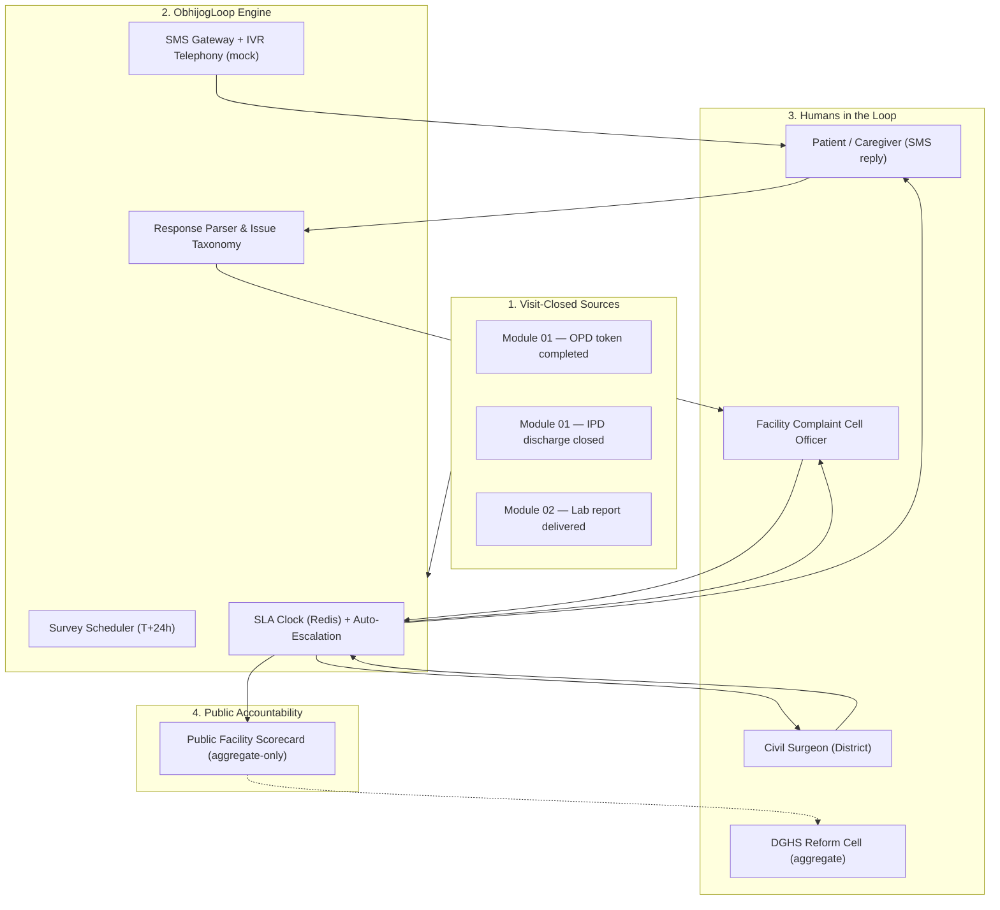
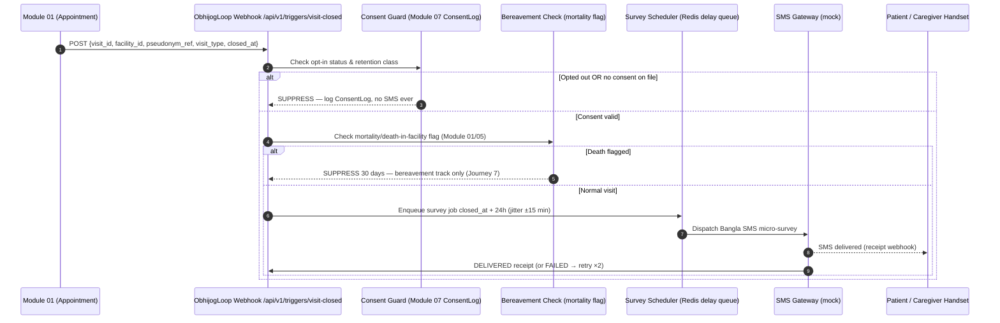
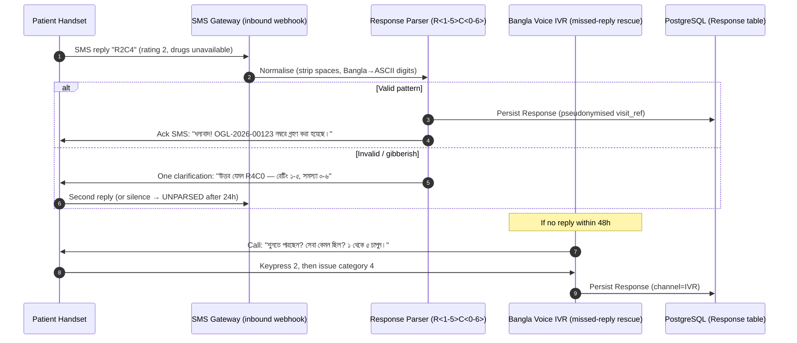
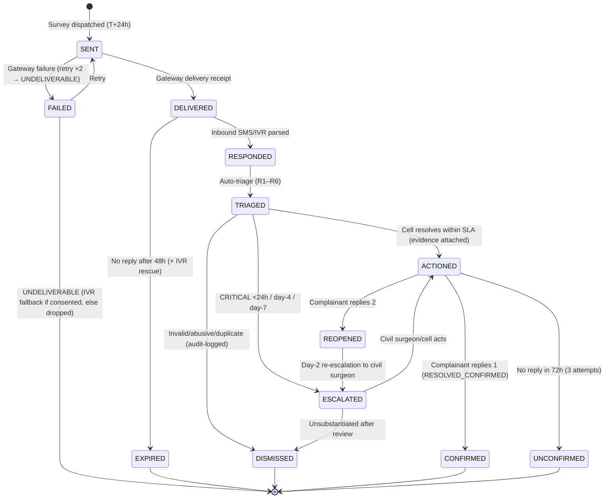

# 🔄 Application Flow — Post-Visit Patient Feedback & Grievance Resolution

## Module 14 — ObhijogLoop: Trigger, Micro-Survey, Triage, 24h Escalation & Closure Loops

---

## Table of Contents

- [System Architecture & Interaction Overview](#system-architecture--interaction-overview)
- [Personas](#personas)
- [Journey 1: Visit Closed → SMS Trigger Fires (T+24h)](#journey-1-visit-closed--sms-trigger-fires-t24h)
- [Journey 2: Patient Replies — SMS 2-Tap or IVR Voice](#journey-2-patient-replies--sms-2-tap-or-ivr-voice)
- [Journey 3: Facility Complaint Cell Triage & 7-Day Resolution](#journey-3-facility-complaint-cell-triage--7-day-resolution)
- [Journey 4: CRITICAL Flag → Civil Surgeon Within 24h](#journey-4-critical-flag--civil-surgeon-within-24h)
- [Journey 5: Resolution Confirmation → Complainant Closure SMS](#journey-5-resolution-confirmation--complainant-closure-sms)
- [Journey 6: Monthly Scorecard & Public League Table](#journey-6-monthly-scorecard--public-league-table)
- [Journey 7: Death in Facility — Bereavement Protocol (No Survey)](#journey-7-death-in-facility--bereavement-protocol-no-survey)
- [Feedback Ticket State Machine](#feedback-ticket-state-machine)
- [Offline & Low-Connectivity Flow (SMS-First)](#offline--low-connectivity-flow-sms-first-zero-smartphone-required)
- [Edge Cases & Exception Handling Matrix](#edge-cases--exception-handling-matrix)
- [Journey Summary Table](#journey-summary-table)

---

## System Architecture & Interaction Overview

ObhijogLoop synchronises five actors: the **patient/caregiver** (respondent), the **Module 01/02 trigger services** ("visit closed" source of truth), the **ObhijogLoop engine**, the **facility complaint cell**, and the **district civil surgeon** (via Module 05 Feature 9). SMS/IVR-first; dashboards are for staff, never required for the patient.



> [!NOTE]
> **No smartphone, app, or login is ever required from the patient.** A basic GSM handset with Bangla SMS or a voice call is sufficient. Dashboards are web (React), role-gated.

---

## Personas

| Persona | Profile | Needs | Channel |
|:---|:---|:---|:---|
| **Babul, 34 — post-visit OPD patient** | Narsingdi UHC; shared family handset; Bengali semi-literate | 2-tap feedback; privacy; closure confirmation | SMS (primary), IVR (fallback) |
| **Rina, 41 — family caregiver (proxy)** | IPD discharge proxy; answers on mother's behalf | Proxy answering; no clinical leakage on shared phone | SMS/IVR, proxy flag |
| **Complaint Cell Officer (facility)** | One designated officer/facility; often senior nurse/office staff | Prioritised queue; auto-escalation; action templates; audit | Web dashboard + SMS alerts |
| **Civil Surgeon (district)** | 64 districts; drowning in reports | Decision-ready CRITICAL escalations; ward/shift heatmap | Dashboard (Module 05 F9) + SMS/pager |
| **DGHS Reform Cell / Reform Commission PMU** | Programme unit for grievance commitment | Aggregate KPIs; open-data publication; SLA audits; gaming detection | Aggregate dashboard + monthly CSV/JSON |

---

## Journey 1: Visit Closed → SMS Trigger Fires (T+24h)

Module 01 closes the visit lifecycle (`COMPLETED` token / IPD discharge recorded). ObhijogLoop subscribes to that event — never polls, never fires without Module 01's authoritative signal.



**Journey 1A — Delivery failure**: gateway retries 2× over 6h; on persistent `FAILED` → `UNDELIVERABLE`; if IVR consent on file, IVR call queued at T+48h; else abandoned silently (never counted as non-response). **Timing**: T+24h balances recall freshness vs intrusion; if the visit reopens (same-day follow-up), the job is cancelled.

---

## Journey 2: Patient Replies — SMS 2-Tap or IVR Voice



**Bangla IVR script (abbreviated)**:
```text
"BD-HealthLoop থেকে বলছি। গতকাল আপনার সেবা কেমন ছিল?
 রেটিং দিতে ১ থেকে ৫ চাপুন। ৫ = চমৎকার, ১ = খুবই খারাপ।" [১–৫]
"কোনো সমস্যা থাকলে ১ চাপুন, না থাকলে ৯ চাপুন।" [১]
"সমস্যা: কর্মীর আচরণ=১, খরচ=২, পরিষ্কার=৩, ওষুধ নেই=৪, দেরি=৫, অন্যান্য=৬।" [৪]
```

**Valid replies**: `R5C0` (excellent, none), `R2C4` (bad — drugs), `R1C1` (very bad — staff behaviour → CRITICAL). Free-text ("ঔষধ পাইনি") keyword-mapped to category 4, flagged for human confirmation.

---

## Journey 3: Facility Complaint Cell Triage & 7-Day Resolution

```mermaid
sequenceDiagram
    autonumber
    participant Engine as Resolution Engine
    participant Cell as Complaint Cell Officer (Facility)
    participant Flags as Critical-Flag Escalator
    participant DB as IssueTicket + ActionTaken
    participant Redis as SLA Clock (day 0→7)

    Engine->>DB: Create IssueTicket (status=TRIAGED_PENDING, severity auto)
    Engine->>Cell: Dashboard badge + SMS: "নতুন অভিযোগ OGL-2026-00123 — SLA ৭ দিন"
    Engine->>Flags: If CRITICAL → Journey 4 in parallel
    Cell->>DB: Opens ticket; action note (e.g., stock verified w/ Module 06)
    DB->>Redis: Start/continue SLA clock
    loop Day 4 and Day 7 checkpoints
        Redis->>Cell: Reminder (day 4) / Escalation to Civil Surgeon (day 7)
    end
    Cell->>DB: Mark ACTIONED (evidence note/photo)
    DB->>Flags: Clear SLA breach risk
```

**Auto-triage rules (human-overridable, audit-logged)**:

| Rule | Condition | Severity | Route |
|:---|:---|:---|:---|
| R1 | rating ≤2 AND staff behaviour | CRITICAL | Civil Surgeon < 24h |
| R2 | keyword: "ঘুষ", "মারধর", "extortion", "bribe" | CRITICAL | Civil Surgeon < 24h |
| R3 | rating ≤2 AND cost / drugs unavailable | HIGH | Cell + weekly digest |
| R4 | rating 3 OR single low-volume issue | STANDARD | Cell (7d SLA) |
| R5 | rating ≥4, no issue | COMPLIMENT | Cell log + recognition feed |
| R6 | profanity/abuse filter hit | REVIEW | Human triage first |

---

## Journey 4: CRITICAL Flag → Civil Surgeon Within 24h

```mermaid
sequenceDiagram
    autonumber
    participant Engine as Resolution Engine
    participant Cell as Facility Complaint Cell
    participant CS as Civil Surgeon (District)
    participant M05 as Module 05 — Feature 9 Command Center
    participant Audit as Immutable Audit Ledger

    Engine->>Cell: Immediate CRITICAL ticket + SMS alert
    Engine->>CS: SMS/pager: "CRITICAL: <facility> — ticket OGL-2026-00123; review within 24h"
    Engine->>M05: Create escalation card in district queue (Module 05 Feature 9)
    Cell->>Cell: Acknowledge within 4h (auto-reminder at 2h)
    CS->>M05: Open ticket; assign inspection or phone verification
    alt Facility acts within SLA
        Cell->>Audit: Action taken + evidence uploaded
        Audit->>M05: Ticket → ACTIONED
    else No action by day 4
        M05->>CS: Day-4 re-escalation (unresolved CRITICAL)
    else No action by day 7
        M05->>CS: Day-7 escalation + DGHS reform cell flag (aggregate)
    end
    Audit->>Audit: All transitions append-only (no edits)
```

**SLA clock** starts at ticket creation, not acknowledgement; public holidays don't pause it. Office unreachable (cyclone, hartal) → Deputy Civil Surgeon + DGHS grievance cell, logged. **Privacy**: CS sees facility, ward/shift, severity, category, pseudonymous ticket ID — **never name, NID, or diagnosis**; identity disclosure requires written DGHS order (break-glass), audit-logged.

---

## Journey 5: Resolution Confirmation → Complainant Closure SMS

```mermaid
sequenceDiagram
    autonumber
    participant Cell as Facility Complaint Cell
    participant Engine as Resolution Engine
    participant Patient as Complainant Handset
    participant DB as IssueTicket / ActionTaken
    participant Score as Monthly Scorecard Builder

    Cell->>Engine: Mark ticket ACTIONED (evidence attached)
    Engine->>Patient: Resolution SMS: "আপনার অভিযোগটি সমাধান হয়েছে। OGL-2026-00123। সন্তুষ্ট=১, অসন্তুষ্ট=২"
    alt Complainant replies 1
        Patient->>Engine: "1"
        Engine->>DB: status=RESOLVED_CONFIRMED
    else Complainant replies 2
        Patient->>Engine: "2"
        Engine->>DB: status=REOPENED → Civil Surgeon (day-2 SLA)
        Engine->>Patient: "দুঃখিত। পুনরায় উচ্চপর্যায়ে পাঠানো হয়েছে।"
    else No reply in 72h (3 attempts)
        Engine->>DB: status=RESOLVED_UNCONFIRMED (never counts as confirmed)
    end
    DB->>Score: Nightly aggregate feed (counts only; no PII)
```

**Acknowledgement SMS**: `আপনার অভিযোগটি গ্রহণ করা হয়েছে। অভিযোগ নম্বর: OGL-2026-00123। ৭ দিনের মধ্যে জানানো হবে।` — uses the mandated formulation.

---

## Journey 6: Monthly Scorecard & Public League Table

```mermaid
sequenceDiagram
    autonumber
    participant DB as IssueTicket (month partition)
    participant Agg as Aggregation Job (nightly → monthly rollup)
    participant Suppress as Small-Sample Suppression (n ≥ 30; cell k ≥ 10)
    participant Web as Public Portal + open CSV/JSON
    participant CS as Civil Surgeon Dashboard (Module 05 F9)

    Agg->>DB: SELECT facility_id, counts, rating dist, resolution times
    Agg->>Suppress: k-anonymity suppression; "insufficient data" flags
    Suppress->>Web: Publish ranked league table (0.4·resolution + 0.3·rating + 0.15·response + 0.15·trend)
    Web->>Web: Aggregates only — zero patient rows, zero ticket text
    CS->>CS: District drill-down: facility → ward → shift heatmap
```

**Publication discipline**: facilities <30 responses/month shown unranked; drugs-unavailable and staff-behaviour rates published only at k≥10. **No patient identifiers, no free-text — ever.**

---

## Journey 7: Death in Facility — Bereavement Protocol (No Survey)

This journey guarantees one thing: **no bereaved family ever receives a satisfaction survey.**

```mermaid
sequenceDiagram
    autonumber
    participant M01M05 as Module 01 / 05 (Death flag source)
    participant Obh as ObhijogLoop Trigger Guard
    participant Bereave as Bereavement Officer (Facility/District)
    participant Engine as Engine (suppression list)
    participant GW as SMS Gateway

    M01M05->>Obh: Visit closed, disposition = DECEASED / died-in-facility
    Obh->>Engine: HARD SUPPRESS survey for visit + household 30 days
    Engine->>Bereave: Flag for condolence outreach (not feedback)
    Bereave->>GW: Optional condolence SMS (template B-CND-01) — human-initiated only
    Note over GW: "আপনার প্রিয়জনের মৃত্যুতে আমরা শোকাহত। কোনো প্রশ্ন থাকলে হেল্পলাইনে ফোন করুন।"
    Bereave->>Bereave: Log condolence call; NO survey, NO KPI, NO scorecard effect
    Note over Engine: Audit shows SUPPRESSED_BEREAVEMENT
```

**Rules**: (1) suppress the visit **and** household for **30 days**; (2) condolence template, human-initiated only; (3) zero KPI/scorecard impact; (4) suppression never lapses into survey automatically — needs explicit re-consent after 30 days; (5) accidental send → apology SMS + DGHS incident report ≤24h.

---

## Feedback Ticket State Machine



Happy path: `SENT → DELIVERED → RESPONDED → TRIAGED → ACTIONED → CONFIRMED`. Abuse → `DISMISSED` with reason codes. Bereavement never enters this machine.

---

## Offline & Low-Connectivity Flow (SMS-First, Zero Smartphone Required)

Rural reality: intermittent 2G/3G, shared handsets, low literacy (77.7%; 74.6% rural; smartphone 41%/26% urban/rural — GSMA 2024; BBS 2026). The median rural user has a basic GSM phone and can press keys.

| Layer | Offline behaviour |
|:---|:---|
| **Survey delivery** | Plain SMS (GSM-7); no data session needed; IVR on 2G voice |
| **Delivery receipts** | Store-and-forward; gateway buffers, posts on reconnect |
| **Inbound replies** | Server-side parse; late replies accepted (SLA starts at ticket creation) |
| **IVR fallback** | SMS undeliverable/unread + IVR consent → outbound voice call |
| **No phone at all** | Paper exit-survey card at discharge desk (QR/numeric code); staff key into dashboard; `channel=PAPER` |
| **Cellular blackout (hartal/cyclone)** | Surveys queued, sent at restoration; never dropped; idempotent (`visit_id#wave1`) — no double surveys |
| **Staff dashboard offline** | Read-only cache; actions require connectivity (audit integrity) |
| **Shared handset privacy** | No diagnosis/name in SMS; generic sender; content limited to rating + category codes |

**Zero-smartphone guarantee**: every patient-side step works on a non-smartphone handset. Staff dashboards need any PC/tablet browser.

---

## Edge Cases & Exception Handling Matrix

| # | Scenario / Edge Case | Risk / Failure Mode | System Defense & Protocol |
|:---|:---|:---|:---|
| E1 | **Opt-out (STOP / বন্ধ)** | Continued messaging — PDPO 2025 violation | Suppression ≤1h; ConsentLog; permanent for patient_ref; confirm SMS "আপনি বাতিল করেছেন। আর মেসেজ দেয়া হবে না।" |
| E2 | **Abusive / fake feedback** | Trolling; staff morale; metric gaming | Rate-limit 1/visit; 5/month/phone [illustrative]; profanity filter → `REVIEW`; pattern detection (multi-facility/24h) → flag; never auto-actioned |
| E3 | **Same family, multiple visits** | Noise; duplicate grievances | Dedupe by phone + facility + 30d → merged thread, single SLA; household monthly count cap [illustrative]; unique complainants weighted |
| E4 | **Language: Chakma / Santali / Rohingya** | Non-Bangla speakers excluded; Cox's Bazar camps | IVR prompts: Bangla (default), English, Chakma, Santali (Phase 2 records); Rohingya — camp health posts out of scope v1; SMS stays Bangla/English dual |
| E5 | **Patient died in facility** | Survey to grieving family — irreparable harm | Journey 7: 30-day blanket suppression; condolence-only, human-initiated; zero KPI impact |
| E6 | **Survey fatigue at scale** | Declining response; annoyance | Max **1 per visit**; at national scale, random **1-in-N sampling** (default 2) if volume exceeds budget; never re-survey |
| E7 | **Wrong number / recycled SIM** | Survey reaches stranger; privacy leak | Generic SMS only (no PII); STOP instant; bounce → UNDELIVERABLE; max 2 retries |
| E8 | **Shared handset — relative reads** | Health info disclosure | No clinical content; rating + category only; opt-out via STOP |
| E9 | **Proxy answering (caregiver)** | Feedback not from patient | IVR asks "আপনি কি রোগীর পক্ষে চাপছেন? ১=হ্যাঁ" — tagged `proxy=true`, weighted separately |
| E10 | **Facility games scorecard** | Cherry-picked happy calls; complaint suppression | Detectors: response-rate anomaly >60%, compliment clustering, identical timestamps; random 5% ticket audit; outlier suppression |
| E11 | **Complainant unreachable post-resolution** | Closure never confirmed; KPI deflated | 3 attempts/72h → `RESOLVED_UNCONFIRMED`; never inflates confirmed KPI |
| E12 | **Conflicting reports (patient vs facility)** | He-said/she-said stalls SLA | Side-by-side review by CS office; decision ≤14 days; logged |
| E13 | **CRITICAL during hartal/cyclone** | Staff unavailable; SLA breach | Backup officer + DGHS cell; SLA pauses only for *communication impossibility*, logged; day-4 recheck mandatory |
| E14 | **Free-text bribe details** | Defamation; legal exposure | Treated CRITICAL; never published; civil surgeon + DGHS only; legal referral if corroborated |
| E15 | **Drugs-unavailable ↔ Module 06 mismatch** | Cross-module truth conflict | Auto-attach Module 06 stock-out flag; procurement review at district |
| E16 | **Minor / incapacitated patient** | Invalid consent | Guardian answers only; guardian consent at registration (Module 07); else suppressed |
| E17 | **Survey before legal filing** | Parallel channels conflict | Legal-hold flag → DGHS legal cell; no parallel local pressure |
| E18 | **Facility pencil-whips closure** | "Resolved" without action | Evidence-required closure; random audit; repeat offenders → district inspection + scorecard flag |

---

## Journey Summary Table

| Journey | Actor(s) | Trigger | Output | SLA | Cross-Module |
|:---|:---|:---|:---|:---|:---|
| J1 — Visit closed → SMS | Module 01/02 → Engine | `VISIT_CLOSED` | Survey job T+24h | n/a | 01, 02, 07 |
| J2 — Patient replies | Patient ↔ GW ↔ Parser | Inbound SMS/IVR | Response persisted; ack SMS | Real-time | 07 |
| J3 — Facility triage | Complaint Cell Officer | New ticket | Action note; SLA clock | 7 days | 06 |
| J4 — CRITICAL escalation | Engine → Civil Surgeon | R1/R2 | 24h district alert; F9 card | **< 24h** | 05 (F9), 16 |
| J5 — Closure confirmation | Engine ↔ Complainant | ACTIONED | Closure SMS; Y/N | 72h window | 05 |
| J6 — Monthly scorecard | Agg job → Portal | Month end | League table + open data | Monthly (day 3) | 05, open-data |
| J7 — Bereavement | Death flag → Bereavement Officer | `DECEASED` | Survey suppressed 30d | Immediate | 01, 05 |

**Design invariants**: (1) no survey after death in facility; (2) no patient-identifiable data on public surfaces; (3) every CRITICAL reaches a named district officer <24h; (4) every closure is complainant-confirmed or explicitly unconfirmed; (5) reach metrics are never reported without resolution metrics alongside.
