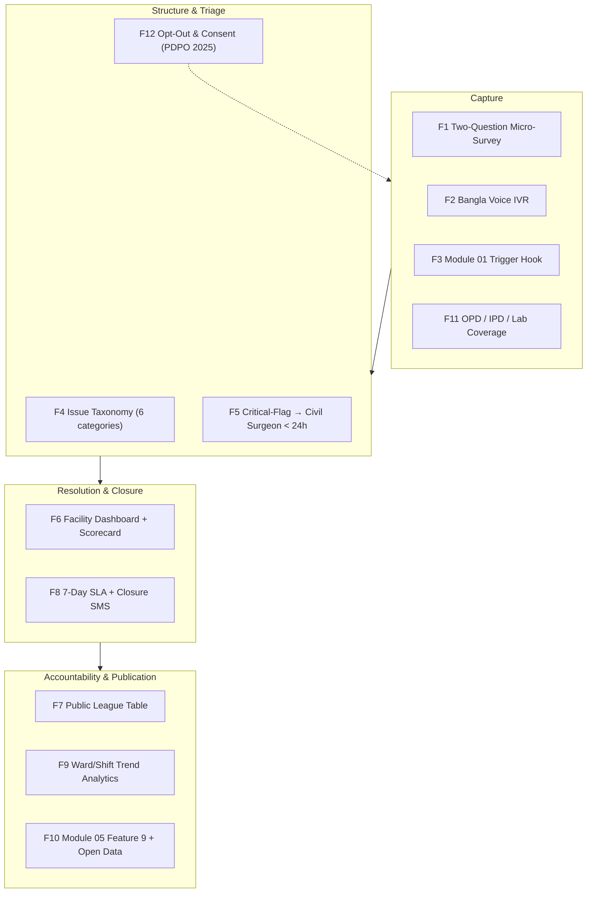

# ⚡ Functional Specifications & Feature Catalog — Module 14

## ObhijogLoop — Post-Visit Patient Feedback & Grievance Resolution

---

## Table of Contents

- [Functional Architecture Overview](#functional-architecture-overview)
- [Feature 1: Post-Visit SMS/IVR Micro-Survey (Two Questions: 1–5 Rating + Issue Category)](#feature-1-post-visit-smsivr-micro-survey-two-questions-15-rating--issue-category)
- [Feature 2: Bangla Voice IVR for Low-Literacy Users (77.7% Literacy, 74.6% Rural)](#feature-2-bangla-voice-ivr-for-low-literacy-users-777-literacy-746-rural)
- [Feature 3: Trigger Hook from Module 01 (Visit Closed → 24h Later SMS)](#feature-3-trigger-hook-from-module-01-visit-closed--24h-later-sms)
- [Feature 4: Issue Taxonomy — Staff Behaviour / Cost / Cleanliness / Drugs Unavailable / Long Wait / Other](#feature-4-issue-taxonomy--staff-behaviour--cost--cleanliness--drugs-unavailable--long-wait--other)
- [Feature 5: Critical-Flag Auto-Escalation to Civil Surgeon Within 24h](#feature-5-critical-flag-auto-escalation-to-civil-surgeon-within-24h)
- [Feature 6: Facility Dashboard & Monthly Scorecard](#feature-6-facility-dashboard--monthly-scorecard)
- [Feature 7: Public Facility League Table (Transparency Push)](#feature-7-public-facility-league-table-transparency-push)
- [Feature 8: 7-Day Resolution Tracking & Complainant Closure SMS](#feature-8-7-day-resolution-tracking--complainant-closure-sms)
- [Feature 9: Trend Analytics — Staff-Behaviour Complaints by Ward/Shift](#feature-9-trend-analytics--staff-behaviour-complaints-by-wardshift)
- [Feature 10: Integration to Module 05 Command Center (Feature 9) & Open-Data Publication](#feature-10-integration-to-module-05-command-center-feature-9--open-data-publication)
- [Feature 11: Feedback for Outpatient, Inpatient & Diagnostic Labs (Module 02)](#feature-11-feedback-for-outpatient-inpatient--diagnostic-labs-module-02)
- [Feature 12: Opt-Out & Consent Management (PDPO 2025)](#feature-12-opt-out--consent-management-pdpo-2025)
- [Feature Matrix](#feature-matrix)
- [Out of Scope (Explicit Non-Goals)](#out-of-scope-explicit-non-goals)

---

## Functional Architecture Overview



Each feature below follows the same contract: **What / Why / How / Edge cases**. Cross-module dependencies use the canonical sibling paths (`../01-appointment/`, `../02-test-reports/`, `../05-integrated-system/`, `../06-medicine-stock/`, `../07-health-card/`).

---

## Feature 1: Post-Visit SMS/IVR Micro-Survey (Two Questions: 1–5 Rating + Issue Category)

**What**: The entire patient-facing interaction is two questions: (1) a 1–5 rating (৫ = চমৎকার … ১ = খুবই খারাপ), (2) an optional issue category. Delivered via SMS 24h after visit close; IVR rescue for non-responders at T+48h.

**Why**: Mera Aspataal proved outbound asking surfaces a **24% dissatisfaction rate (2016–19)** concentrated in staff behaviour, cost, cleanliness — invisible to inbound systems. MomConnect proved 1.7M+ registrations on SMS with an 8:1 compliments:complaints ratio — engagement works when the ask is tiny. Two questions keeps completion feasible on GSM for low-literacy users (77.7% literacy; 74.6% rural — Dec 2024).

**How**:
- SMS body (GSM-7 safe): `BD-HealthLoop: গতকালের সেবা কেমন ছিল? রেটিং ১-৫ দিন (৫=সেরা)। সমস্যা: 1=আচরণ 2=খরচ 3=পরিষ্কার 4=ওষুধ নেই 5=দেরি 6=অন্যান্য। উত্তর: R2C4। বাতিল: STOP`
- Deep parse of replies `R[1-5]C[0-6]` (ASCII or Bangla digits), free-text keyword mapping as fallback.
- Ticket auto-created on rating ≤2 or any C>0; rating ≥4 with C0 logs COMPLIMENT.

**Edge cases**: shared handset (no clinical content in SMS); invalid reply → one clarification prompt then `UNPARSED`; reply `STOP` → instant opt-out; same visit re-triggered → idempotent suppression; survey after IPD death → suppressed (Journey 7, APP_FLOW.md).

---

## Feature 2: Bangla Voice IVR for Low-Literacy Users (77.7% Literacy, 74.6% Rural)

**What**: Outbound interactive voice response in Bangla (with English and Chakma/Santali prompt packs in Phase 2) for patients who do not reply to SMS within 48h, or who consented to voice-first at registration.

**Why**: **77.7% literacy overall, 74.6% rural** (Jagonews24, Dec 2024); individual smartphone use only **41% urban / 26% rural** (GSMA 2024). A text-only survey systematically excludes the rural poor — precisely the population most dependent on public facilities. Voice keypress (1–9) is universally usable; MomConnect and Mera Aspataal both relied on voice channels for exactly this reason.

**How**:
```text
"BD-HealthLoop থেকে বলছি। গতকাল আপনার সেবা কেমন ছিল?"
"রেটিং দিতে ১ থেকে ৫ চাপুন। ৫ = চমৎকার, ১ = খুবই খারাপ।"
[১–৫]
"কোনো সমস্যা থাকলে ১ চাপুন।"
[১]
"সমস্যা নির্বাচন: কর্মীর আচরণ=১, খরচ=২, পরিষ্কার=৩, ওষুধ নেই=৪, দেরি=৫, অন্যান্য=৬।"
[৪] "ধন্যবাদ। আপনার মতামত গ্রহণ করা হয়েছে।"
```
- Bangla TTS (or recorded professional voice); DTMF keypress capture; 20s no-input timeout ×2 → hang-up logged `IVR_NOINPUT`; proxy question included ("আপনি কি রোগীর পক্ষে? ১=হ্যাঁ").
- Cost: voice minutes ~Tk 0.50–1.00/connected call [estimate]; use only for non-responders to control spend.

**Edge cases**: wrong-person answer (proxy disclaimer + tagging); noisy line → repeat prompts ≤2; hearing-impaired users → SMS path remains primary; callback abuse → max 2 outbound attempts per survey; language mismatch → language menu at call start (বাংলা/English).

---

## Feature 3: Trigger Hook from Module 01 (Visit Closed → 24h Later SMS)

**What**: Outbound survey is fired exclusively by Module 01's `VISIT_CLOSED` event (OPD token `COMPLETED`, IPD discharge closed, lab delivery confirmed in Module 02) — never by timers alone or manual lists.

**Why**: The 2012 DGHS SMS system failed in part because it was inbound-only and unaware of visits; an authoritative upstream trigger guarantees coverage, prevents double-counting, and keeps the denominator honest (complaints per **1,000 visits** is computable). It also guarantees bereavement suppression (Module 01 marks `DECEASED` dispositions).

**How**:
- Module 01 emits `POST /api/v1/triggers/visit-closed` `{visit_id, facility_id, visit_type, pseudonym_ref, closed_at}` signed with HMAC; ObhijogLoop validates, checks consent + bereavement flags, enqueues T+24h job (jitter ±15min for load spreading).
- Re-open handling: if Module 01 reopens the visit within 24h, the queued job is cancelled.
- Delivery receipts flow back into visit record as `feedback_status` (DELIVERED/FAILED/RESPONDED) — visible to Module 01 staff screen, never to patient.

**Edge cases**: duplicate webhook (idempotency key `visit_id#wave1`); Module 01 downtime → at-least-once delivery with replay; visit closed retroactively (paper back-entry) → survey suppressed if closed_at > 30 days in past; lab-only visits (Module 02) → Module 02 emits equivalent trigger with `visit_type=LAB`.

---

## Feature 4: Issue Taxonomy — Staff Behaviour / Cost / Cleanliness / Drugs Unavailable / Long Wait / Other

**What**: A fixed six-category taxonomy mapped to single digits:

| Code | Category (EN) | বাংলা | Source of concern |
|:---:|:---|:---|:---|
| 1 | Staff behaviour | কর্মীর আচরণ | 24% Mera Aspataal dissatisfaction driver #1; violence early-warning (Module 16) |
| 2 | Cost / hidden charges | খরচ / অতিরিক্ত টাকা | Hidden charges named in UNB Dec 2025 emigration drivers; informal-fee leakage |
| 3 | Cleanliness / hygiene | পরিষ্কার-পরিচ্ছন্নতা | Mera Aspataal top-3; infection-control proxy |
| 4 | Drugs unavailable | ওষুধ নেই | 84% of health workers report patients return for lack of medicines (Dhaka Tribune, Jun 2026); validated vs Module 06 stock |
| 5 | Long wait | দেরি / দীর্ঘ অপেক্ষা | 48-second consultation context (BMJ Open 2017); queue pain |
| 6 | Other | অন্যান্য | Free-text; human-mapped weekly; new codes proposed quarterly |

**Why**: fixed taxonomy makes complaints **countable, comparable across 64 districts, and automatable to escalation rules** — free-text alone never reaches KPI-grade aggregation. Aligned with Mera Aspataal's published clustering (staff behaviour, cost, cleanliness).

**How**: category stored as enum; free-text optional; monthly taxonomy review by DGHS reform cell; `6=Other` share >25% for two consecutive months triggers taxonomy v1.1 proposal (add/split codes) via governance board.

**Edge cases**: multi-issue replies ("R2C14") — lowest category number wins for severity, full string retained; wrong category chosen — complainant can SMS `FIX C4` within 72h to reclassify; "0" used for none; codes valid 0–6 only; unknown codes → clarification reply.

---

## Feature 5: Critical-Flag Auto-Escalation to Civil Surgeon Within 24h

**What**: Keyword/rating-triggered CRITICAL tickets (rating ≤2 + staff behaviour, or bribe/assault/extortion keywords incl. "ঘুষ", "মারধর") escalate automatically to the **64 district civil surgeons** within 24h — via SMS/pager + Module 05 Feature 9 (Civil Surgeon District Health Command Center) district queue.

**Why**: inbound 2012 failure mode = facility self-review with zero external accountability; political dynamics documented (BMJ GH 2021). A binding district-level SLA is the minimum credible deterrent and mirrors mTrac's district accountability (US$400k recovered, 2013). Staff-behaviour signals double as Module 16 (violence registry) early warning — >80% of health workers experienced/witnessed violence, only ~25% ever reported it (CIPRB/ICRC, n=1,703).

**How**: rules R1/R2 (APP_FLOW.md); escalation card contains facility, ward/shift, category, severity, pseudonymous ticket ID, 48h action request; day-4 and day-7 auto re-escalation; immutable audit ledger; DGHS reform cell sees aggregates only.

**Edge cases**: false positive (keyword-only) → human triage review within 4h before *public* visibility (district notification itself is internal, not public); civil surgeon unreachable → Deputy CS + DGHS cell notified; political figure implicated → DGHS central grievance cell directly; festival/hartal → SLA continues; retaliation risk → complainant identity never disclosed; all access audit-logged.

---

## Feature 6: Facility Dashboard & Monthly Scorecard

**What**: Role-gated dashboard per facility: live ticket queue, SLA countdowns, rating distribution, issue mix, ward/shift heatmap, compliment feed, and the auto-generated **monthly scorecard** (resolution ≤7d %, rating mean, complaint rate per 1,000 visits, trend arrow).

**Why**: closes the loop locally — facilities must see and act before district intervention; MomConnect's 8:1 compliment ratio shows recognition drives engagement; scorecard creates the internal accountability ritual (monthly review) the 2012 system lacked.

**How**: React dashboard; role = `FACILITY_CELL` (own facility only) / `CIVIL_SURGEON` (district rollup) / `DGHS_REFORM` (national aggregate); scorecard PDF auto-generated day 3 of month; facility can append explanatory note (not overwrite) — displayed alongside, audit-logged.

**Edge cases**: low-volume facility → scorecard flagged "insufficient data", no league ranking but full internal visibility; disputed ticket → side-by-side evidence view; staff morale — compliments wall displayed equally; offline facility (no internet) → weekly paper print pack via district office; dashboard login failures → MFA reset via civil surgeon office.

---

## Feature 7: Public Facility League Table (Transparency Push)

**What**: Monthly public ranking of facilities on `obhijog.dghs.gov.bd` (proposed): aggregate score (0.4·resolution + 0.3·rating + 0.15·response rate + 0.15·trend), issue-mix chart, complaint rate/1,000 visits; downloadable CSV/JSON; **zero patient rows**.

**Why**: hackathon brief demands "every penny spent transparently" — a visible public scorecard is governance made legible. India published Mera Aspataal dissatisfaction data to institutional effect; Bangladesh's opacity enables impunity (1,027 facilities without valid licences, DGHS 2024; >880 unauthorised facilities closed, 2024). Public ranking converts grievance data into civic accountability — the same pattern as Module 04 anti-dalal dashboard and Module 06 public stock board.

**How**: aggregate-only publication; k≥10 cell suppression; facilities with <30 responses shown unranked; monthly methodology note published with table; API open (no auth) for journalists/researchers; takedown only by DGHS order with audit log.

**Edge cases**: small-sample gaming → audit + flag; misleading single month → 3-month rolling rank used for headline, monthly shown alongside; community pressure on poor facilities → DGHS support package pathway (not just sanction); private accredited facilities included only if consented to public reporting (public facilities mandatory); vandalism of public display → QR code to official portal.

---

## Feature 8: 7-Day Resolution Tracking & Complainant Closure SMS

**What**: Every HIGH/CRITICAL ticket carries a 7-day SLA with day-4 reminder and day-7 escalation; complainant receives (a) acknowledgement SMS and (b) resolution SMS with 1/2 confirmation.

- Acknowledgement: `আপনার অভিযোগটি গ্রহণ করা হয়েছে। অভিযোগ নম্বর: OGL-2026-00123। ৭ দিনের মধ্যে জানানো হবে।`
- Resolution: `আপনার অভিযোগটি সমাধান হয়েছে। OGL-2026-00123। সন্তুষ্ট=১, নাহলে=২।`

**Why**: the single biggest failure of the 2012 system was silence after complaint; MomConnect shows acknowledgement drives engagement; confirmation converts "actioned" into "resolved (verified)" — the metric that matters. Unconfirmed closures are reported separately and never inflate targets.

**How**: Redis SLA timers; action requires evidence (note + optional photo/document); complainant reply `1` → `RESOLVED_CONFIRMED`; `2` → auto-reopen + civil surgeon day-2; 72h silence ×3 attempts → `RESOLVED_UNCONFIRMED`; monthly KPI = % complainants confirming resolution (target ≥70%, pilot).

**Edge cases**: complainant phone off → SMS retries + IVR call; SIM changed → UNDELIVERABLE, logged; disputed closure → reopening with reason; anonymous complaint → acknowledgement suppressed, closure logged internally; bereavement → no SMS ever (Journey 7); legal hold → SLA paused only with DGHS legal flag, logged.

---

## Feature 9: Trend Analytics — Staff-Behaviour Complaints by Ward/Shift

**What**: Nightly aggregation slicing complaints by facility × ward × shift (morning/evening/night) × day-of-week; staff-behaviour sub-rate as headline; threshold alerts (e.g., >3 staff-behaviour complaints in one ward in 30 days) to civil surgeon.

**Why**: patterns predict harm. Attendant/relative violence is >70% of health-worker violence (71.9% CIPRB/ICRC); staff-behaviour complaints are the measurable leading indicator — Module 16's registry consumes this feed. Drugs-unavailable trends validated against Module 06 expose stock-out denial (84% return-rate). Cost-complaint clusters flag informal-fee hotspots for audit.

**How**: PostgreSQL nightly rollup → materialised heatmap views; 28-day rolling windows; k≥10 suppression; district drill-down in Module 05 Feature 9; quarterly export to DGHS reform cell; anonymised API for research.

**Edge cases**: misattributed ward (free-text) → triage officer confirms; tiny wards → rolling windows, no ranking; seasonal confound (dengue season) → surge flag separates surge-month data; retaliation against named staff impossible (no names in analytics); data retention: raw 180 days → anonymised aggregates thereafter.

---

## Feature 10: Integration to Module 05 Command Center (Feature 9) & Open-Data Publication

**What**: (a) Every CRITICAL/HIGH ticket surfaces as an escalation card in **Module 05 Feature 9 — Civil Surgeon District Health Command Center**; district KPI panel includes complaint rate/1,000 visits; (b) monthly anonymised aggregate dataset published as open data (CSV/JSON) under DGHS open-licence; (c) optional FHIR `Communication` resource linkage (see IMPLEMENTATION.md).

**Why**: a standalone feedback silo repeats the 2012 failure; embedding in Module 05 Feature 9 gives civil surgeons one cockpit (beds, stocks, stock-outs, complaints) — cross-signal detection (e.g., drugs-unavailable + stock-out + cost complaints in same UHC = systemic). Open data satisfies the transparency mandate and enables independent audit — the anti-"star count" principle: data out, accountability out.

**How**: REST + webhook to Module 05 (`POST /api/module05/escalations`); schema: ticket_id, facility, ward, category, severity, ts; Feature 9 renders queue + heatmap; open-data publisher runs day 3 monthly with k-anonymity checks; FHIR mapping: `Communication` (status, category=instruction/alert, about=Encounter reference from Module 01/02) — optional, not required for operation.

**Edge cases**: Module 05 downtime → tickets queue locally, replay on recovery (at-least-once, idempotent); partial data publication → job aborts if k-suppression fails (never publish unsuppressed); Feature 9 access roles enforced by Module 05 RBAC; open-data schema versioning (v1.0, semver); license: open government data, attribution required.

---

## Feature 11: Feedback for Outpatient, Inpatient & Diagnostic Labs (Module 02)

**What**: Coverage across the three visit types: (1) OPD (Module 01 token completion), (2) IPD (discharge summary closed), (3) diagnostic labs (Module 02 report delivered/collected — "রিপোর্ট কি সময়ে পেয়েছেন?"). Each emits the same two-question micro-survey with visit-type-specific framing, same taxonomy.

**Why**: Module 02's lab pathway reaches patients who never see a doctor (report pickup) — a high-friction, high-dissatisfaction touchpoint (52% diagnostic equipment idle; repeat tests due to lost records). Single taxonomy keeps comparability; inpatient feedback catches nursing-care and cleanliness issues OPD cannot see.

**How**: Module 02 emits equivalent closed-visit event (`LAB_REPORT_DELIVERED`); survey template variant `LAB` (adds question variant on timeliness mapped into category 5/long-wait); IPD variant references discharge; module-specific deep links for staff action (lab ticket → Module 02 quality officer; IPD → ward in-charge).

**Edge cases**: lab-only visitor without Health ID → consent captured at Module 02 registration (collection desk) with same ConsentLog schema; home-collection samples → SMS to registered contact; IPD death → Journey 7; report re-collection (abnormal → repeat test) → no second survey within 30 days; lab private franchise → include only with consent + DGHS MOU.

---

## Feature 12: Opt-Out & Consent Management (PDPO 2025)

**What**: Explicit opt-in captured at visit registration (Module 07 Health Card consent flow); STOP/বন্ধ honoured ≤1h; 180-day retention then irreversible anonymisation; public views aggregate-only; right to erasure (request → 30-day completion, audit-logged); no clinical data collected ever.

**Why**: **Personal Data Protection Ordinance 2025** (gazetted 6 Nov 2025) classifies health data as **sensitive personal data** requiring explicit consent for collection, storage, transfer, use; sections effective ~May 2027 (estimate); enforcement status under 2026 government **[uncertain]** — design to the strictest reading. Phones are shared (BBS 2026) — consent must survive shared-device reality: consent is per Health ID, not per handset.

**How**: consent recorded in `ConsentLog` (module 07 shared schema): purpose=`POST_VISIT_FEEDBACK`, lawful_basis=`CONSENT`, scope=[SMS, IVR]; withdrawal = STOP or written request or dashboard toggle; erasure workflow: pseudonymous link severed, response rows anonymised (irreversible k-anonymised aggregates retained); DPO contact published on public portal; DPIA (data protection impact assessment) filed pre-pilot.

**Bangla consent snippet (registration desk)**: `সেবা-পরবর্তী মতামত জরিপে অংশ নিতে চান? হ্যাঁ/না। না বললে কোনো মেসেজ দেয়া হবে না।`

**Edge cases**: consent withdrawn mid-survey-chain → pending jobs cancelled; guardian consent for minors/incapacitated; illiterate patient → verbal consent + thumbprint log at desk; emergency admission → consent deferred, asked at discharge (never at emergency threshold); data export request → machine-readable pseudonymised extract; audit: consent trail exportable for DGHS/PDPO officer inspection.

---

## Feature Matrix

| Feature ID | Feature Name | Priority | Depends On | Standard / Interface | Target User |
|:---|:---|:---:|:---|:---|:---|
| **F-OBH-01** | Two-Question Micro-Survey (SMS/IVR) | P0 | F3, F12 | GSM-7 / DTMF | Patients |
| **F-OBH-02** | Bangla Voice IVR (Low-Literacy) | P0 | F1, F12 | IVR / TTS | Rural & low-literacy users |
| **F-OBH-03** | Module 01 Visit-Closed Trigger Hook | P0 | Module 01 | HMAC webhook | System |
| **F-OBH-04** | Six-Category Issue Taxonomy | P0 | — | Enum + free-text | Triage |
| **F-OBH-05** | CRITICAL → Civil Surgeon < 24h | P0 | F1, Module 05 F9 | SMS + Feature 9 card | Civil Surgeons |
| **F-OBH-06** | Facility Dashboard & Scorecard | P0 | F4, F8 | React / PDF | Complaint Cells |
| **F-OBH-07** | Public League Table (Open Data) | P1 | F6 | Open CSV/JSON | Citizens / Press |
| **F-OBH-08** | 7-Day Resolution Tracking + Closure SMS | P0 | F1, F6 | Redis SLA timers | Cells + Complainants |
| **F-OBH-09** | Ward/Shift Trend Analytics | P1 | F4, F8 | SQL rollup / heatmap | Civil Surgeons / Module 16 |
| **F-OBH-10** | Module 05 Feature 9 + Open Data Integration | P1 | F5, F6 | REST/webhook; FHIR `Communication` (optional) | District Command |
| **F-OBH-11** | OPD / IPD / Lab (Module 02) Coverage | P1 | F3, Module 02 | `LAB_REPORT_DELIVERED` event | All visit types |
| **F-OBH-12** | Opt-Out & Consent (PDPO 2025) | P0 | Module 07 | ConsentLog schema | Data Protection |

---

## Out of Scope (Explicit Non-Goals)

> [!CAUTION]
> **ObhijogLoop is an accountability instrument, not a clinical system.** The following are deliberately excluded — mistaking this module for any of them is a category error:

1. **NOT a clinical tool** — no diagnosis, prescription, triage of symptoms, or treatment advice. Rating/category only; zero clinical data fields exist in the schema.
2. **NOT for emergencies** — anyone in a medical emergency must call **999** (national emergency) or **16263** (Shasthya Batayon health hotline). A complaint about emergency care is logged like any other, but *response* routes clinically through 999/16263, never through this queue. The survey SMS states: `জরুরি অবস্থায় ৯৯৯ কল করুন।`
3. **Does NOT replace the DGHS 16263 inbound hotline** — 16263 is inbound tele-advice; ObhijogLoop is outbound feedback. They coexist; 16263 signal may cross-reference but neither substitutes for the other. (16263 call volumes are contested — ~3,000–6,500 calls/day; arrears 17–22 months — cited qualitatively only.)
4. **No patient identifiers in public league table** — aggregate-only; k≥10 suppression; zero names, NIDs, Health IDs, phone numbers, free-text, or per-ticket data ever published.
5. **Not a grievance court** — no legal adjudication, compensation decisions, or disciplinary verdicts; it routes evidence to civil surgeons/DGHS who decide by existing rules.
6. **Not for private facilities without consent** — public facilities mandatory; private/accredited only via opt-in MOU.
7. **Not a replacement for Module 16 (violence registry)** — it *feeds* it; the registry remains the system of record for violent incidents.
8. **Not bereavement support** — death-in-facility flows to Journey 7 condolence protocol; ObhijogLoop never surveys a bereaved household.
9. **No real-time staff surveillance** — analytics are aggregate and delayed (nightly); no live monitoring of individuals; no location tracking of staff or patients.
10. **Not a complaints box for corruption prosecutions** — legal-referral pathway exists (Feature 5) but investigation belongs to the Anti-Corruption Commission/DGHS, not this module.
11. **No social-media scraping** — captures only solicited responses; no passive listening.
12. **Not national from day 1** — pilot in the five e-Health Card districts (Khulna, Noakhali, Bogura, Sirajganj, Narsingdi) before scale.
