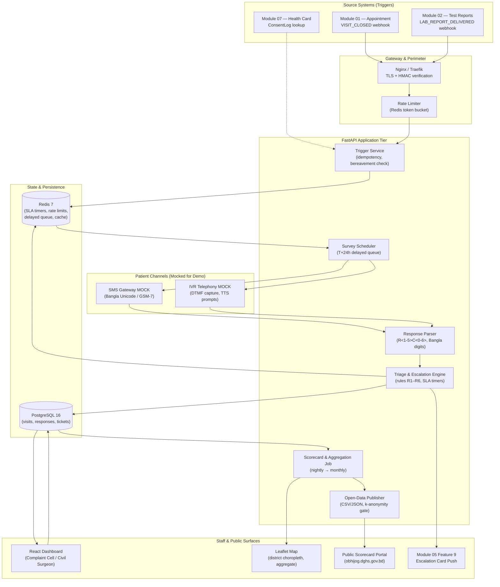
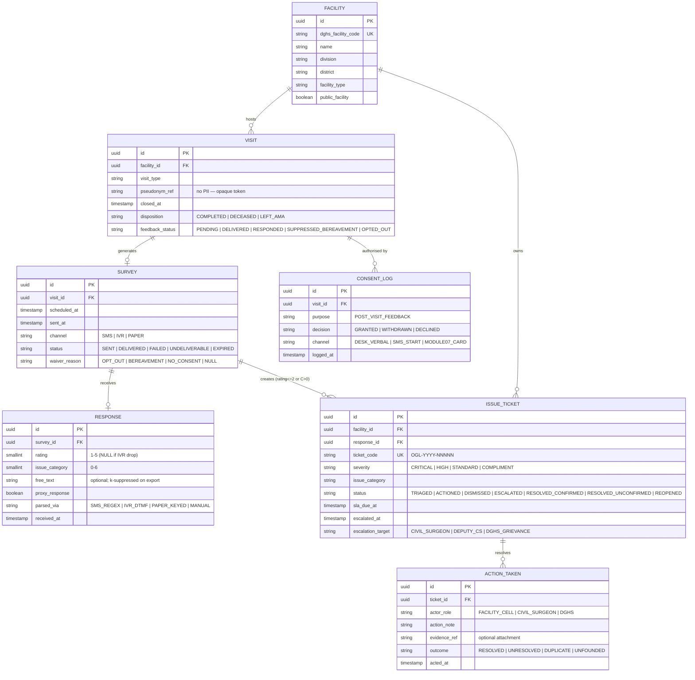
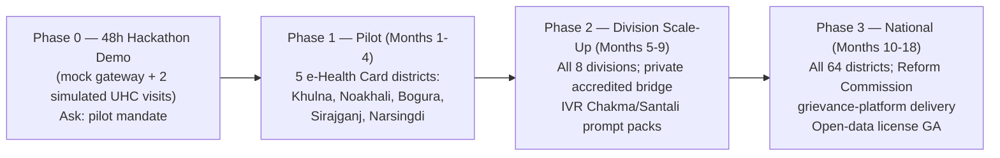

# 🛠️ Technical Architecture & Implementation Blueprint — Module 14

## ObhijogLoop — Post-Visit Feedback Ingestion, Resolution Tracking & Public Scorecard

---

## Table of Contents

- [System Architecture & High-Level Topology](#system-architecture--high-level-topology)
- [Technology Stack](#technology-stack)
- [Database Architecture & Entity-Relationship Model](#database-architecture--entity-relationship-model)
- [HL7 FHIR R4 Note (Optional Spine Link)](#hl7-fhir-r4-note-optional-spine-link)
- [REST API Specification](#rest-api-specification)
- [Security, PDPO 2025 & Privacy Architecture](#security-pdpo-2025--privacy-architecture)
- [Deployment & Rollout Plan (48h Demo → Pilot → National)](#deployment--rollout-plan-48h-demo--pilot--national)
- [Risks & Mitigations](#risks--mitigations)
- [3-Minute Demo Script (Hackathon Pitch)](#3-minute-demo-script-hackathon-pitch)
- [Sources & Data Notes](#sources--data-notes)

---

## System Architecture & High-Level Topology

**Design principles**: (1) patient plane is SMS/IVR-only — zero patient-facing web; (2) staff plane is React; (3) all cross-module links are webhook/REST with HMAC signatures; (4) no clinical payload ever crosses the boundary — `visit_ref` is a pseudonymous pointer, not a record.

---

## Technology Stack

| Layer | Choice | Rationale |
|:---|:---|:---|
| **Backend API** | FastAPI (Python 3.12) + Pydantic v2 | Async; same stack family as Module 05 core; rapid demo build |
| **Database** | PostgreSQL 16 | JSONB for flexible action notes; partitioning by month; strict FK integrity |
| **Cache / Queue / Timers** | Redis 7 (delayed queue via sorted sets; SLA keyspace notifications) | Sub-millisecond SLA checks; rate limiting; idempotency keys |
| **SMS** | Gateway MOCK (`SmsGatewayMock`) — Twilio-compatible interface; production swap = BD telco aggregator (e.g., SSL Wireless / bulk SMS) with Bangla Unicode support | Demo without credentials; production contract isolated behind interface |
| **IVR** | Telephony MOCK (`IvrServiceMock`) — DTMF capture + Bangla TTS prompt files; production = SIP/IVR provider (or 16263-style platform reuse) | Low-literacy reach (77.7% literacy; 74.6% rural) |
| **Frontend (staff)** | React 18 + TypeScript + Tailwind; Recharts; **Leaflet** for district choropleth | Matches platform frontend patterns; Leaflet is OSS, tile-based |
| **Frontend (public)** | Static site (Astro/Next SSG) + open CSV/JSON endpoints | Read-only, cacheable, no PII possible |
| **AuthN/AuthZ** | DGHS Health ID SSO (staff) + RBAC roles: `FACILITY_CELL`, `CIVIL_SURGEON`, `DGHS_REFORM`, `ADMIN` | Module 05-compatible |
| **Observability** | OpenTelemetry → Grafana; structured JSON logs; audit table `audit_ledger` (append-only) | PDPO accountability; SLA breach alerting |
| **Infra** | Docker Compose (demo) → Kubernetes (pilot); BDIX peering; secrets via vault | Path: 48h demo → pilot → national |

---

## Database Architecture & Entity-Relationship Model

**Key constraints**:
- `VISIT.disposition = 'DECEASED'` ⇒ `SURVEY.waiver_reason = 'BEREAVEMENT'` enforced by trigger; no `SURVEY` row may reach `SENT`.
- `RESPONSE` rows never carry `pseudonym_ref` directly — join through `SURVEY → VISIT` only for authorised roles; all public queries exclude tickets entirely.
- Partition `RESPONSE` and `ISSUE_TICKET` by month; 180-day raw retention ⇒ scheduled anonymisation job sets `pseudonym_ref = NULL`, hashes residual linkage, keeps aggregates.
- `audit_ledger` (not shown): append-only log of every status transition and access to a ticket's identity layer; hash-chained nightly.

---

## HL7 FHIR R4 Note (Optional Spine Link)

Module 14 is **not** a clinical data source, but it can register its communications on the BD Core FHIR R4 spine so the longitudinal record shows "feedback sought / closure sent" without exposing content:

- **`Communication`** (optional, recommended for pilot v1.1):
  - `status`: `completed` | `in-progress` | `not-done` (with `notDoneReason` = opt-out / bereavement)
  - `category`: `notification` (or local code `bd-healthloop-feedback`)
  - `about`: `Reference(Encounter)` — **Encounter reference comes from Module 01 (OPD/IPD)** or **Module 02 (lab)**, never free clinical narrative
  - `medium`: `SMS | phone` ; `sent`: timestamp ; `recipient`: pseudonymous `Patient` reference via Module 07 Health ID
  - `payload`: **never** rating/category — only "feedback requested" / "closure confirmed" codes
- **`Encounter`** stays owned by Modules 01/02; ObhijogLoop only references it (read-only scope).
- **`Consent`**: if implementing full FHIR consent, mirror `ConsentLog` as FHIR `Consent` with `provision.purpose = health-operations-quality` — optional; local ConsentLog remains authoritative for PDPO evidence.
- No `Observation`, `Condition`, or clinical resource is ever written. **FHIR is a convenience index, not a dependency** — the module runs standalone if the spine is down.

---

## REST API Specification

Base path `/api/v1/feedback`. All staff endpoints RBAC-gated; patient endpoints are webhook-only (no public write except gateway callbacks).

| Method & Path | Caller | Purpose | Key Request / Response |
|:---|:---|:---|:---|
| `POST /triggers/visit-closed` | Module 01/02 | Register visit for feedback | `{visit_id, facility_id, visit_type, pseudonym_ref, closed_at, disposition}` → `202 {survey_job_id}` |
| `GET /surveys/pending` | Internal (scheduler) | Pop due jobs | → `[{job_id, visit_ref, channel}]` |
| `POST /surveys/dispatch` | Internal | Send via mock gateway | `{job_id, channel, template}` → `202` |
| `POST /webhooks/sms-delivery` | SMS gateway (mock) | Delivery receipt | `{message_id, status}` → `204` |
| `POST /webhooks/sms-inbound` | SMS gateway (mock) | Patient reply | `{from_hash, body}` → `200 {parsed, ack_sent}` |
| `POST /webhooks/ivr-dtmf` | IVR mock | DTMF capture | `{call_id, digits}` → `200` |
| `GET /tickets?facility=&status=&severity=` | Complaint Cell | Dashboard queue | → paginated tickets (no PII) |
| `POST /tickets/{id}/triage` | Complaint Cell | Override/confirm triage | `{severity, category, note}` → `200` |
| `POST /tickets/{id}/action` | Complaint Cell | Log action + evidence | `{action_note, evidence_ref?, outcome}` → `200` |
| `POST /tickets/{id}/escalate` | System / CS | Manual escalation | `{target, reason}` → `200` |
| `GET /tickets/{id}/audit` | CS / DGHS | Immutable audit trail | → `[audit entries]` |
| `GET /scorecards/{facility_id}?month=` | Cell / CS | Monthly scorecard | → aggregate JSON + PDF link |
| `GET /public/league-table?month=` | Public (no auth) | League table | → k-suppressed aggregates; HTTP cache 24h |
| `GET /public/open-data.csv?month=` | Public | Bulk CSV | → k-suppressed rows; content-disposition attachment |
| `POST /consent/optout` | Module 07 / DESK | Withdraw consent | `{visit_ref, via}` → `202`; cancels queued jobs ≤1h |
| `POST /consent/erase` | Data subject / DPO | Right to erasure | `{request_id}` → `202`; 30-day pipeline |
| `GET /healthz` / `GET /readyz` | Ops | Probes | → `200` |

**Idempotency**: mutating endpoints accept `Idempotency-Key` (UUID); duplicates return the original response. **Rate limits**: inbound webhooks 10k/min; staff APIs 120/min/user; public endpoints 60/min/IP. **Errors**: RFC 7807 problem+json.

---

## Security, PDPO 2025 & Privacy Architecture

**Regulatory frame**: Personal Data Protection Ordinance 2025 (gazetted 6 Nov 2025) — health data = **sensitive personal data**; explicit consent required for collection/storage/transfer/use; some provisions effective ~May 2027 (estimate); enforcement under 2026 government **[uncertain]** — design to strictest reading.

| Control | Implementation |
|:---|:---|
| **Lawful basis** | `CONSENT` only (no legitimate-interest fallback); captured at Module 07 registration or desk verbal + thumbprint for illiterate users |
| **Data minimisation** | 1–5 rating + category + optional free-text. **No** NID, name, diagnosis, drug, payment, or address. SMS body contains zero health data |
| **Pseudonymisation** | `pseudonym_ref` = HMAC-SHA256(Health ID, salt held in HSM) — irreversible without salt; salt rotated annually with re-pseudonymisation job |
| **Storage isolation** | Identity mapping table physically separate schema (`identity` vs `feedback`); feedback DB holds no direct identifiers |
| **Retention** | Raw responses 180 days → automated irreversible anonymisation (aggregate retain, row delete); audit logs 7 years (legal), also anonymised |
| **Public views** | Aggregate-only; k≥10 cell suppression; league table hides facilities <30 responses; no free-text export ever |
| **Right to erasure** | Request → identity lookup → cascade: ConsentLog marked withdrawn; survey jobs cancelled; response rows anonymised; confirmation to requester in 30 days; DPO-signed certificate |
| **Right to access / portability** | Pseudonymised export (rating history, dates) as JSON within 30 days |
| **Consent withdrawal** | STOP/বন্ধ ≤1h; desk request instant; Module 07 toggle propagates via webhook ≤15 min |
| **Audit** | `audit_ledger` append-only, hash-chained; any identity access logged with reason code + approver |
| **Encryption** | TLS 1.2+ (BDIX); AES-256 at rest; field-level encryption for free_text; keys in vault (KMS) |
| **Access control** | RBAC; MFA mandatory for staff; break-glass identity access requires DGHS order + second approver; quarterly access review |
| **DPIA** | Completed pre-pilot; filed with DGHS DPO; residual risk register maintained |
| **Breach protocol** | Detect ≤15 min (SIEM); notify DGHS DPO ≤4h; data subjects ≤72h (SMS + newspaper notice for scale); PDPO authority notification as required |
| **Shared handset safety** | No patient name in any SMS; generic sender `8809610XXXXX` labeled BD-HealthLoop; proxy disclosure question on IVR |
| **Bereavement carve-out** | Death flag ⇒ hard suppression; bereavement pathway bypasses all analytics |

---

## Deployment & Rollout Plan (48h Demo → Pilot → National)

**Phase 0 — 48h build**: Docker Compose; SMS/IVR mocks with canned Bangla prompts; one seeded facility ("Narsingdi Sadar UHC"); Module 01 stub emitting `VISIT_CLOSED`; dashboards wired; league table on static page; full Journey 1–7 executable end-to-end with demo patient "Momena" (synthetic).
**Phase 1 — Pilot (5 districts)**: ~40 facilities (UHC + DH + union sub-centres); consent at Module 07 touchpoints; baseline survey of 2,000 visits to calibrate targets; weekly SLA audits; failure-mode review at day 30; success gates: response >15%, resolution SLA >60%, zero bereavement incidents.
**Phase 2**: scale to all divisions; IVR language expansion; Module 06 stock-out cross-validation live; public scorecard v1 public launch.
**Phase 3**: national; Reform Commission grievance-platform formal hand-over; open-data API v1; annual independent evaluation (response, resolution, confirmed-resolution, complaint trend/1,000 visits).

**Funding & ownership**: DGHS grievance cell (operator) + Health Sector Reform Commission programme (delivery commitment) + WHO technical support; **SMS ~Tk 0.30–0.50/message (estimate)** — 100k surveys ≈ Tk 30,000–50,000 per wave [illustrative]; cheaper than one patient lost to foreign care (~US$5bn/yr aggregate).

**Reform Commission hook**: the Commission's 33-proposal short-term list includes a digital grievance platform (Daily Star, "Health Sector Reform: 33 proposals set for implementation") — ObhijogLoop is designed as its patient-facing intake and closure engine, not a parallel system.

---

## Risks & Mitigations

| # | Risk | Likelihood | Impact | Mitigation |
|:---:|:---|:---:|:---:|:---|
| R1 | **Low response rate** (<15%) | High | High | IVR rescue at T+48h; Bangla voice; SMS ≤160 chars; timing jitter; compliment capture (8:1 ratio per MomConnect); paper exit-survey channel; pilot tuning |
| R2 | **Fake / abusive / troll feedback** | Medium | Medium | Rate-limit (1 survey/visit; 5/month/phone [illustrative]); profanity filter → human `REVIEW`; pattern detection (multi-facility same-phone in 24h); never auto-actioned; audit sampling 5% |
| R3 | **Facilities gaming scores** (suppression of complaints; steering happy patients) | Medium | High | Server-side random 1-in-N sampling [N default 2 at scale]; complaint-audit (random 5% tickets re-contacted); gaming-detection rules (response-rate anomaly >60%, compliment clustering); scorecard methodology note; district inspection trigger |
| R4 | **Survey fatigue at national scale** | Medium | Medium | Max 1 per visit; random 1-in-N sampling when volume > budget; household monthly cap [illustrative]; fatigue KPI monitored monthly |
| R5 | **Bereavement incident (survey to grieving family)** | Low | **Critical** | Hard code suppression on `DECEASED`; 30-day household block; human-only condolence; quarterly audit of suppressed sends = zero; incident protocol ≤24h |
| R6 | **PDPO 2025 breach / unlawful processing** | Low | High | Consent-first architecture; pseudonymisation; DPIA; DPO sign-off; quarterly access review; breach protocol with DGHS DPO |
| R7 | **Escalation fatigue — civil surgeons ignore CRITICALs** | Medium | High | Hard 24h SLA + day-4/day-7 auto-re-escalation + DGHS aggregate reporting; non-acknowledgement flagged in district review; escalation quality score for offices |
| R8 | **Wrong-mobile / recycled SIM reaches stranger** | Medium | Low | SMS carries zero PII; STOP honoured ≤1h; delivery bounce → UNDELIVERABLE; no retry beyond 2× |
| R9 | **Facility retaliation against complainant** | Low | High | Identity never disclosed; aggregate k≥10 publication; retaliation report → immediate DGHS legal cell; anonymous submissions accepted |
| R10 | **Gateway/telco cost creep at national scale** | Medium | Medium | 1-in-N sampling; IVR only on non-response; negotiate bulk rate; cap spend per facility wave; quarterly cost review |
| R11 | **Dual-SIM / shared handset confidentiality leak of *opinions*** | Medium | Low | No clinical content; generic sender ID; proxy disclosure; opt-out via STOP |
| R12 | **Gaming via pencil-whipped closures** | Medium | Medium | Evidence-required closure; random re-contact audits; unconfirmed closures reported separately; repeat offenders flagged on district review |

---

## 3-Minute Demo Script (Hackathon Pitch)

**[0:00–0:20] Hook — the number that should embarrass us**
"Twenty-four percent of Indian patients were dissatisfied after public hospital visits — staff behaviour, cost, cleanliness (Mera Aspataal, 2016–19, Lok Sabha Q.966). Bangladesh has *never measured* this. Our SMS complaint box has existed since 2012 — inbound only — and produced 4,694 complaints by 2017 with limited impact (BMJ Global Health 2021). Meanwhile 482,000 patients fled to India last year, spending ~US$5bn annually. The grievance platform is on the Reform Commission's short-term list — here is the working piece."

**[0:20–0:50] The visit and the SMS**
Demo persona **Momena**, 41, OPD at Narsingdi Sadar UHC (Khan Module 01 closes her visit: token #214, `COMPLETED`). Cut to screen: scheduler fires T+24h. SMS appears on demo phone (Bangla):
`BD-HealthLoop: গতকালের সেবা কেমন ছিল? রেটিং ১-৫ (৫=সেরা)। সমস্যা: 1=আচরণ 2=খরচ 3=পরিষ্কার 4=ওষুধ নেই 5=দেরি। উত্তর: R2C4। STOP=বাতিল`
"Two taps. No app, no login, no smartphone required."

**[0:50–1:10] Two-tap reply**
Momena replies `R2C4` — "2 out of 5, drugs unavailable." Parser normalises, creates ticket `OGL-2026-01487`, severity **HIGH** (cost/drugs), and — because she also tapped 1 for staff behaviour in the IVR rescue — rule R1 fires: **CRITICAL**. Ack SMS lands: `আপনার অভিযোগটি গ্রহণ করা হয়েছে। অভিযোগ নম্বর: OGL-2026-01487`

**[1:10–1:40] The 24-hour promise**
Cut to civil surgeon dashboard (Leaflet district map, Module 05 Feature 9 card): `CRITICAL — Narsingdi Sadar UHC — staff behaviour + drugs — ticket OGL-2026-01487 — acknowledge within 4h`. Audit ledger shows routing timestamp T+0. "A named district officer now owns this within 24 hours — not a facility inbox."

**[1:40–2:10] Resolution in 5 days (compressed clock)**
Fast-forward: Cell logs action — stock verified with Module 06 (indent placed), staff counselled, evidence attached. Complainant receives: `আপনার অভিযোগটি সমাধান হয়েছে। OGL-2026-01487। সন্তুষ্ট=১`. Momena presses 1 → status `RESOLVED_CONFIRMED`. Timer on screen: **5 days**, inside the 7-day SLA.

**[2:10–2:35] The scorecard moves**
Monthly page refreshes: Narsingdi Sadar UHC resolution rate 61% → 68%; league table updates; open-data CSV republished. "Every taka a little more visible; every visit answered."

**[2:35–3:00] The ask**
"Pilot in the five e-Health Card districts — Khulna, Noakhali, Bogura, Sirajganj, Narsingdi — 40 facilities, one SMS per visit, ~Tk 0.30–0.50 per message. Bangladesh gets its first *resolution-measured* grievance system — the Reform Commission's promise, delivered as working software. Ask: 5 districts, 4 months, and a DGHS/Reform Commission pilot mandate."

---

## Sources & Data Notes

1. Module 01/02/05/06/07/16 cross-references — internal BD-HealthLoop modules (`../01-appointment/`, `../02-test-reports/`, `../05-integrated-system/FEATURES.md#feature-9`, `../06-medicine-stock/`, `../07-health-card/`).
2. Mera Aspataal 24% dissatisfaction (2016–19); categories staff behaviour / cost / cleanliness — [Lok Sabha Unstarred Q.966 (PDF)](https://cms.neva.gov.in/NeVA/LS/FileStructure/AssemblyFiles/16/17/20190208/Unstarred/966.pdf).
3. MomConnect 1.7M+ registered (2017); compliments : complaints = 8:1 — [PMC5922497](https://www.ncbi.nlm.nih.gov/pmc/articles/PMC5922497/).
4. mTrac — 52,946 workers, 5,684 facilities, US$400k recovered (2013) — [SDSN TReNDS (PDF)](https://files.unsdsn.org/CaseStudy_mTRAC_Sept2018.pdf).
5. DGHS SMS 2012–; +427% to 4,694 complaints (2017); low awareness / political dynamics — [Financial Express 2018](https://mail.thefinancialexpress.com.bd/sci-tech/sms-based-complaints-about-public-hospitals-spike-1520049781?amp=true); [BMJ GH 2021 e004357](https://gh.bmj.com/content/6/2/e004357).
6. Reform Commission digital grievance platform — [The Daily Star](https://www.thedailystar.net/news/bangladesh/news/health-sector-reform-33-proposals-set-implementation-3964871).
7. ~US$5bn/yr abroad; 482,000 patients to India (2024) — [UNB Dec 2025](https://unb.com.bd/category/Bangladesh/usd-5-billion-spent-abroad-annually-due-to-healthcare-gaps-in-bangladesh-dcci/175121).
8. PDPO 2025 (gazetted 6 Nov 2025; sensitive personal data; ~May 2027 partial effect estimate; enforcement [uncertain]) — [TBS](https://www.tbsnews.net/node/1281356); [Daily Star](https://www.thedailystar.net/tech-startup/news/bangladeshs-personal-data-protection-ordinance-2025-key-takeaways-4015401).
9. Literacy 77.7%/74.6% rural (Jagonews24 Dec 2024); smartphone 41%/26% (GSMA 2024 via TBS); households 73.4% smartphone/57.4% internet (BBS Jan–Mar 2026 via Dhaka Tribune).
10. 84% unavailability-return rate — [Dhaka Tribune Jun 2026](https://www.dhakatribune.com/bangladesh/health/413839/inside-bangladesh%E2%80%99s-community-clinics-promise).
11. Violence: >80% experienced/witnessed, ~25% reported — CIPRB/ICRC n=1,703.
12. Pilot districts — Khulna, Noakhali, Bogura, Sirajganj, Narsingdi (Module 07 pilot, April 2026).
13. **Honest flags**: SMS pricing, IVR per-minute cost, 1-in-N default, 5-calls/month cap, response-rate >25% target, 80% SLA and 70% confirmation targets are **design targets/estimates**, not measured facts; Kilkari cited only as reach≠outcome qualitative lesson; maturity index in README is illustrative; 16263 volumes contested; 48-fortnight SLA timings are design choices.
