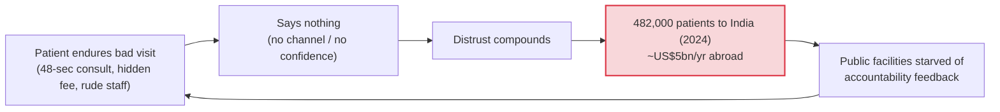
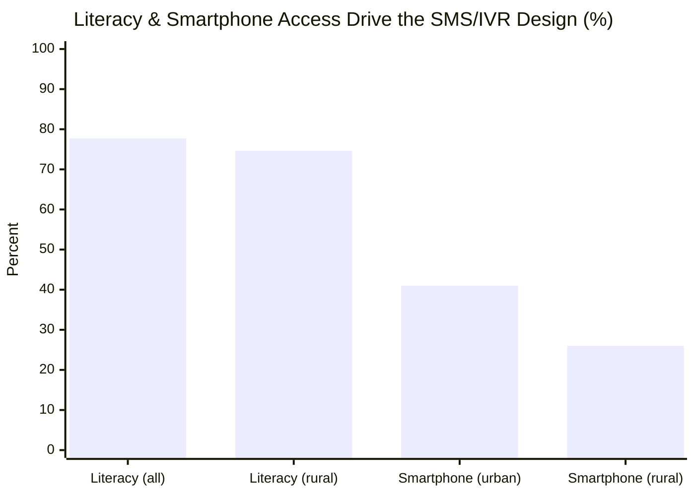
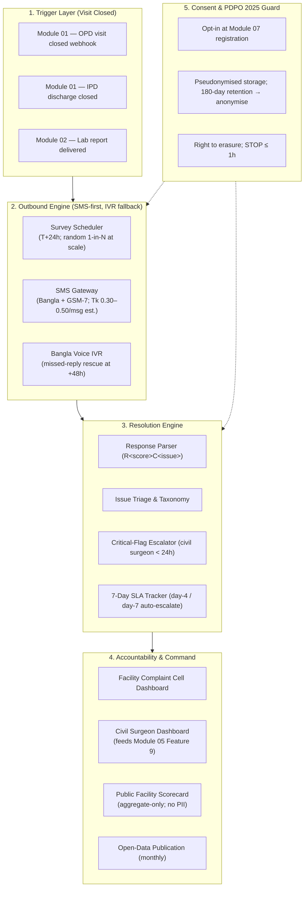
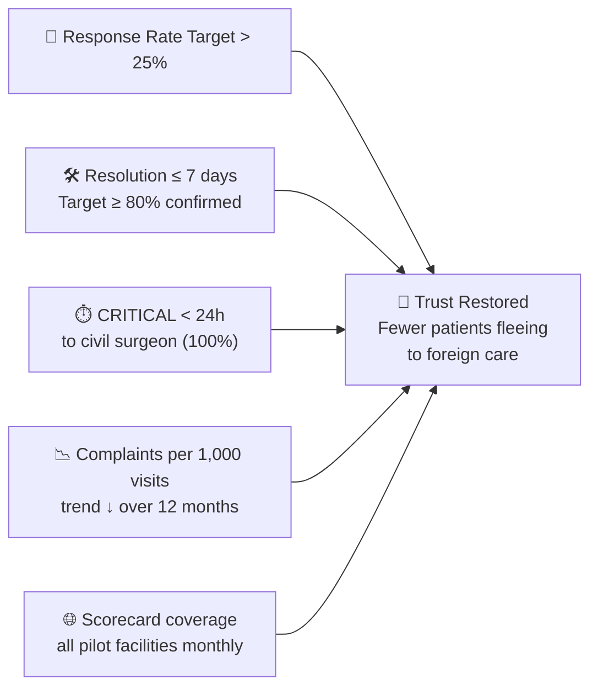

# 📣 ObhijogLoop — Post-Visit Patient Feedback & Grievance Resolution

## Module 14 — Outbound Micro-Surveys, Critical-Flag Escalation & Resolution Tracking (Obhijog / অভিযোগ = Complaint)

> **Tagline**: every visit ends with two questions; every serious complaint reaches the civil surgeon within 24h — reach is not the metric, **resolution is**.

---

## Table of Contents

- [Problem Statement](#problem-statement)
  - [The Trust Gap in Numbers](#the-trust-gap-in-numbers)
  - [Why the 2012 DGHS SMS Complaint System Plateaued](#why-the-2012-dghs-sms-complaint-system-plateaued)
- [International Precedent: India, South Africa & Uganda](#international-precedent-india-south-africa--uganda)
- [System Architecture & Vision](#system-architecture--vision)
- [Capability Deep-Dive 1: The Two-Question Micro-Survey](#capability-deep-dive-1-the-two-question-micro-survey)
- [Capability Deep-Dive 2: 24-Hour Critical-Flag Escalation to the Civil Surgeon](#capability-deep-dive-2-24-hour-critical-flag-escalation-to-the-civil-surgeon)
- [Capability Deep-Dive 3: 7-Day Resolution Tracking & Closure SMS](#capability-deep-dive-3-7-day-resolution-tracking--closure-sms)
- [Capability Deep-Dive 4: Public Facility Scorecard & League Table](#capability-deep-dive-4-public-facility-scorecard--league-table)
- [Capability Deep-Dive 5: Trend Analytics — Ward & Shift Early Warning](#capability-deep-dive-5-trend-analytics--ward--shift-early-warning)
- [Comparative Benchmark](#comparative-benchmark-bangladesh-vs-regional--global-standards)
- [Stakeholder Matrix](#stakeholder-matrix)
- [Success Metrics & National Targets](#success-metrics--national-targets)
- [Sources & Data Notes](#sources--data-notes)

---

## Problem Statement

Bangladesh does not have a listening problem — it has a **closing-the-loop** problem. An inbound SMS complaint system has technically existed since 2012, yet complaints rose 427% to 4,694 in 2017 while a realist evaluation found **low awareness and political dynamics limit its impact** ([Financial Express 2018](https://mail.thefinancialexpress.com.bd/sci-tech/sms-based-complaints-about-public-hospitals-spike-1520049781?amp=true); [BMJ Global Health 2021, e004357](https://gh.bmj.com/content/6/2/e004357)). Patients who suffer a bad visit almost never complain — they simply stop trusting public care and vote with their feet: **~US$5 billion per year is spent on treatment abroad and ~482,000 patients travelled to India in 2024**, citing distrust, hidden charges and fear of fake drugs ([UNB, Dec 2025](https://unb.com.bd/category/Bangladesh/usd-5-billion-spent-abroad-annually-due-to-healthcare-gaps-in-bangladesh-dcci/175121)).

India's **Mera Aspataal** shows the shape of the failure and the fix: **24% of patients dissatisfied (2016–19)**, mainly over **staff behaviour, cost, cleanliness** ([Lok Sabha Unstarred Q.966, 8 Feb 2019](https://cms.neva.gov.in/NeVA/LS/FileStructure/AssemblyFiles/16/17/20190208/Unstarred/966.pdf)). Bangladesh has never run an equivalent **outbound** programme — gap analysis row 21 rates it **NOT PRESENT (outbound)** ([03_global_gap_analysis.md](../../hackathon-research/03_global_gap_analysis.md)) — and a **digital grievance platform is explicitly on the Health Sector Reform Commission's short-term list of 33 proposals** ([The Daily Star](https://www.thedailystar.net/news/bangladesh/news/health-sector-reform-33-proposals-set-implementation-3964871)). ObhijogLoop is the buildable answer: outbound SMS/IVR T+24h after every visit, two questions, automatic escalation of serious complaints to the civil surgeon within 24h, a 7-day resolution SLA confirmed back to the complainant, and a public aggregate scorecard.

> [!CAUTION]
> **This is not another complaint inbox.** The 2012 system failed because it was inbound-only, invisible to patients, and had no resolution SLA or public accountability. ObhijogLoop inverts all three: outbound contact, automatic triage, civil-surgeon escalation <24h, closure SMS, public scorecard.

### The Trust Gap in Numbers

| Indicator / Metric | Ground Statistic | Source & Context |
|:---|:---:|:---|
| **Post-visit dissatisfaction (India benchmark)** | **24%** (2016–19) | Mera Aspataal, Lok Sabha Q.966 — staff behaviour, cost, cleanliness |
| **BD outbound post-visit feedback** | **NOT PRESENT** | Gap analysis row 21; Master Plan reserve idea #3 |
| **DGHS inbound SMS complaints** | Since 2012; +427% to 4,694 by 2017 | Financial Express 2018; BMJ GH 2021 — limited impact |
| **BD inbound channel saturation** | "SATURATED (inbound)" | Gap analysis row 20 |
| **Reform Commission commitment** | Grievance platform on short-term list | The Daily Star — 33 proposals |
| **Treatment abroad** | **~US$5bn/yr**; ~482,000 to India (2024) | UNB (DCCI), Dec 2025 |
| **Out-of-pocket spending** | **79.31%** of current health expenditure (2023) | World Bank WDI / WHO GHED |
| **Avg primary-care consultation** | **48 seconds** (shortest of 67 countries, pooled) | BMJ Open blog, 2017 |
| **Literacy (all / rural)** | **77.7% / 74.6%** | Jagonews24, Dec 2024 |
| **Smartphone use (urban / rural)** | **41% / 26%**; households 73.4% smartphone | GSMA 2024; BBS Jan–Mar 2026 (TBS; Dhaka Tribune) — phones shared |
| **Health-worker violence reported** | **>80% experienced/witnessed; ~25% reported** | CIPRB/ICRC, n=1,703 — feeds Module 16 |
| **Drug unavailability → repeat visits** | 84% of health workers report it | Dhaka Tribune, Jun 2026 |
| **Upazila medical officer vacancies** | 55.2% of posts vacant (4,770 of 10,640) | Prothom Alo, 2018 |
| **Uganda mTrac recovery precedent** | 52,946 workers / 5,684 facilities; **US$400k** recovered (2013) | SDSN TReNDS case study, Sept 2018 |





### Why the 2012 DGHS SMS Complaint System Plateaued

1. **Inbound only** — effort sat entirely on the aggrieved, literate, phone-confident citizen.
2. **No outbound trigger** — the system didn't know a visit had happened; Module 14 fixes this via the Module 01 "visit closed" webhook.
3. **No resolution SLA or closure loop** — complaints were logged, not *resolved and confirmed*.
4. **Low awareness & political dynamics** — patients didn't know it existed; facilities faced no consequence (BMJ GH 2021).

ObhijogLoop has an explicit architectural countermeasure for each (see Deep-Dives below).

---

## International Precedent: India, South Africa & Uganda

**India — Mera Aspataal (outbound post-visit).** The closest analogue and designated model. **24% dissatisfied (2016–19)**, mainly **staff behaviour, cost, cleanliness**; outbound phone/SMS/IVR; published dissatisfaction data pressured hospitals systemically. Strong on measurement, weak on published closure-loop evidence — Module 14 adds the 7-day SLA + complainant confirmation SMS.

**South Africa — MomConnect.** National SMS/USSD push + helpdesk; **1.7M+ women registered by 2017**; **compliments outnumbered complaints 8:1** ([PMC5922497](https://www.ncbi.nlm.nih.gov/pmc/articles/PMC5922497/)). Proof that SMS scales for low-literacy users — and that praise must be a first-class output, not an afterthought.

**Uganda — mTrac.** SMS reporting by health workers + **anonymous citizen complaints**; **52,946 health workers at 5,684 facilities; US$400k misappropriated funds recovered (2013)** ([SDSN TReNDS, Sept 2018 (PDF)](https://files.unsdsn.org/CaseStudy_mTRAC_Sept2018.pdf)). Anonymity was the trust unlock; district accountability converted complaints into recovered resources.

### Lesson Table: What Module 14 Adopts and Rejects

| Programme | What it proves | Honest limit | Adoption decision |
|:---|:---|:---|:---|
| **Mera Aspataal (India)** | Outbound asking works; 24% dissatisfaction measurable & clustered | Strong measurement, weak closure-loop evidence | **Adopt** outbound + taxonomy; **Add** 7-day SLA + closure SMS + public scorecard |
| **MomConnect (South Africa)** | 1.7M+ registered; compliments 8:1 complaints; SMS for low-literacy | Maternal-child scope only | **Adopt** multi-channel SMS/IVR + compliment feed |
| **mTrac (Uganda)** | 52,946 workers; 5,684 facilities; US$400k recovered (2013); anonymity unlocks reporting | Inbound-weighted; 2013-era GSM | **Adopt** anonymity option + district accountability |
| **Kilkari (India)** | Millions reached via voice messages | **Evaluations found negligible effect on care practices/outcomes** (effect sizes not reproduced here — see Data Notes) | **Reject** "messages sent" as metric; **Adopt** resolution rate as headline KPI |
| **DGHS SMS (BD, 2012–)** | Technically feasible; +427% to 4,694 complaints (2017) | Inbound-only; low awareness; political dynamics; no SLA | **Reject** inbound-only; **Adopt** outbound trigger + SLA + public scorecard |
| **Complaint resolution, not star counts** | Framing principle | Star ratings collapse into vanity metrics | **Adopt** % actioned ≤7d and % complainants confirming resolution as headline KPIs |

> [!IMPORTANT]
> **The Kilkari lesson is binding.** Any target written as "SMS sent" or "coverage %" is a reach metric and insufficient. Headline targets: **>25% response rate; ≥80% complaints actioned ≤7 days; ≥70% complainants confirming resolution** (pilot targets — see Success Metrics).

---

## System Architecture & Vision



Module 14 is **thin on clinical data, thick on accountability flow**: a 1–5 rating, an issue category, an optional free-text line. It is a governance instrument, not a clinical record.

---

## Capability Deep-Dive 1: The Two-Question Micro-Survey

**What**: exactly two questions, T+24h after visit close: (1) rate 1–5 (৫=চমৎকার…১=খুবই খারাপ); (2) issue category — staff behaviour / cost / cleanliness / drugs unavailable / long wait / other.

**Bangla SMS body (GSM-7 safe, no clinical data)**:
```text
BD-HealthLoop: গতকালের সেবা কেমন ছিল?
রেটিং ১-৫ দিন (৫=সেরা)। সমস্যা:
1=আচরণ 2=খরচ 3=পরিষ্কার 4=ওষুধ নেই 5=দেরি 6=অন্যান্য
উত্তর: R<রেটিং>C<সমস্যা>, যেমন R2C4
বাতিল: STOP
```

**Why two questions**: Mera Aspataal and MomConnect both show completion collapses beyond 2–3 interactions on basic GSM. `R4C0` (4 stars, no issue) is achievable even for low-literacy users; the IVR rescue covers the rest.

**How**: Module 01 emits `VISIT_CLOSED` → scheduler enqueues T+24h job → gateway dispatch + delivery receipt → inbound webhook parses `R[1-5]C[0-6]` → pseudonymised persist → rating ≤2 or C∈{1,2,4} auto-triages.

**Edge cases**: shared handset (never name facility/patient); no reply 48h → IVR; `STOP`/`বন্ধ` → opt-out ≤1h + ConsentLog; gibberish → one clarification then `UNPARSED` (excluded from KPIs).

---

## Capability Deep-Dive 2: 24-Hour Critical-Flag Escalation to the Civil Surgeon

**What**: rating ≤2 **and** category=staff behaviour, OR keyword match ("ঘুষ" bribe, "মারধর" assault, "extortion") → **CRITICAL**, auto-escalated to the district civil surgeon **<24h** — not queued behind facility self-review.

**Why**: the 2012 system failed precisely here — complaints entered the facility's own queue with no external accountability; political dynamics documented (BMJ GH 2021). Bangladesh's violence data (>80% experienced/witnessed; ~25% reported — CIPRB/ICRC, n=1,703) shows informal channels under-report; a binding 24h district path is the minimum credible floor, and feeds **Module 16 (health-worker violence registry)**.

**How**: keyword-only triggers get 4h human review before external dispatch; rating-1+staff-behaviour dispatches immediately per protocol; civil surgeon gets SMS/pager + Module 05 Feature 9 card; auto day-4 and day-7 re-escalation if facility takes no action; unreachable office → Deputy CS + DGHS grievance cell.

| Severity | Trigger example | Route | SLA |
|:---|:---|:---|:---|
| `CRITICAL` | Rating 1 + staff behaviour; bribe/assault keyword | Civil Surgeon + Facility Cell | **< 24h** |
| `HIGH` | Rating ≤2 + cost or drugs; repeat within 30d | Facility Cell + weekly digest to CS | 48h ack |
| `STANDARD` | Rating 3, single issue | Facility Cell | 7 days |
| `COMPLIMENT` | Rating ≥4, no issue | Cell + recognition feed | Monthly log |

**Edge cases**: false keyword → 4h human triage; festival/holiday → SLA continues, backup officer auto-notified; identity never disclosed; all access audit-logged.

---

## Capability Deep-Dive 3: 7-Day Resolution Tracking & Closure SMS

**What**: HIGH/CRITICAL tickets carry a 7-day SLA with day-4/day-7 auto-escalation; the complainant gets two confirmation SMS events:

- Acknowledgement: `আপনার অভিযোগটি গ্রহণ করা হয়েছে। অভিযোগ নম্বর: OGL-2026-00123। ৭ দিনের মধ্যে জানানো হবে।`
- Resolution: `আপনার অভিযোগটি সমাধান হয়েছে। OGL-2026-00123। সন্তুষ্ট হলে 1, না হলে 2 চাপুন।`

**Why**: the 2012 system's silence killed reporting; MomConnect's 8:1 compliment ratio shows acknowledgement drives engagement. Complainant confirmation produces the second KPI: **% complainants confirming resolution** — the metric that separates this from star counts.

**How**: ticket state machine `SENT → DELIVERED → RESPONDED → TRIAGED → ACTIONED | DISMISSED | ESCALATED` (full diagram in APP_FLOW.md); Redis timers; closure requires complainant `1` confirmation **or** facility evidence after 72h silence — unconfirmed closures are reported as `RESOLVED_UNCONFIRMED`, never counted as resolved.

**Edge cases**: unreachable after resolution (3 attempts) → `RESOLVED_UNCONFIRMED`; complainant disputes (`2`) → reopen + CS day-2; bereavement → no SMS ever (APP_FLOW Journey 7); anonymous → closure logged, no SMS.

---

## Capability Deep-Dive 4: Public Facility Scorecard & League Table

**What**: monthly aggregate publication of every participating facility: response rate, rating distribution, % resolved ≤7d, staff-behaviour rate, drugs-unavailable rate. Ranked league table; **no patient-level data**; facilities <30 responses/month unranked ("পর্যাপ্ত ডেটা নেই").

**Why**: the hackathon brief demands "every penny spent transparently" — a public scorecard is governance made legible, the same pattern as Module 04's anti-dalal dashboard and Module 06's public stock board. India published Mera Aspataal dissatisfaction data to institutional effect; BD's opacity enables impunity (1,027 facilities unlicensed, DGHS 2024).

**How**: score = 0.4·resolution + 0.3·rating + 0.15·response + 0.15·trend; published at proposed `obhijog.dghs.gov.bd` as HTML + open CSV/JSON; k≥10 cell suppression; CS gets district drill-down via Module 05 Feature 9; facility may append (not overwrite) an explanatory note.

**Edge cases**: small facilities suppressed; gaming → rate-limit + pattern detection + 5% random audit; retaliation fears → aggregate-only, anonymous channel preserved; dengue-surge months flagged as surge context, not ranked punitively.

---

## Capability Deep-Dive 5: Trend Analytics — Ward & Shift Early Warning

**What**: staff-behaviour complaint rate sliced by **facility × ward × shift × day-of-week**; drugs-unavailable rate correlated with Module 06 stock-out feed; cost complaints correlated with facility ownership type.

**Why**: singles are noise; patterns are signal. Night-shift staff-behaviour complaints in one ward over 90 days is a leading indicator for attendant/relative violence (Module 16) — actionable *before* physical assault. Drugs-unavailable validated vs Module 06 eLMIS becomes ground-truth for procurement reform.

**How**: nightly rollup → 28-day rolling heatmap → threshold alerts (>3 staff-behaviour complaints in a ward/30d → district notification) → quarterly export to DGHS reform cell + Module 05 Feature 9.

**Edge cases**: misattributed ward → officer confirms; low-volume wards → rolling windows; small cells → k≥10 suppression; seasonality → surge flag; political pressure to hide a ward → publication mandatory, audit log.

---

## Comparative Benchmark: Bangladesh vs Regional & Global Standards

| Dimension / Metric | Bangladesh (2012 SMS, inbound) | India (Mera Aspataal) | South Africa (MomConnect) | Uganda (mTrac) | **Module 14 (ObhijogLoop)** |
|:---|:---|:---|:---|:---|:---|
| **Direction** | Inbound only | Outbound post-visit | Push + inbound helpdesk | Inbound (worker + citizen) | **Outbound T+24h + IVR rescue** |
| **Channel** | SMS | Phone/SMS/IVR | SMS/USSD | SMS | **SMS + Bangla IVR (+ paper exit survey)** |
| **Dissatisfaction measured** | No | **24% (2016–19)** | n/d (compliment-led) | n/d | **Measured from month 1** |
| **Resolution SLA** | None | Not published | Not published | Not published | **7 days; day-4/day-7 escalation** |
| **Complainant confirmation** | No | Not published | Yes (helpdesk loop) | Partial | **Yes — closure SMS Y/N** |
| **Public accountability** | None | Aggregate reporting | Programme-level | District reports | **Public scorecard + open data** |
| **Escalation to district officer** | No | No | No | Yes (district) | **Yes — civil surgeon < 24h** |
| **Financial recovery proof** | No | n/d | n/d | **US$400k (2013)** | Target: informal-fee & leakage reduction |
| **Low-literacy accommodation** | Partial | Yes (IVR) | Yes | Yes | **Mandatory (77.7% / 74.6% rural)** |
| **PDPO 2025 alignment** | n/a | n/a | n/a | n/a | **Opt-in; pseudonymised; 180-day anonymisation** |

---

## Stakeholder Matrix

| Stakeholder | Key Frustrations | System Solution | Measured Benefit |
|:---|:---|:---|:---|
| **Patients & families** | No voice post-visit; fear of retaliation; hidden charges | 2-question SMS/IVR; closure SMS; aggregate-only publication | Dignity restored; closure ≤7 days |
| **Family caregivers (shared handsets)** | Privacy on shared phones | No PII/diagnosis in SMS; STOP opt-out | Safe participation |
| **Facility complaint cell** | Unmanageable inbox; no prioritisation | Triage engine; SLA auto-reminders; audit trail | Workload → real signal |
| **Civil surgeons (64)** | Blind to grievance patterns | 24h CRITICAL alerts + Module 05 F9 drill-down; ward/shift heatmap | Early warning; targeted inspection |
| **DGHS / Reform Commission** | Commitment without delivery instrument | Ready platform feeding Reform Commission short-term list | Visible quick win |
| **Facility staff / leadership** | Fear of naming; survey fatigue; unfair single complaints | Aggregate-only publication; compliments wall; audits | Recognition; fair process |
| **Reform Commission & donors (WHO/MoHFW)** | No verifiable accountability KPI | Open data; resolution-rate KPI; Tk 0.30–0.50/SMS | Auditable stewardship |
| **Module 16 (violence registry)** | Under-reporting attendant/relative violence | Staff-behaviour complaint feed = leading indicator | Earlier de-escalation |

---

## Success Metrics & National Targets



- **Response rate**: target **>25%** (pilot-validated; Mera Aspataal doesn't publish its rate — label as target, not fact).
- **Resolution SLA**: ≥**80%** actioned ≤**7 days**; complainant-confirmation target ≥**70%** (unconfirmed tracked separately).
- **Critical escalation**: **100%** reach civil surgeon **<24h** (hard, audited protocol).
- **Complaints per 1,000 visits**: baseline in pilot months 1–2; target — **downward trend over 12 months**.
- **Scorecard coverage**: 100% of pilot facilities published monthly by month 3.
- **Staff-behaviour rate**: Module 16 leading indicator; ≥**40%** of flagged wards get corrective action ≤30d.
- **Cost**: SMS ~**Tk 0.30–0.50** (estimate); 100k surveys ≈ **Tk 30,000–50,000** [illustrative] — cheaper than one patient lost abroad.
- **Pilot scope**: five e-Health Card districts — **Khulna, Noakhali, Bogura, Sirajganj, Narsingdi** (Module 07) — then national; feeds Reform Commission digital grievance platform commitment.
- **PDPO 2025**: 100% opt-in logging; 180-day retention → anonymise; aggregate-only publication; zero clinical data.

---

## Sources & Data Notes

1. Mera Aspataal — 24% dissatisfied (2016–19); staff behaviour, cost, cleanliness — [Lok Sabha Unstarred Q.966 (PDF)](https://cms.neva.gov.in/NeVA/LS/FileStructure/AssemblyFiles/16/17/20190208/Unstarred/966.pdf).
2. MomConnect — 1.7M+ registered (2017); compliments:complaints 8:1 — [PMC5922497](https://www.ncbi.nlm.nih.gov/pmc/articles/PMC5922497/).
3. mTrac — 52,946 workers; 5,684 facilities; US$400k recovered (2013) — [SDSN TReNDS (PDF)](https://files.unsdsn.org/CaseStudy_mTRAC_Sept2018.pdf).
4. DGHS SMS 2012–; +427% to 4,694 (2017); low awareness, political dynamics — [Financial Express 2018](https://mail.thefinancialexpress.com.bd/sci-tech/sms-based-complaints-about-public-hospitals-spike-1520049781?amp=true); [BMJ GH 2021 e004357](https://gh.bmj.com/content/6/2/e004357).
5. Grievance platform on Reform Commission short-term list — [The Daily Star](https://www.thedailystar.net/news/bangladesh/news/health-sector-reform-33-proposals-set-implementation-3964871).
6. ~US$5bn/yr abroad; 482,000 patients to India (2024) — [UNB, Dec 2025](https://unb.com.bd/category/Bangladesh/usd-5-billion-spent-abroad-annually-due-to-healthcare-gaps-in-bangladesh-dcci/175121).
7. OOP — **79.31%** (2023, WB WDI/WHO GHED); BNHA gives 68.5–69% (2020). Use this series.
8. Literacy 77.7%/74.6% (Jagonews24 Dec 2024); smartphone 41%/26% (GSMA 2024 via [TBS](https://www.tbsnews.net/node/1013061)); households 73.4% smartphone/57.4% internet (BBS Jan–Mar 2026 via [Dhaka Tribune](https://www.dhakatribune.com/bangladesh/415972/bbs-survey-over-57%25-of-bangladeshi-households-now)); phones shared → proxy design.
9. 48-second consultation (shortest of 67; pooled, not national survey) — [BMJ Open blog, 2017](https://blogs.bmj.com/bmjopen/2017/11/08/primary-care-consultations-last-less-than-5-minutes-for-half-the-worlds-population/).
10. Violence: >80% experienced/witnessed; ~25% reported; 71.9% by attendants/relatives — CIPRB/ICRC, n=1,703.
11. 84% unavailability-return — [Dhaka Tribune Jun 2026](https://www.dhakatribune.com/bangladesh/health/413839/inside-bangladesh%E2%80%99s-community-clinics-promise); 55.2% UPA MO posts vacant — [Prothom Alo, 2018](https://en.prothomalo.com/bangladesh/Unhealthy-state-of-health-services-for-rural).
12. 16263 call volumes contested (~3,000–6,500/day; arrears 17–22 months) — cited qualitatively only.
13. PDPO 2025 — gazetted 6 Nov 2025; health data = sensitive personal data; explicit consent; ~May 2027 partial effect (estimate); enforcement [uncertain] — [TBS](https://www.tbsnews.net/node/1281356); [The Daily Star](https://www.thedailystar.net/tech-startup/news/bangladeshs-personal-data-protection-ordinance-2025-key-takeaways-4015401).
14. Gap analysis rows 20–21; Master Plan §5.5 reserve idea #3 — [03_global_gap_analysis.md](../../hackathon-research/03_global_gap_analysis.md); [MASTER_PLAN.md](../../hackathon-research/MASTER_PLAN.md).
15. Cross-refs: [Module 01](../01-appointment/README.md) (trigger), [Module 02](../02-test-reports/README.md) (lab), [Module 04](../04-icu-beds/README.md) (transparency pattern), [Module 05 F9](../05-integrated-system/FEATURES.md) (Command Center), [Module 06](../06-medicine-stock/README.md) (stock validation), [Module 07](../07-health-card/README.md) (consent), [Module 16] (violence registry).

**Data notes & honesty flags**:
- **Kilkari**: qualitative reach≠outcome lesson only; no effect sizes reproduced (not re-verified this session).
- **SMS Tk 0.30–0.50** is an **estimate**, not a telco quote; pilot must confirm.
- **>25% response / 80% SLA / 70% confirmation** are **pilot targets**, not measured results.
- **4,694 (2017) implies ~890 in 2012** (base year derived from "+427%"; not independently published; unused elsewhere).
- Mera Aspataal category-wise dissatisfaction percentages **not published**; only ordering (staff behaviour, cost, cleanliness) used.
- Inbound 2012 system's current status **not publicly verified**; design assumes inbound, low-impact.
