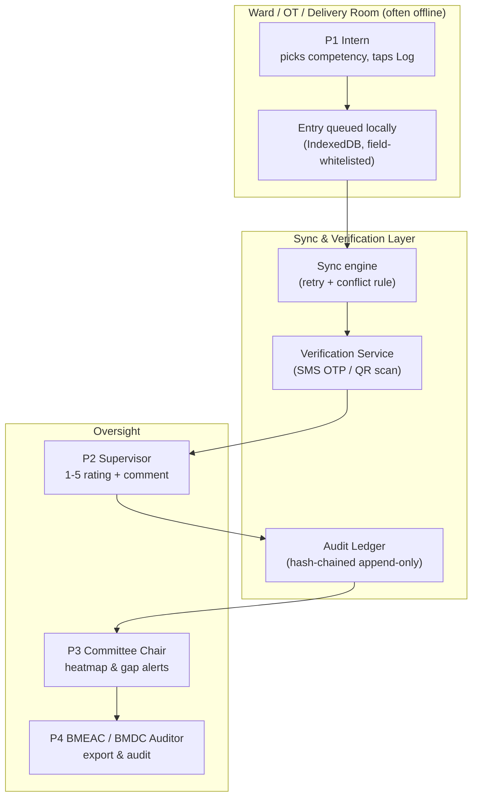
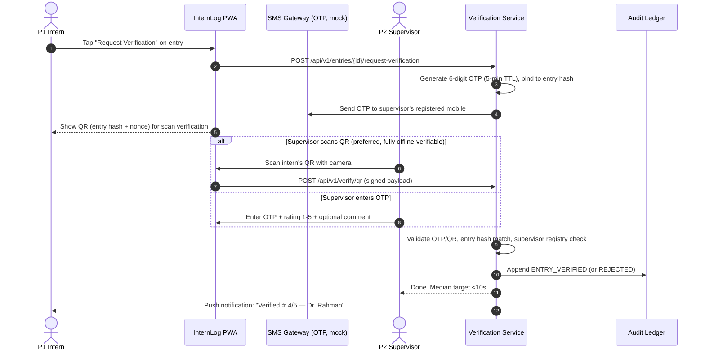
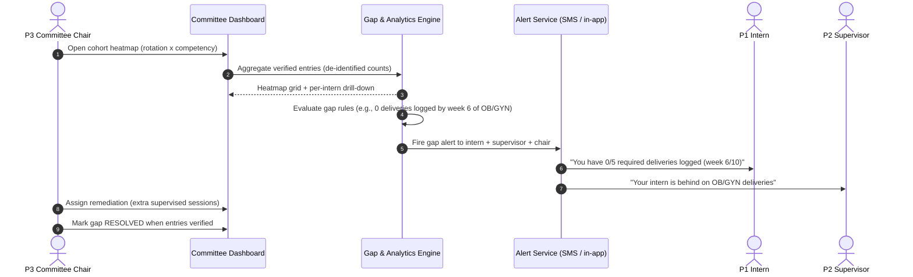
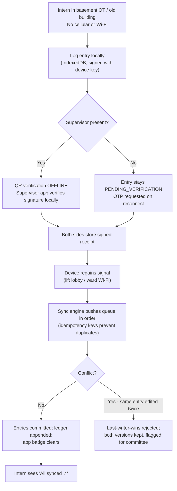

# 🔄 Application Flow — InternLog MBBS Internship Competency E-Logbook

## Module 15 — Intern Journeys, Supervisor Verification, Committee Heatmaps & Audit Escalation

> **Tagline:** scan, tap, done — interns log procedures on their phone; supervisors confirm in 10 seconds; committees finally see who actually did what.

---

## Table of Contents

- [Personas](#personas)
- [System Interaction Overview](#system-interaction-overview)
- [Journey 1: Intern Onboarding & BMDC Verification](#journey-1-intern-onboarding--bmdc-verification)
- [Journey 2: One-Tap Procedure Logging (with Offline Queue)](#journey-2-one-tap-procedure-logging-with-offline-queue)
- [Journey 3: Supervisor OTP / QR Verification (10 Seconds)](#journey-3-supervisor-otp--qr-verification-10-seconds)
  - [Competency Entry State Machine](#competency-entry-state-machine)
- [Journey 4: Committee Review — Heatmap & Gap Alerts](#journey-4-committee-review--heatmap--gap-alerts)
- [Journey 5: BMEAC Accreditation Evidence Export & Audit](#journey-5-bmeac-accreditation-evidence-export--audit)
- [Journey 6: Offline → Sync (Hospital Basements & Scanners)](#journey-6-offline--sync-hospital-basements--scanners)
- [Journey 7: Edge Cases & Escalation Protocols](#journey-7-edge-cases--escalation-protocols)
- [Cross-Journey Summary Table](#cross-journey-summary-table)

---

## Personas

| ID | Persona | Role | Primary Pain Today | What They Get |
|:---|:---|:---|:---|:---|
| **P1** | **Intern** | Logs procedures; requests verification | Signature-only assessment; ~54% get no assessment after major rotations | One-tap logging; 1–5 feedback; personal gap view |
| **P2** | **Supervising Resident / Consultant** | Verifies entries; rates 1–5; comments | 41–43% vacant teaching posts; paperwork with no value | <10s sign-off; fraud-flagged bulk approvals visible |
| **P3** | **Internship Committee Chair** (college) | Cohort heatmaps; gap closure; rotation sign-off | No visibility until rotation end; paper lost | Real-time heatmap; gap alerts; de-identified exports |
| **P4** | **BMEAC / BMDC Auditor** | Read-only national/college audit; accreditation evidence | ~100 colleges unaccredited; no objective evidence | Hash-verified evidence pack; tamper-evident ledger |
| (P5) | **Department Head** (escalation) | Steps in when supervisor unavailable ≥2 weeks | Silent rotations; unverifiable entries | Auto-routed escalation queue |
| (P6) | **DGME / BMDC Registry** (system) | Issues/verifies intern identity (BMDC reg no) | Paper records never reach registry | API-verified identity; on-request extract |

---

## System Interaction Overview



---

## Journey 1: Intern Onboarding & BMDC Verification

**Goal:** a verified intern identity (BMDC registration number) before any logging. No parallel identity system — reuses Module 07 (BD Health Card) patterns.

```mermaid
sequenceDiagram
    autonumber
    actor Intern as P1 Intern
    participant App as InternLog PWA
    participant HC as 07 Health Card / BMDC Registry (mock API)
    participant DB as InternLog Core

    Intern->>App: Sign up with BMDC reg no + phone
    App->>HC: GET /api/v1/bmdc/verify?reg=BD-12345
    HC-->>App: Verified: name, college, internship batch, rotation schedule
    App->>DB: Create Intern profile (reg no as key; no patient data)
    DB-->>App: Profile created; onboarding checklist
    Intern->>App: Select current rotation (per BMDC programme)
    App-->>Intern: Competency list for that rotation loaded
```

**Steps & rules**
1. **BMDC reg no + mobile OTP** proves identity; no NID/biometric required at MVP.
2. Rotation schedule is pulled from the college's uploaded roster (admin-imported CSV) or selected manually by the intern and confirmed by the committee.
3. If BMDC lookup fails (mock API down / number not found), onboarding is **blocked with a clear error** — never silently allowed; the committee can pre-approve a reg no manually with a reason logged to the audit trail.
4. One intern account per BMDC reg no; duplicate device logins are allowed but logged.

**Edge cases**
- Reg no typo → inline validation against mock registry format; 3 failed lookups → route to committee helpdesk.
- Intern transferred colleges mid-year → rotation roster re-import; history retained under same reg no.
- Graduated/struck-off intern logs in → registry flag `INTERNSHIP_COMPLETE` or `SUSPENDED` blocks logging.

---

## Journey 2: One-Tap Procedure Logging (with Offline Queue)

**Goal:** log a supervised procedure in **under 15 seconds**, with **zero patient identifiers**.

```mermaid
sequenceDiagram
    autonumber
    actor Intern as P1 Intern
    participant App as InternLog PWA (offline-capable)
    participant Queue as Local Queue (IndexedDB)
    participant API as InternLog API
    participant Audit as Hash-Chained Audit Ledger

    Intern->>App: Pick rotation -> competency -> role (SUPERVISED/ASSISTED/OBSERVED)
    App->>App: Auto-stamp date/time; NO patient fields exist in form
    Intern->>App: Tap "Log Entry"
    alt Online
        App->>API: POST /api/v1/entries (whitelisted fields only)
        API->>API: Field whitelist validation (reject anything else)
        API->>Audit: Append ENTRY_CREATED (hash chain)
        API-->>App: Entry ID + status DRAFTED -> OTP_SENT
    else Offline (basement / no signal)
        App->>Queue: Enqueue entry (signed locally, device key)
        Queue-->>App: Saved; badge "1 pending sync"
        App-->>Intern: Entry stored locally; will sync automatically
    end
```

**Field whitelist (the only fields that may exist):** `competency_id`, `rotation_id`, `role`, `performed_at`, `intern_reg_no`, `supervisor_id` (optional until verified), `intern_note` (≤280 chars, pattern-screened for ID-like digit runs). Nothing else — no name, age, sex, diagnosis, ward, bed, phone, NID or Health ID of any patient. Ever.

**Steps & rules**
1. Role defaults to `SUPERVISED`; intern may downgrade to `ASSISTED`/`OBSERVED` — never self-upgrade.
2. Same competency can be logged repeatedly (exposure counting, not a checkbox).
3. Same competency + date + role within 60 min → **probable duplicate** flag (not auto-rejected); committee sees flags.
4. Entries immutable once `VERIFIED`; corrections create a linked `CORRECTION_OF` entry.

---

## Journey 3: Supervisor OTP / QR Verification (10 Seconds)

**Goal:** the supervisor confirms the procedure happened and rates the intern — in under 10 seconds, from their own phone, with no training.



### Competency Entry State Machine

```mermaid
stateDiagram-v2
    [*] --> DRAFTED: Intern taps Log
    DRAFTED --> OTP_SENT: Intern requests verification<br/>(OTP via SMS or QR issued)
    OTP_SENT --> VERIFIED: Supervisor scans QR / enters OTP<br/>+ 1-5 rating
    OTP_SENT --> REJECTED: Supervisor rejects<br/>(not performed / not supervised / wrong role)
    OTP_SENT --> EXPIRED: OTP TTL (5 min) or<br/>72h request window lapses
    REJECTED --> DRAFTED: Intern corrects & re-requests
    EXPIRED --> DRAFTED: Intern re-requests<br/>(max 3 attempts per entry)
    VERIFIED --> [*]: Immutable; correction = linked new entry
```



**Verification rules**
1. OTP is **single-use**, 6 digits, 5-min TTL, bound to the entry hash — a forwarded OTP verifies only that one entry; repeated failures/shares raise a **fraud flag**.
2. QR embeds entry hash + nonce; supervisor app verifies the signature **offline**; server confirms on next sync. Right design for signal-dead theatres.
3. Rating **1–5** (1 unsafe · 3 supervised-acceptable · 5 independent-ready); comment **required if rating ≤2**.
4. Supervisor identity: BMDC reg no (mock-verified) or college staff ID; residents scoped to own department unless committee grants cross-dept rights.
5. Median response target **<10 min**; the interaction itself **<10 sec**; both tracked as KPIs.

---

## Journey 4: Committee Review — Heatmap & Gap Alerts

**Goal:** the internship committee chair sees, per intern and per cohort, who has actually done what — before rotation end.



**Steps & rules**
1. Heatmap cell = verified entries vs BMDC-recommended minimum exposures (thresholds configurable; defaults from typed BMDC competency list, marked **[illustrative]** until transcription is complete).
2. **Gap alerts** fire at configurable checkpoints (week 2 / 6 / 10 of each rotation) by SMS + in-app; unacknowledged alerts escalate to chair at rotation midpoint.
3. Committee can export the heatmap as PDF/CSV for college council minutes.
4. Benchmarking across colleges is **de-identified** (k≥10 cohorts) — a college sees its own distribution vs national percentiles only; no college names are shown to peers.
5. Rotation completion requires: all mandatory competencies ≥ minimum exposures **or** a committee-signed waiver with reason (logged, audited).

---

## Journey 5: BMEAC Accreditation Evidence Export & Audit

**Goal:** produce, in one click, a hash-verified evidence pack for BMEAC accreditation — the "why colleges will pay/mandate" journey.

```mermaid
sequenceDiagram
    autonumber
    actor Auditor as P4 BMEAC / BMDC Auditor
    participant Console as Auditor Console (read-only)
    participant Export as Evidence Export Service
    participant Ledger as Audit Ledger (hash chain)
    actor Chair as P3 Committee Chair

    Auditor->>Console: Request evidence pack (college, rotation, period)
    Console->>Export: Generate de-identified pack
    Export->>Ledger: Verify hash chain integrity (tamper check)
    Ledger-->>Export: Chain valid / broken at entry #N
    Export-->>Console: Pack: coverage %, verified counts, response-time stats, gap closures, waiver log
    Auditor->>Console: Download signed PDF + CSV (+ verification hash)
    Console->>Chair: Pack request logged; college notified (no data beyond pack)
```

**Steps & rules**
1. Exports are **de-identified**: no patient data exists by design; intern reg nos are pseudonymised per-export with a sealed key held by BMDC (re-identification only by lawful order).
2. Every export records: who requested, what scope, hash-chain verification result, download timestamp — appended to the ledger.
3. Broken hash chain → export is watermarked **"INTEGRITY FAILURE — DO NOT USE"** and BMDC is auto-notified; affected entries quarantined pending investigation.
4. BMEAC can request a pack for any college with a registered intern cohort; colleges see that a request occurred (transparency, no covert audits).

---

## Journey 6: Offline → Sync (Hospital Basements & Scanners)

**Goal:** full functionality below ground and in signal-dead zones; zero data loss.



**Offline rules**
1. **Writes never block.** Logging works 100% offline; verification works offline via QR (asymmetric signature) only — SMS OTP requires connectivity and is queued as `OTP_PENDING`.
2. **Idempotency keys** (`client_uuid`) guarantee a retried sync never double-counts an entry.
3. **Clock skew:** entries carry device time + server receipt time; >15-minute skew is flagged (not rejected) for audit visibility.
4. **Storage cap:** queue holds up to 500 entries; oldest flagged if exceeded (never silently dropped).
5. Basement procedure rooms are a first-class target: the MVP demo includes an airplane-mode logging flow.

---

## Journey 7: Edge Cases & Escalation Protocols

| # | Scenario | Failure Mode / Threat | System Defense & Protocol |
|:---|:---|:---|:---|
| E1 | **Supervisor unavailable ≥ 2 weeks** | Entry stuck `OTP_SENT`; rotation blocked | Auto-escalation to **department head** at day 14; chair at day 21; head may verify with comment "SUPERVISOR_ABSENT — verified by HoD"; logged, audited |
| E2 | **OTP shared / forwarded** ("just verify it yourself") | Self-verification fraud | OTP bound to entry hash + device fingerprint; mismatch → **fraud flag**; 3 flags → quarantine, chair + BMDC notified. QR mode defeats this (needs physical scan) |
| E3 | **Duplicate entries** (double-tap, sync replay) | Inflated counts | `client_uuid` idempotency; same competency+date+role ≤60 min → flag, never auto-delete |
| E4 | **Intern logs procedure they did NOT do** | False competency record | Verification is the control; plus **5% random spot re-verification** per rotation under observation; mismatch → entry voided, integrity review |
| E5 | **Bulk approvals at 03:00** | Rubber-stamping | Anomaly detection: >20 verifies/10 min, all-5s, identical comments → flag to chair; visible, not auto-blocked |
| E6 | **Phone lost / number changed** | Orphaned verifications | Re-issue via BMDC reg no; pending requests expire (72h); device keys rotated; ledger unaffected |
| E7 | **Wrong rotation competency logged** | Data noise | Server enforces roster context; wrong-rotation rejected with guidance |
| E8 | **Intern disputes a rejection** | Unfair rejection; morale | One-tap "Request re-review" → department head; uphold/overturn; `VERIFIED_ON_REVIEW`; all kept in ledger |
| E9 | **College refuses to mandate** | Shelfware | Position as **BMEAC evidence requirement** (~100 unaccredited colleges); DGME/BMDC circular |
| E10 | **Crisis answer in wellbeing check-in** | Missed deterioration | Not a clinical tool; static helpline screen + counsellor suggestion; **nothing stored** unless intern taps "log it"; links Module 16 |
| E11 | **Hash chain broken** (tamper/bug) | Evidence invalid | Export watermarked `INTEGRITY FAILURE`; BMDC auto-alert; restore from WAL to last valid checkpoint |
| E12 | **Supervisor verifies, intern not rostered that day** | Proxy logging | Cross-check vs roster; mismatch → flag (not block) — night/theatre duties often unrostered |

---

## Cross-Journey Summary Table

| Journey | Actor(s) | Key Artifact | State / Outcome | Offline-capable | SLA / Target |
|:---|:---|:---|:---|:---:|:---|
| **J1 Onboarding & BMDC verify** | P1, system | Verified profile (reg no) | `PROFILE_ACTIVE` | Partial (roster cache) | < 2 min |
| **J2 One-tap logging** | P1 | LogEntry (whitelisted) | `DRAFTED` | **Yes (100%)** | < 15 sec |
| **J3 Supervisor verification** | P1, P2 | Signed Verification + 1–5 rating | `OTP_SENT → VERIFIED/REJECTED/EXPIRED` | QR yes / SMS no | Interaction < 10 sec; median response < 10 min |
| **J4 Committee heatmap & gaps** | P3 | Heatmap + gap alert | `GAP_OPEN → RESOLVED / WAIVED` | View cached; actions need sync | Alerts at wk 2/6/10 |
| **J5 BMEAC evidence export** | P4, P3 | Signed evidence pack (PDF/CSV) | `EXPORT_ISSUED` / `INTEGRITY_FAILURE` | No (requires ledger) | < 30 sec generation |
| **J6 Offline → sync** | P1 | Synced, deduplicated ledger entries | `PENDING_SYNC → COMMITTED` | **Yes (core)** | On reconnect, minutes |
| **J7 Edge cases & escalation** | P3, P5, P4 | Escalation / fraud flags / waiver | Varies (see table) | n/a | Escalate day 14 / 21 |

**Design invariants across all journeys**
1. **No patient identifiers — ever** (field whitelist; enforced twice: client form + server validator + DB constraint).
2. **Every state change is appended to the hash-chained ledger** — nothing is silently edited or deleted.
3. **Verification, not self-assertion, unlocks "competent" status** — the supervisor is the gate; the committee is the auditor; BMEAC is the external check.
4. **Graceful degradation** — basements, no signal, dead phones: the system queues, never blocks, never loses.
