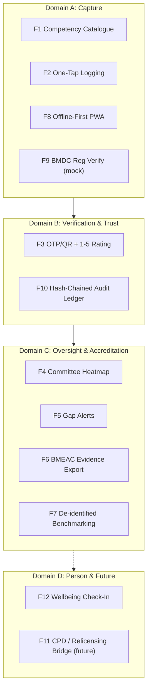

# ⚡ Functional Specifications & Feature Catalog — Module 15

## InternLog — MBBS Internship Competency E-Logbook

> **Tagline:** scan, tap, done — interns log procedures on their phone; supervisors confirm in 10 seconds; committees finally see who actually did what.
>
> **Scope guardrail:** InternLog is a **procedural exposure log**, not a knowledge assessment, not a patient-record system, and **not for postgraduates** (the BCPS FCPS e-logbook is being piloted separately — [BCPS newsletter](https://bcps.edu.bd/it_inhouse/newsletter)). See [Out of Scope](#out-of-scope).

---

## Table of Contents

- [Domain Map](#domain-map)
- [Feature 1: Competency Catalogue per Rotation (from BMDC Paper)](#feature-1-competency-catalogue-per-rotation-from-bmdc-paper)
- [Feature 2: One-Tap Entry Logging (Zero Patient Identifiers)](#feature-2-one-tap-entry-logging-zero-patient-identifiers)
- [Feature 3: Supervisor OTP / QR Approval + 1–5 Rating](#feature-3-supervisor-otp--qr-approval--15-rating)
- [Feature 4: Rotation-Completion Heatmap for Committees](#feature-4-rotation-completion-heatmap-for-committees)
- [Feature 5: Gap Alerts (e.g., 0 Deliveries Logged by Week 6 OB/GYN)](#feature-5-gap-alerts-eg-0-deliveries-logged-by-week-6-obgyn)
- [Feature 6: Evidence Export for BMEAC Accreditation](#feature-6-evidence-export-for-bmeac-accreditation)
- [Feature 7: Multi-College Benchmarking (De-identified)](#feature-7-multi-college-benchmarking-de-identified)
- [Feature 8: Offline-First PWA](#feature-8-offline-first-pwa)
- [Feature 9: BMDC Registration Verification API (Mock)](#feature-9-bmdc-registration-verification-api-mock)
- [Feature 10: Tamper-Evident Audit Log (Hash Chain)](#feature-10-tamper-evident-audit-log-hash-chain)
- [Feature 11: CPD / Relicensing Bridge (Future)](#feature-11-cpd--relicensing-bridge-future)
- [Feature 12: Intern Wellbeing Check-In (Optional, 2 Questions)](#feature-12-intern-wellbeing-check-in-optional-2-questions)
- [Feature Matrix](#feature-matrix)
- [Out of Scope](#out-of-scope)

---

## Domain Map

---

## Feature 1: Competency Catalogue per Rotation (from BMDC Paper)

**What.** The structured competency list for each rotatory-internship rotation (Medicine, Surgery, OB/GYN, Paediatrics, Emergency, etc.), **typed in manually from the BMDC Rotatory Internship Programme PDF** — the same list the paper booklet uses. Each competency carries: `id`, `rotation`, `title`, `minimum exposures [illustrative until transcribed]`, `role allowed`, `gap-alert checkpoint`.

**Why.** The BMDC rotatory logbook is **paper** ([BMDC PDF](https://www.bmdc.org.bd/docs/RotatoryInternshipProgramme.pdf)); digitising the *exact same* competency list guarantees the e-logbook is a superset of the legal requirement, not a reinvention — colleges adopt it without a syllabus fight. (Note: the BMDC PDF returned HTTP 403 during research — transcription is a manual pilot-team task.)

**How.**
1. Pilot team transcribes the BMDC PDF → `competency_catalogue.csv` (rotation, competency, min exposures); reviewed by 2 faculty + 1 BMDC nominee; version-pinned (`catalogue_v1`).
2. Seeded into Postgres, versioned; changes require committee sign-off, ledger-logged.
3. Example (**[illustrative]** — NOT official BMDC): OB/GYN — "normal vaginal delivery", "assisted breech delivery", "PPH first response", "episiotomy repair"; min 5 / 2 / 1 / 3 exposures.
4. UI shows only the current rotation's list; full catalogue browsable read-only.

**Edge cases.** BMDC revises programme → new `catalogue_vN`; old entries keep version ref; absent competency cannot be logged (whitelist). Disputed wording → committee adjudicates, logged.

---

## Feature 2: One-Tap Entry Logging (Zero Patient Identifiers)

**What.** The core capture flow: rotation → competency → role (`SUPERVISED` / `ASSISTED` / `OBSERVED`) → date → tap **Log**. No patient fields exist anywhere in the data model.

**Why.** >66% of interns say a logbook signature is their main assessment and ~54% get **no assessment** after major rotations ([BJME 32243](https://banglajol.info/index.php/BJME/article/view/32243)); paper adds no traceability. A 15-second log is the only version supervisors and interns will actually use.

**How.**
1. Date auto-stamped (editable ±72h with reason); role defaults `SUPERVISED`.
2. **Field whitelist** at 3 layers: client zod → API validator (rejects unknown keys) → Postgres trigger + CI migration lint (see IMPLEMENTATION.md §Security).
3. `intern_note` ≤280 chars, digit-pattern screened; rejected with guidance if ID-like.
4. Repeated exposures encouraged (counting tool); duplicates flagged, never blocked.
5. Entry lands `DRAFTED` → requests verification (Feature 3).

**Edge cases.** Late retroactive logging → ≤72h allowed; older needs committee approval with reason. Double-tap → idempotent via `client_uuid`. Patient details pasted into note → rejected by pattern screen; repeats flagged to chair.

---

## Feature 3: Supervisor OTP / QR Approval + 1–5 Rating

**What.** Verification request → supervisor receives **6-digit SMS OTP** (mock gateway) or scans the intern's **QR** → rates competency **1–5** (anchored: 1 unsafe, 3 supervised-acceptable, 5 independent-ready) → optional comment (**mandatory if rating ≤2**) → done. Target **<10 seconds**.

**Why.** Sign-off friction kills adoption; Horus works because feedback is short. OTP binds the approval to a specific person, entry and time — the primitive paper lacks. Fake sign-offs become statistically visible (bulk timestamps, all-5s).

**How.**
1. Entry hash + nonce in QR; QR verifiable **offline** (Ed25519); SMS OTP needs signal.
2. OTP: single-use, 5-min TTL, 3 attempts → `EXPIRED`; 72h request window.
3. Supervisor: BMDC reg no (mock) or college staff ID; residents scoped to own department unless committee grants cross-dept rights.
4. Ratings feed heatmap (F4) and gap engine (F5); comments auditable, not public.
5. Median response tracked; goal <10 min; interaction <10 sec.

**Edge cases.** OTP shared → fraud flag (device fingerprint); QR scanned by a different supervisor → fine, they verify as themselves. Rating ≤2 without comment → blocked. Leave ≥2 weeks → department-head escalation (APP_FLOW J7-E1). Disputed rejection → dept-head re-review (E8).

---

## Feature 4: Rotation-Completion Heatmap for Committees

**What.** Cohort grid: intern × competency, cell = verified count vs minimum, colour-coded (red <50%, amber 50–99%, green ≥100%). Per-intern drill-down and per-rotation roll-up for the committee chair; exportable to PDF/CSV.

**Why.** Committees currently discover underexposure at rotation end — or never. With Habiganj MC running **~7 years without practical intern training** ([Daily Star 4034436](https://www.thedailystar.net/opinion/news/ensure-quality-medical-education-4034436)), visibility *during* the rotation is the whole point.

**How.**
1. Aggregates **verified** entries only; `DRAFTED`/`EXPIRED` shown separately as "awaiting verification" (not counted).
2. Filters: rotation, week, college; de-identified by default; k≥10 for any cohort figure shown outside the college.
3. Roll-up feeds BMEAC export (F6) and benchmarking (F7).
4. Access: chair + BMDC auditor (read-only); interns see only their own row.

**Edge cases.** All-red cohort (supervision collapse) → chair template to principal + BMDC; one supervisor verifying 300/day → visible, not blocked. Empty college → onboarding nudge, not failure verdict. Pre-`catalogue_v1` data → marked provisional.

---

## Feature 5: Gap Alerts (e.g., 0 Deliveries Logged by Week 6 OB/GYN)

**What.** Rule-based alerts when minimum exposures are unlikely to be met: configurable checkpoints per competency (default **week 2 / 6 / 10**). Example: *"0 obstetric deliveries logged by week 6 of OB/GYN — minimum 5 required."* Channels: in-app + SMS to intern, supervisor, chair.

**Why.** Paper never alerts. Early, specific, actionable nudges convert the logbook from post-mortem to steering wheel — and directly attack the ~54% no-assessment failure mode.

**How.**
1. Rules: `verified_count < f(weeks_elapsed, min_exposure)` with linear ramp; configurable per competency, per rotation.
2. Alert states: `GAP_OPEN → ACKNOWLEDGED → RESOLVED | WAIVED (committee, reason mandatory) | ESCALATED`.
3. Unacknowledged alerts re-send at day 3 and 7; chair sees all `ESCALATED` items.
4. Thresholds default from Feature 1's catalogue; **all numeric thresholds are [illustrative] until BMDC transcription**.

**Edge cases.** Approved leave (roster flag) → alerts suppressed, clock paused. Shorter rotation → prorated thresholds. Alert fatigue → per-user mute (chair-visible). Near a delivery, no solo exposure → message suggests "request supervised cases"; never implies unsafe practice.

---

## Feature 6: Evidence Export for BMEAC Accreditation

**What.** One-click, de-identified **accreditation pack**: coverage per rotation, % verified, supervisor response-time distribution, gap closures, waiver log, ledger integrity certificate. PDF + CSV, digitally signed.

**Why.** **~100 colleges await BMEAC accreditation** (WFME pending — [Daily Star 4082026](https://www.thedailystar.net/news/step-towards-improving-medical-education-quality-4082026)); DGME: 2,459/5,920 teaching posts vacant — paper evidence can't scale to ~100 reviews. The module's **regulatory keystone**.

**How.**
1. Scope picker: college × rotation × period; k-anonymity k≥10 for any cohort figure shown outside the college.
2. Pseudonymisation: intern reg nos replaced with per-export salted hashes; sealed key split between BMDC and college (two-person rule to re-identify).
3. Ledger verification runs before export; failure → pack watermarked `INTEGRITY FAILURE` and BMDC auto-notified.
4. Every export is itself ledgered (who/what/when/hash).

**Edge cases.** Pack mid-rotation → "interim". <10 interns in a cell → suppressed. Raw entries requested → refused; only packs exist. Disputed pack → BMEAC challenge protocol, logged.

---

## Feature 7: Multi-College Benchmarking (De-identified)

**What.** National percentiles: each college sees its own distributions (coverage %, response times, gap-closure rate) vs **anonymised** national cohort — never named peers. Optional open-data annex for BMEAC reports.

**Why.** ~103 colleges, wildly varying quality (Habiganj MC vs DMC); anonymised league tables create pressure without shaming, and give BMEAC a national quality map. Supports the ~11,101 seats/yr pipeline review (572 seats already cut in 2025–26 for poor infrastructure).

**How.**
1. Nightly aggregate job → `benchmark_mart` (no row-level data); k≥10 suppression; differential-privacy noise **[illustrative — ε to be set with BMDC]**.
2. Views: college vs national (own data only), BMEAC/DGME aggregate (all colleges, no names), public? **No — never public.**
3. Feedback loop: bottom-quartile colleges flagged to DGME for support visits, not punishment by default.

**Edge cases.** <20 interns → band not percentile. Opt-out → pack works, benchmarking excluded, flagged in pack. Data poisoning → outliers winsorised + flagged; benchmark shown with/without flagged college.

---

## Feature 8: Offline-First PWA

**What.** Installable PWA (React + Vite + Tailwind); full logging offline via IndexedDB; QR verification offline (signature check); SMS OTP and sync require connectivity; background sync with idempotency keys.

**Why.** Internship happens in **basements, OTs, delivery rooms, old buildings** — Bd-scale Android devices and intermittent 3G/4G. "Online-only" = abandoned app = paper returns.

**How.** See APP_FLOW Journey 6. Service worker caches app shell + current rotation catalogue; queue max 500 entries; `client_uuid` dedupes; device clock skew >15 min flagged; conflict = keep both versions, committee adjudicates.

**Edge cases.** Storage full → oldest pending flagged, never dropped. Uninstall with pending queue → export prompt. Two devices same reg no → merged by `client_uuid`. Token expiry mid-sync → re-auth, queue preserved. SMS deep links work post-install.

---

## Feature 9: BMDC Registration Verification API (Mock)

**What.** `GET /api/v1/bmdc/verify` — mock of the real BMDC registry: reg no → {name, college, batch, status: ACTIVE/COMPLETED/SUSPENDED}. Used at onboarding, at supervisor verification (scope check), and for exports.

**Why.** Identity is the trust root. The real BMDC API does **not exist publicly today**; the module ships a faithful mock so the pilot never blocks, and the contract is ready for the real integration (MOU with BMDC required — flagged as a dependency, not a given).

**How.**
1. Mock dataset seeded from synthetic records (no real PII); contract-tested; swappable via env flag `BMDC_API_MODE=mock|live`.
2. Cache verified identities 30 days; re-verify on any `SUSPENDED` signal.
3. Failure modes: timeout → onboarding blocked with helpline; 404 → manual committee approval path (ledgered); 5xx → cached identity allowed read-only for 7 days.

**Edge cases.** Valid reg no, wrong college → roster mismatch flagged. Real API later returns different schema → adapter absorbs. Abuse → 20 req/min/IP + 100/day/reg no.

---

## Feature 10: Tamper-Evident Audit Log (Hash Chain)

**What.** Append-only ledger: every state change (`ENTRY_CREATED`, `OTP_SENT`, `ENTRY_VERIFIED`, `GAP_OPENED`, `EXPORT_ISSUED`, …) hash-chained (`SHA-256` of prev hash + payload). Periodic signed checkpoints; verification run on every export and on demand.

**Why.** Evidence is worthless if editable. BMEAC accreditation, fraud investigations and "who signed this?" all need an answer that survives hostile review. Mirrors Module 05's `AuditEvent` spine and Module 04's ledger pattern.

**How.**
1. `audit_ledger(id, prev_hash, payload_jsonb, entry_hash, actor, ts)`; DB role `app_writer` cannot UPDATE/DELETE; partition by month.
2. Nightly Merkle root anchored (optionally notarised to BDIX-hosted timestamping service **[illustrative]**).
3. Integrity check endpoint `GET /api/v1/audit/verify?from=&to=` → `{valid, broken_at?}`.
4. Export embeds verification hash; auditors can re-verify offline.

**Edge cases.** Chain broken → exports watermarked, BMDC notified, restore from WAL backup to last valid checkpoint. Legitimate correction → never edits; new `CORRECTION_OF` entry. Key compromise → rotate signing keys, re-anchor, disclose in pack. Volume (100 colleges × ~2,000 entries) → ~200k rows/yr — trivial for Postgres 16.

---

## Feature 11: CPD / Relicensing Bridge (Future)

**What.** After internship, InternLog data could seed a **BMDC CPD / relicensing** record: verified procedures, CME attendances, supervised practice — a continuous professional portfolio across a career.

**Why.** BMDC relicensing is a stated direction (per module brief); the UK revalidation model (Horus-adjacent) shows feasibility. Starting at internship builds the habit and the data spine early. **Explicitly not built in MVP.**

**How (future).** Export schema versioned (`cpd_export_v1`); BMDC consent screen; retention per PDPO; reuse of hash-chain verification; integration via Module 05. Timeline, governance and legal basis **undefined — BMDC decision required**.

**Edge cases.** Consent withdrawn → internship data retained for accreditation (legal basis: statutory), CPD export refused. Career gap (emigration) → record frozen, resumable. Schema drift → versioned export, old packs still verifiable.

---

## Feature 12: Intern Wellbeing Check-In (Optional, 2 Questions)

**What.** After every 10th logged entry (or weekly), an **optional** 2-question check-in: (1) "How are you holding up this week?" 5-point scale; (2) "Need to talk to someone?" yes/no. **No responses stored unless intern taps "log it"**; crisis answer → static helpline screen; aggregate (k≥10) feed to college + Module 16 safety registry.

**Why.** **55.4% of frontline Chattogram doctors burnt out** (2020 data, PMC 2022); **32.9%** burnt out ([NEMJ](https://journal.nemc.edu.bd/?p=6878)); **28.8%** depression, 65% anxiety (840 students, 2021, [PMC](https://www.ncbi.nlm.nih.gov/pmc/articles/PMC10904939/)). Interns also carry the night-shift violence burden — **61% of 157 Platform-network incidents occurred at night** ([Frontiers 2021](https://www.frontiersin.org/articles/10.3389/fpsyg.2021.787221/full)); **67.3% of 441 DMCH physicians** faced workplace violence (BMJ Open 2024, [TBS](https://www.tbsnews.net/node/1465051)).

**How.**
1. Two taps max; skippable always; never shown during active logging streak pressure.
2. Crisis path: answer → persistent screen with helplines (999; Kaan Pete Roi **[illustrative — verify before print]**) + "contact your college counsellor"; **no auto-alert to anyone** (avoiding trust destruction); aggregate only.
3. College sees only k≥10 aggregates per rotation; MoHFW/DGME sees national k≥50.
4. Links Module 16 (`16-safety-registry`) for night-shift violence reporting.

**Edge cases.** Intern answers crisis then logs nothing → no data retained, helpline shown once. College weaponises aggregates → contract clause + k≥10 + public methodology. Repeated "need to talk" opt-ins → not an alert system; explicitly documented as such. Low uptake expected (~20–30% [illustrative]) — success = any signal, not coverage.

---

## Feature Matrix

| ID | Feature | Priority | Layer | Offline | Patient Data | Key KPI |
|:---|:---|:---:|:---|:---:|:---:|:---|
| **F-IL-01** | Competency catalogue (BMDC) | P0 | Core | Read-cache | None | Catalogue v1 signed off |
| **F-IL-02** | One-tap logging (zero PII) | P0 | Capture | **Yes** | **None (whitelist)** | <15 s per entry |
| **F-IL-03** | OTP/QR verify + 1–5 rating | P0 | Verify | QR yes | None | Median response <10 min |
| **F-IL-04** | Rotation heatmap (committee) | P0 | Oversight | Cached | None | ≥90% rotations assessed |
| **F-IL-05** | Gap alerts (wk 2/6/10) | P0 | Oversight | Alert on reconnect | None | ≥70% gaps resolved pre-end **[ill.]** |
| **F-IL-06** | BMEAC evidence export | P0 | Accreditation | No | De-identified | Packs exported / college |
| **F-IL-07** | De-identified benchmarking | P1 | Analytics | No | k≥10 | College vs national band |
| **F-IL-08** | Offline-first PWA | P0 | Platform | **Yes** | None | 100% log success offline |
| **F-IL-09** | BMDC verify API (mock) | P0 | Identity | Mock | None | Verify success rate |
| **F-IL-10** | Hash-chain audit ledger | P0 | Trust | Append local | None | 100% chain-valid exports |
| **F-IL-11** | CPD/relicensing bridge | P2 (future) | Future | n/a | Consent-gated | BMDC decision |
| **F-IL-12** | Wellbeing check-in (2Q) | P1 | Person | Yes | **None stored w/o opt-in** | Uptake; crisis-path usage |

---

## Out of Scope

1. **Not an assessment of knowledge.** No MCQs, no theory exams, no OSCE scoring (see Qpercom/digital-OSCE gap in global analysis — out of scope here). InternLog records **procedural exposure only**.
2. **No patient data — ever.** No names, IDs, diagnoses, wards, dates of birth. Enforced by field whitelist + audit; a single patient identifier in an entry is a Sev-1 incident.
3. **Not for PG / FCPS.** The BCPS e-logbook pilot covers postgraduates; InternLog must not fork or confuse it. MBBS internship (BMDC) only.
4. **Not a scheduling / roster tool.** Rotation rosters are imported read-only; InternLog never assigns duties.
5. **Not a clinical decision support system.** No dosing, diagnosis, or triage logic.
6. **Not a public ratings site.** College benchmarking is k≥10, non-public, non-punitive by default.
7. **Not a wellbeing therapy service.** Feature 12 is a signpost, never a clinical intervention; no counsellor chat, no records held.
8. **No billing / payments.** Free to interns; funded via BMDC/DGME + colleges (accreditation evidence is the value exchange).
