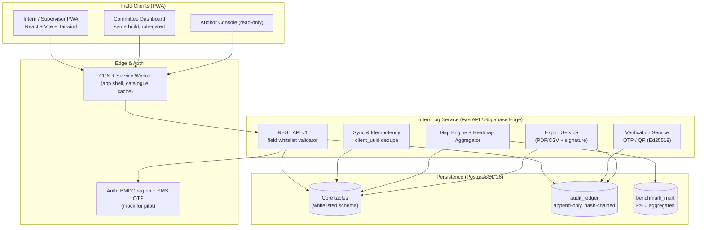
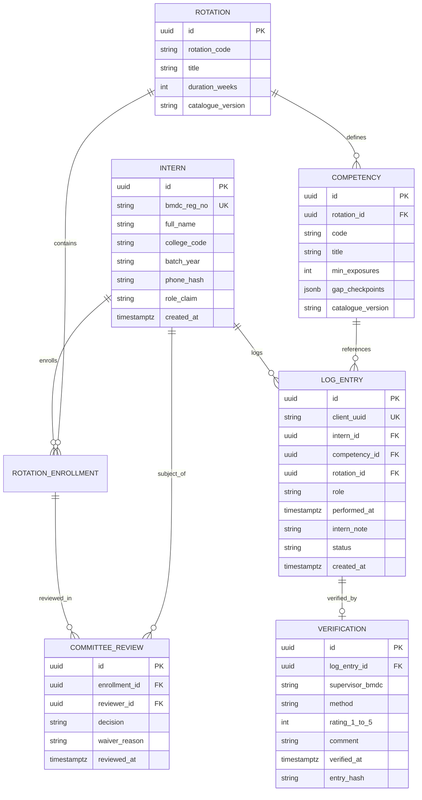
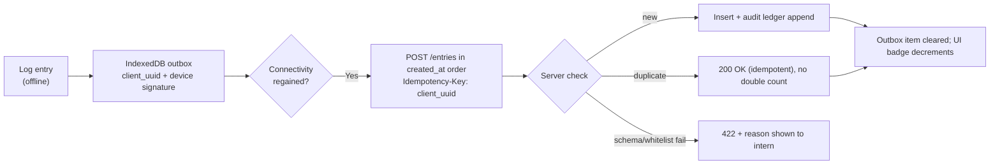

# 🛠️ Technical Architecture & Implementation Blueprint — Module 15

## InternLog — MBBS Internship Competency E-Logbook (PWA, Offline-First, Zero Patient Data)

> **Tagline:** scan, tap, done — interns log procedures on their phone; supervisors confirm in 10 seconds; committees finally see who actually did what.
>
> **Engineering north star:** the whole module must be credible **without any real external API** — BMDC registry, SMS gateway and BMEAC export all ship as contract-tested mocks behind env flags; nothing here blocks a 48-hour hackathon demo.

---

## Table of Contents

- [Tech Stack](#tech-stack)
- [High-Level Topology](#high-level-topology)
- [Database Architecture & ER Model](#database-architecture--er-model)
  - [Entity-Relationship Diagram](#entity-relationship-diagram)
- [FHIR Note: Practitioner Domain, Not Patient Domain](#fhir-note-practitioner-domain-not-patient-domain)
- [REST API Specification](#rest-api-specification)
- [Security & Privacy Architecture](#security--privacy-architecture)
- [Offline Queue & Sync Design](#offline-queue--sync-design)
- [Rollout Roadmap (48h Demo → 1 College → ~103 Colleges)](#rollout-roadmap-48h-demo--1-college--103-colleges)
- [Risks & Mitigations](#risks--mitigations)
- [3-Minute Demo Script](#3-minute-demo-script)
- [Definition of Done & Hackathon Readiness](#definition-of-done--hackathon-readiness)

---

## Tech Stack

| Layer | Choice | Rationale / Alternative |
|:---|:---|:---|
| **Client** | **React 18 + Vite 5 + Tailwind CSS 3 PWA** (`vite-plugin-pwa`, Workbox) | Matches platform frontend skills; installable on low-end Android; offline shell |
| **Local store** | **IndexedDB** via `idb` (+ outbox table) | Offline queue; survives app restarts |
| **Backend (hackathon)** | **Supabase** (Postgres 15/16 + Row-Level Security + Edge Functions) *or* **Firebase** (Firestore + Cloud Functions) | Fastest path; RLS enforces role scoping |
| **Backend (platform/prod)** | **FastAPI (Python 3.12) + PostgreSQL 16** on BDIX-hosted sovereign cloud | Aligns with Modules 02/05; BDIX latency <50 ms target (Module 04 precedent) |
| **Auth** | Supabase Auth (magic link/OTP) → prod: **BMDC reg no + SMS OTP** (mock); JWT with role claim (`INTERN`/`SUPERVISOR`/`COMMITTEE`/`AUDITOR`/`DEPT_HEAD`) | BMDC MOU pending — never block pilot |
| **SMS OTP** | **Mock gateway** (`SMS_MODE=mock` logs to console + `otp_outbox` table); prod: BD telco aggregator (SSL Wireless / BulkSMSBD **[illustrative]**) | Cost ≈ Tk 0.35–0.60/SMS at scale **[illustrative]** |
| **Hash chain** | SHA-256 (`prev_hash ‖ payload`), nightly Merkle root | See Feature 10 |
| **Exports** | Server-side PDF (WeasyPrint) + CSV; Ed25519-signed manifest | BMEAC evidence packs |
| **Analytics** | SQL views + materialised `benchmark_mart`; no ML required for MVP | k≥10 suppression in views |
| **Hosting** | Vercel/Netlify (demo) → DGME/BMDC-managed K8s or BDIX cloud (prod) | Data stays in-country |

**Deliberately excluded:** patient FHIR servers, HAPI FHIR, DICOM, any PHI store, native iOS/Android apps (PWA only), microservices (single FastAPI service + worker is enough for MVP).

---

## High-Level Topology

---

## Database Architecture & ER Model

### Entity-Relationship Diagram

**Schema guardrails**
- No column anywhere stores patient attributes — enforced by migration lint (`scripts/check_no_phi_columns.sql`**, CI fails on forbidden names: `patient_*`, `nid`, `hid`, `diagnosis`, `ward`, `bed_no` …).
- `log_entry.status`: `DRAFTED → OTP_SENT → VERIFIED | REJECTED | EXPIRED`; transitions only via service layer; DB trigger rejects illegal jumps.
- `audit_ledger` is `INSERT`-only for role `app_writer`; monthly partitions; nightly Merkle root logged to `audit_checkpoint`.

---

## FHIR Note: Practitioner Domain, Not Patient Domain

InternLog touches **zero patient FHIR resources** — no `Patient`, `Encounter`, `Observation`, `Condition`, `DocumentReference` with clinical content. It lives in the **practitioner/education** domain.

- **MVP:** no FHIR at all; plain REST/JSON + Postgres. Adding FHIR now would add ceremony with no consumer.
- **Later (optional):** map verified interns to **`Practitioner`** and per-rotation supervision to **`PractitionerRole`** (`code` = e.g. `trainee`; `period`, `organization` = college) when BMDC/DGME publish a practitioner registry profile. This composes cleanly with Module 07 (BD Health Card → `Patient`) without mixing domains.
- **`AuditEvent` alignment:** InternLog's ledger exports can be *projected* to FHIR `AuditEvent` for Module 05 interoperability — a one-way, read-only projection, never the source of truth.
- **Never:** `Consent` for patients (none exist), `Composition`/`ClinicalImpression`, or any resource implying clinical care.

---

## REST API Specification

Base: `/api/v1` · Auth: `Authorization: Bearer <jwt>` · All bodies JSON · Errors: RFC 9457 problem+json.

| Method & Path | Role | Purpose | Key Response |
|:---|:---|:---|:---|
| `POST /auth/otp/request` | any | Send login/verification OTP (mock) | `202 {request_id}` |
| `POST /auth/otp/verify` | any | Verify OTP, issue JWT | `200 {token, role}` |
| `GET /bmdc/verify?reg=` | system/committee | Mock registry lookup | `200 {name, college, status}` |
| `GET /rotations/current` | intern | Current rotation + catalogue (cached) | `200 {rotation, competencies[]}` |
| `POST /entries` | intern | Create log entry (whitelist validated) | `201 {id, status}` |
| `GET /entries?rotation=&status=` | intern | Own entries | `200 {items[]}` |
| `POST /entries/{id}/request-verification` | intern | Issue OTP / QR payload | `200 {otp_ttl, qr_payload}` |
| `POST /verify/otp` | supervisor | OTP + rating + comment | `200 {status: VERIFIED}` |
| `POST /verify/qr` | supervisor | Offline-signed QR verify | `200 {status: VERIFIED}` |
| `POST /verify/{id}/reject` | supervisor | Reject with reason | `200 {status: REJECTED}` |
| `GET /committee/heatmap?cohort=` | committee | Heatmap grid (de-identified) | `200 {grid, gaps[]}` |
| `POST /gaps/{id}/acknowledge` | intern/supervisor | Ack gap alert | `200 {status}` |
| `POST /gaps/{id}/resolve` | committee | Close gap / waive w/ reason | `200 {status}` |
| `GET /exports/bmeac?college=&from=&to=` | auditor | Signed evidence pack | `200 {pack_url, integrity}` |
| `GET /audit/verify?from=&to=` | auditor/committee | Hash-chain check | `200 {valid, broken_at?}` |
| `GET /benchmarks/college` | committee | Own college vs national band | `200 {bands}` |
| `GET /wellbeing/checkin` (GET/POST) | intern | 2-question optional check-in | `202` / minimal stats |
| `GET /health` | all | Liveness | `200 {ok}` |

**Rate limits:** 60 req/min/user; `/verify/*` 10 req/min; OTP request 5/hour/reg-no; export 10/day/college.

---

## Security & Privacy Architecture

1. **Zero patient identifiers — enforced, not promised.**
   - Field whitelist at 3 layers: client zod schema → API validator (rejects unknown keys) → Postgres `CHECK (jsonb_object_keys(note_meta) …)`/trigger + migration lint in CI.
   - Forbidden-column CI gate; any PR adding `patient_*`, `nid`, `hid`, `diagnosis`, `ward`, `bed`, `dob` fails build.
2. **OTP + timestamps everywhere.** Single-use 6-digit OTP, 5-min TTL, bound to `entry_hash`; every verify records `verified_at`, supervisor id, device fingerprint; anomalies (>20 verifies/10 min, identical comments, 03:00 bulk) → chair flag (visible, not auto-block).
3. **Hash-chained audit ledger.** Append-only; `prev_hash` linkage; nightly Merkle checkpoint; exports embed verification result; broken chain → export refused/watermarked + BMDC notified.
4. **RBAC + RLS.** Postgres RLS: interns read own rows; supervisors read assigned dept; committee reads college; auditor read-only packs; `service_role` only in backend.
5. **Pseudonymised exports.** Per-export salted hashes; re-identification needs 2-person (BMDC + college) unseal; k≥10 suppression in every aggregate.
6. **Transport & at rest.** TLS 1.2+; AES-256 at rest; secrets in vault; PDP0/PDPO-aligned privacy notice; **data residency in Bangladesh** for prod.
7. **Threat model (top):** OTP forwarding (device binding + flag), fake sign-offs (timestamps + 5% random spot re-verification per rotation), roster proxying (flag), DB tampering (hash chain + WAL restore), insider export abuse (export ledger + alerts).

---

## Offline Queue & Sync Design

- **QR verification offline:** supervisor app verifies Ed25519 signature of `{entry_hash, nonce, expiry}` locally; receipt stored both sides; confirmed server-side on sync (attested by both signatures → counts as verified even if one side was offline).
- **Conflict rule:** server wins on whitelist/constraint failure; duplicates dropped silently; divergent edits (rare) → both kept, `CONFLICT` flag to committee.
- **Clock skew:** >15 min → entry accepted but `clock_skew` flag set for audit.

---

## Rollout Roadmap (48h Demo → 1 College → ~103 Colleges)

| Phase | Timeline | Actions | Exit Criteria |
|:---|:---|:---|:---|
| **P0 — 48h hackathon demo** | Days 1–2 | Seed catalogue subset (OB/GYN + Medicine, ~40 competencies, **[illustrative]**); mock OTP; 2 demo phones; heatmap; export | End-to-end: log → verify → heatmap → export in 3 min |
| **P1 — 1 college pilot (e.g., Dhaka Medical College)** | Months 1–3 | MOU with DMC + BMDC observer; transcribe full BMDC rotatory PDF (`catalogue_v1`); 2 intern batches; supervisor training 15 min; weekly metrics | ≥70% entries verified; median response <10 min; 1 BMEAC-style pack exported |
| **P2 — 5–10 colleges (BMEAC cohort)** | Months 4–6 | Onboard unaccredited colleges seeking BMEAC review; benchmark dashboards; fraud-flag tuning; PDPO sign-off | Packs accepted by BMEAC reviewers **[target]** |
| **P3 — National mandate** | Months 7–18 | BMDC/DGME circular: e-logbook mandatory for internship completion; BMEAC ties accreditation evidence to export; legacy paper sunset plan | ≥90% rotations with recorded assessment; all ~103 colleges onboarded |
| **P4 — CPD bridge (future)** | Year 2+ | BMDC decision on relicensing portfolio; `PractitionerRole` registry mapping | Separate governance approval |

**Ownership:** **BMDC + DGME** (mandate, registry, data governance) · **Colleges** (roster, committee use) · **BMEAC** (evidence consumer) · **MoHFW/WHO** (hackathon showcase, policy nudge). Supports **BMEAC accreditation of the ~100 unaccredited colleges** — the single strongest adoption lever.

---

## Risks & Mitigations

| Risk | Severity | Mitigation | Early Signal |
|:---|:---:|:---|:---|
| **Supervisor time burden** → rubber-stamping or abandonment | High | Sign-off **<10 s** design; QR preferred; batch review with flags; no free-text required | Median verify time >30 s; >20% entries rejected for friction |
| **Fake sign-offs / collusion** | High | OTP+device binding+timestamps; 5% random spot re-verification; anomaly flags to chair; ledger | Flag rate >5%; same-comment clusters |
| **Low adoption / opt-out** | High | Make it **accreditation-mandated** (BMEAC) + BMDC circular; zero cost to interns; embed in rotation completion | <50% entries by week 4 → intervene |
| **Privacy breach (patient identifiers)** | Critical | Field whitelist (3 layers) + CI lint + Sev-1 runbook; **zero patient data by design** | Any `patient_*` CI failure (blocks merge) |
| **BMDC/DGME non-engagement** | Medium | Start DMC pilot independently; MoHFW+WHO hackathon visibility; BMEAC pull (they need evidence) | No MOU by month 2 → escalate via MoHFW |
| **Catalogue wrong vs BMDC PDF** | Medium | 2-faculty + BMDC nominee sign-off; version-pinned; errata process | >10 correction requests |
| **Offline data loss / phone failure** | Medium | Outbox persisted; export-before-uninstall; 500-entry cap with warning | Support tickets on "lost entries" |
| **Hash-chain break / insider tamper** | Medium | Append-only RBAC + nightly Merkle + WAL backups; restore drill twice yearly | Any verify failure → Sev-2 |
| **Scope creep into exams/CPD** | Low | Out-of-scope list enforced in PR reviews; CPD = future phase only | Feature requests tagged `scope-creep` |
| **Allowance/strike context (Tk 35k [uncertain])** | Low | InternLog is free, offline, low-effort — explicitly marketed as *reducing* admin burden; never tied to pay | Pilot-floor feedback |

---

## 3-Minute Demo Script

**0:00 — The hook (stat on screen).** "A logbook signature is the main assessment for **more than 66% of interns** — and **~54% of interns get no assessment at all** after major rotations. Eight colleges. Paper booklet. (Source: BJME.) And only **2 of ~103 colleges** are BMEAC-accredited — with ~100 still waiting, and no objective evidence to review."

**0:30 — Intern logs a cannula.** On phone (offline mode — airplane on): rotation = Medicine → competency = "Peripheral IV cannula insertion" → role = SUPERVISED → tap **Log**. Done in 12 seconds. "Notice what we never asked: patient name, age, ward, diagnosis — nothing. Zero patient identifiers, enforced by the database itself."

**0:50 — Supervisor approves in 10 seconds.** Second phone (supervisor): scan the QR on the intern's screen → rating **4/5** → comment "Good asepsis; watch hub contamination" → tap **Verify**. "Ten seconds. That's the whole price of truth. And it's signed, timestamped, and impossible to quietly edit — every entry is hash-chained."

**1:20 — Committee heatmap shows OB/GYN gaps.** Laptop: cohort heatmap — Medicine row green, Surgery amber, **OB/GYN red: 14 of 22 interns have 0 deliveries logged at week 6** (threshold min 5). One click → gap alerts sent to interns, supervisors, chair. "This is the failure paper could never see — early enough to fix it."

**1:50 — Export the BMEAC evidence.** Click **Export BMEAC pack** → PDF downloads: coverage per rotation, % verified, response-time stats, gap closures, ledger integrity certificate ("chain valid, 2,148 entries"). "This is what an accreditation reviewer actually needs — for the ~100 unaccredited colleges."

**2:30 — The ask.** "Pilot this with **one college's next intern batch** — Dhaka Medical College — one semester, BMDC observer, and let BMEAC trial the pack. Cost: one FastAPI service, Postgres 16, and two phones. If the heatmap turns OB/GYN green, we scale to all 103 colleges — and Bangladesh finally knows who its doctors actually are."

---

## Definition of Done & Hackathon Readiness

- [ ] Airplane-mode demo path rehearsed (log → QR verify → sync).
- [ ] Seed script: 24 fake interns × 3 rotations × realistic entries + heatmap contrast (OB/GYN all-red).
- [ ] Mock BMDC verify + mock SMS OTP documented in README; flip via env.
- [ ] Export PDF generates <30 s with integrity certificate.
- [ ] "Zero patient data" CI lint green; whitelist test passes.
- [ ] Screenshots: 3 phones + laptop heatmap + exported pack (for submission deck).
- [ ] One-page judge brief: problem (66%/54%) → demo → pilot ask; budget line: **< $0 infra for demo; pilot est. Tk 8–12 lakh/college/yr [illustrative]**.
