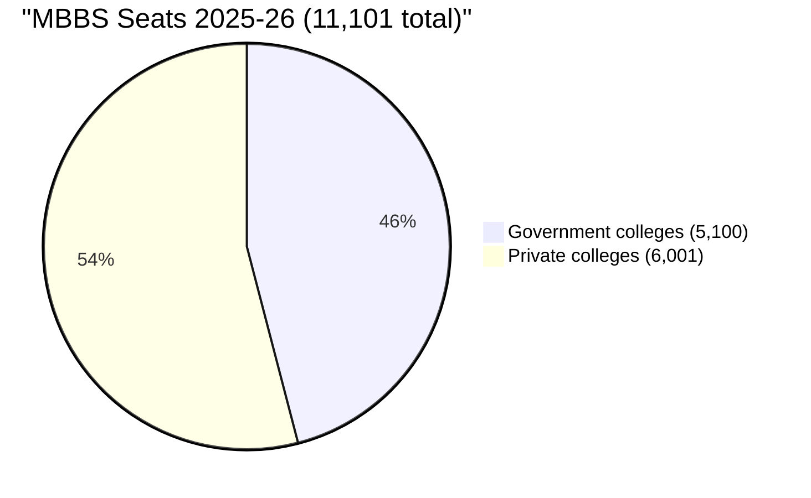
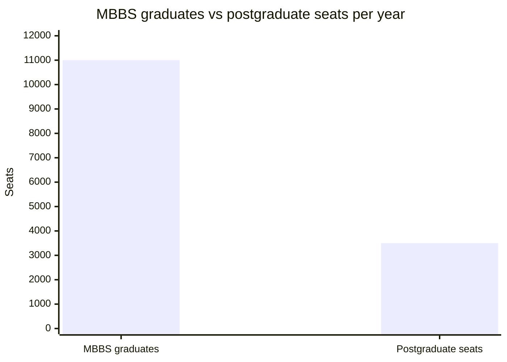
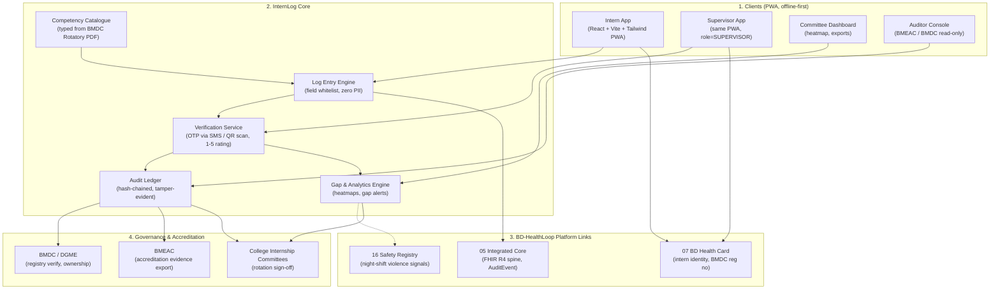
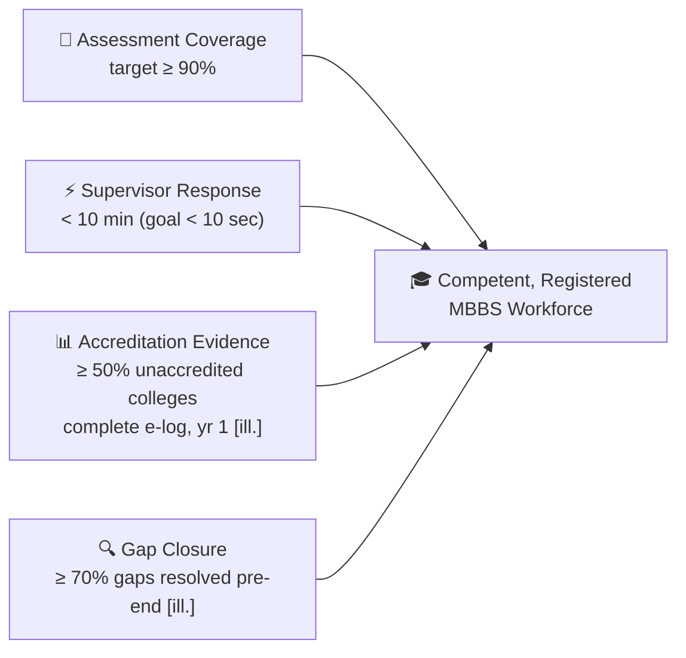

# 🩺 InternLog — MBBS Internship Competency E-Logbook

## Module 15 — MBBS Internship Competency E-Logbook (InternLog)

> **Tagline:** scan, tap, done — interns log procedures on their phone; supervisors confirm in 10 seconds; committees finally see who actually did what.
>
> **Hackathon position:** U3 · F5 · I3 · J3 · D4 = **18/25** (see `hackathon-research/05_final_ideas.md`, Idea 8). Weakest "e-Health Card" fit of the ten ideas — we lead with the **health workforce records** angle instead. Cheap to build (F5), high legitimacy upside for the platform.

---

## Table of Contents

- [Problem Statement](#problem-statement)
  - [The Internship Signature Gap in Numbers](#the-internship-signature-gap-in-numbers)
  - [Why Paper Fails in Practice](#why-paper-fails-in-practice)
- [International Precedent: UK Horus ePortfolio & India PGMER-2023](#international-precedent-uk-horus-eportfolio--india-pgmer-2023)
  - [Lessons from the Precedents](#lessons-from-the-precedents)
- [System Architecture & Vision](#system-architecture--vision)
- [Capability Deep-Dives](#capability-deep-dives)
  - [1. One-Tap Procedure Logging (Zero Patient Identifiers)](#1-one-tap-procedure-logging-zero-patient-identifiers)
  - [2. Supervisor 10-Second Verification (OTP / QR)](#2-supervisor-10-second-verification-otp--qr)
  - [3. Rotation-Completion Heatmap & Gap Alerts](#3-rotation-completion-heatmap--gap-alerts)
  - [4. BMEAC Accreditation Evidence Export](#4-bmeac-accreditation-evidence-export)
  - [5. Offline-First PWA for Basements & Ward Scanners](#5-offline-first-pwa-for-basements--ward-scanners)
- [Comparative Benchmark: Bangladesh vs Regional & Global Standards](#comparative-benchmark-bangladesh-vs-regional--global-standards)
- [Stakeholder Matrix](#stakeholder-matrix)
- [Success Metrics & National Targets](#success-metrics--national-targets)
- [Cross-Module Dependencies](#cross-module-dependencies)
- [Sources & Data Notes](#sources--data-notes)

---

## Problem Statement

Bangladesh graduates **>11,000 MBBS doctors a year** across **~103 colleges**; every one completes a **one-year rotatory internship** (BMDC Rotatory Internship Programme) before independent registration. The mandatory logbook proving they actually *performed* — not merely watched — each rotation's procedures is **a paper booklet**, and functionally meaningless.

> [!CAUTION]
> **A signature is the curriculum.** A logbook signature is the main assessment for **more than 66% of interns** (and 72% of doctors), and **~54% of interns receive NO assessment at all after major rotations** across 8 colleges. The paper logbook measures attendance, not competence. — [BJME](https://banglajol.info/index.php/BJME/article/view/32243)

### The Internship Signature Gap in Numbers

| Indicator / Metric | Ground Statistic | Authoritative Source & Context |
|:---|:---:|:---|
| **Logbook signature = main assessment** | **>66% of interns (72% of doctors)** | [BJME](https://banglajol.info/index.php/BJME/article/view/32243) — 8 colleges |
| **No assessment after major rotations** | **~54% of interns** | [BJME](https://banglajol.info/index.php/BJME/article/view/32243) — 8 colleges |
| **Negative about logbook use** | **~56% of interns** | [BJME](https://www.banglajol.info/index.php/BJME/article/view/36233) — 9 hospitals |
| **Counterpoint: rated programme >4/5** | **400 interns, mean agreement >4/5** | [BJME](https://www.banglajol.info/index.php/BJME/article/view/63680) — 2021–22 survey; honest reporting: both findings are real |
| **MBBS seats 2025–26** | **11,101** (5,100 govt + 6,001 private); **572 cut** | [Daily Star](https://www.thedailystar.net/news/step-towards-improving-medical-education-quality-4082026) |
| **Colleges** | **~103**; only **2 BMEAC-accredited** (DMC, Shaheed Suhrawardy MC); **~100 unaccredited**; WFME pending | [Daily Star](https://www.thedailystar.net/news/step-towards-improving-medical-education-quality-4082026) |
| **PG seats vs graduates** | **~3,500** vs **>11,000/yr (~1:10)** | [Daily Star Campus](https://www.thedailystar.net/campus/news/do-we-have-too-many-medical-colleges-3724766) |
| **Teaching posts vacant** | **41–43%** (DGME: 2,459/5,920 ≈ **41.5%**) | [Daily Star](https://www.thedailystar.net/opinion/news/ensure-quality-medical-education-4034436) |
| **Internship logbook format** | **PAPER** | [BMDC Rotatory Internship Programme (PDF)](https://www.bmdc.org.bd/docs/RotatoryInternshipProgramme.pdf) — the exact gap |
| **No practical training for interns** | **Habiganj MC ran ~7 years without it** | [Daily Star](https://www.thedailystar.net/opinion/news/ensure-quality-medical-education-4034436) — 2025 |
| **Intern/PG allowance strike** | **~7,000 PG trainees + 3,500 interns** struck (Mar 2024, Tk 20k/15k); Tk 35k from 1 Jul 2025 **[uncertain]** | [TBS](https://www.tbsnews.net/bangladesh/health/postgraduate-trainees-interns-go-strike-over-pay-hike-815036) |
| **Wellbeing** | **55.4%** Chattogram frontline burnt out (PMC 2022); **32.9%** ([NEMJ](https://journal.nemc.edu.bd/?p=6878)); **28.8%** depression (840 students, [PMC](https://www.ncbi.nlm.nih.gov/pmc/articles/PMC10904939/)) | → Feature 12 |
| **Workplace violence** | **67.3% of 441 DMCH physicians** (BMJ Open 2024, [TBS](https://www.tbsnews.net/node/1465051)); **61% of 157** incidents at night — interns hit hardest | [Frontiers 2021](https://www.frontiersin.org/articles/10.3389/fpsyg.2021.787221/full) → Module 16 |
| **Hackathon score** | **U3 · F5 · I3 · J3 · D4 = 18/25** | `hackathon-research/05_final_ideas.md` (Idea 8) |

### Why Paper Fails in Practice

1. **Signature inflation.** Supervisors sign in bulk at rotation end; the signature certifies presence, not competence. With **41–43% of teaching posts vacant**, signing is the path of least resistance.
2. **No feedback loop.** Interns never learn *which* procedures they under-performed; committees see gaps only at final viva, if ever.
3. **Accreditation blind spot.** BMEAC must accredit **~100 colleges** with almost no objective evidence; paper books are unauditable at scale and easily lost.
4. **No registry linkage.** Paper records never connect to BMDC registration, DGME workforce planning, or a future CPD/relicensing system.
5. **Equity of scrutiny.** Habiganj MC passed interns on paper for **~7 years** without practical training — paper hides this.

---

## International Precedent: UK Horus ePortfolio & India PGMER-2023

| Precedent | What it is | Status & Evidence | Lesson |
|:---|:---|:---|:---|
| **UK — Horus ePortfolio** | National e-portfolio for Foundation doctors (mini-CEX, DOPS, CBD) | **All foundation schools in England** — [KSS Deanery](https://kss.hee.nhs.uk/horus-eportfolio/) | **Mandatory + universal + short assessments** wins |
| **India — PGMER-2023 e-logbook** | NMC PG regulations 2023 mandate e-logbook | **Vendor-claimed; regulator notice NOT verified — [uncertain]** ([eportfolios.in](https://eportfolios.in/resources/guides/logbooks-vs-eportfolios)) | **Verify the regulator before citing the mandate** |
| **BD — BCPS (FCPS) pilot** | Postgraduate e-logbook | [BCPS newsletter](https://bcps.edu.bd/it_inhouse/newsletter) | **Don't duplicate PG work — target MBBS** |
| **BD — BMDC logbook** | MBBS internship logbook | **PAPER** — [BMDC PDF](https://www.bmdc.org.bd/docs/RotatoryInternshipProgramme.pdf) | The exact gap; competency list typed from this document |

### Lessons from the Precedents

1. **Mandate beats merit.** Horus is universal because it is required, not loved. InternLog must be *accreditation-mandated* (BMEAC evidence pack), not merely "available".
2. **Keep the supervisor tax near zero.** Sign-off must stay under **10 seconds**; with 41–43% vacant teaching posts, every extra tap loses supervisors.
3. **Never let it become an exam.** A **procedural log**, not a knowledge test (see Out of Scope, FEATURES.md) — Horus succeeds with short structured workplace assessments.
4. **Verify before you cite.** India PGMER-2023's "mandate" is vendor marketing; the NMC notice could not be verified. BD policy claims must trace to BMDC/DGME/BMEAC, not vendors.
5. **Honest adoption read.** ~56% of interns are negative about the current logbook, yet 400 interns rated it >4/5 — poor tooling, not poor intent; design for the sceptics.

---

## System Architecture & Vision

InternLog is a **zero-patient-data, practitioner-domain** module: it records *who did what procedure under whose supervision, when* — never *on whom*. It plugs into the BD-HealthLoop spine (Module 05) for identity and audit, reuses the Health Card identity layer (Module 07) for intern identification, and stays deliberately outside clinical FHIR resources.

---

## Capability Deep-Dives

### 1. One-Tap Procedure Logging (Zero Patient Identifiers)

The intern opens the app, picks the rotation and competency (e.g., "IV cannula insertion — Medicine"), taps **Log**, confirms role (`SUPERVISED` / `ASSISTED` / `OBSERVED`) and date — **no patient name, ID, age, ward, or diagnosis is ever captured**. Enforced by a **field whitelist** at API and database layers (IMPLEMENTATION.md §Security). The single most important constraint: deployable without patient-consent machinery and safe under PDPO review.

### 2. Supervisor 10-Second Verification (OTP / QR)

The intern's screen shows a QR; the supervisor scans it (or receives an **SMS OTP**), rates competency **1–5**, adds an optional comment — **<10 seconds**. Timestamps + OTP make rubber-stamping visible (03:00 bulk approvals, all-5 ratings, one supervisor approving 400 entries/hour are all flagged). Supervisor unreachable for **2 weeks** → auto-escalation to the **department head** (APP_FLOW.md, Journey 7).

### 3. Rotation-Completion Heatmap & Gap Alerts

Committees see a **rotation × competency heatmap** per intern and per cohort. **Gap alerts** fire when minimum exposures are unmet — e.g., **0 obstetric deliveries logged by week 6 of the OB/GYN rotation** (threshold configurable per competency). This converts the logbook from a compliance ritual into an early-warning system for underexposed interns — exactly the cohort that Habiganj MC (~7 years of zero practical training) hid in paper.

### 4. BMEAC Accreditation Evidence Export

One click exports a **de-identified, hash-verified accreditation pack**: competency coverage per rotation, % entries verified, supervisor response-time distribution, gap-closure actions. The selling point for the **~100 unaccredited colleges** BMEAC must clear — objective evidence replaces anecdote. (BMEAC's own WFME recognition is pending — [Daily Star](https://www.thedailystar.net/news/step-towards-improving-medical-education-quality-4082026).)

### 5. Offline-First PWA for Basements & Ward Scanners

Internship happens in wards, OT theatres, delivery rooms and basement procedure rooms — **hospital basements and ageing Android phones are the norm**. Entries queue locally (IndexedDB) and sync when connectivity returns; QR verification works fully offline; SMS OTP requires signal. See APP_FLOW.md, Journey 6.

---

## Comparative Benchmark: Bangladesh vs Regional & Global Standards

| Dimension | BD Paper Logbook (status quo) | UK Horus ePortfolio | India PGMER-2023 e-logbook [unverified mandate] | BCPS FCPS Pilot (PG) | **Module 15 — InternLog** |
|:---|:---|:---|:---|:---|:---|
| **Format** | Paper booklet | Web e-portfolio | E-logbook (vendor platforms) | E-logbook (pilot) | **Mobile PWA, offline-first** |
| **Coverage** | All interns (nominal) | All foundation schools in England — [KSS](https://kss.hee.nhs.uk/horus-eportfolio/) | PG residents (claimed) | FCPS trainees | **~103 colleges × intern cohorts** |
| **Assessment type** | Signature (>66% main assessment) | Structured workplace-based (mini-CEX/DOPS) | Structured (claimed) | Structured | **1–5 rating + comment, <10s** |
| **Patient data** | Often handwritten notes | De-identified assessment forms | De-identified (claimed) | De-identified | **Zero patient identifiers (whitelist)** |
| **Committee visibility** | None until final review | Deanery dashboards | Programme dashboards | Pilot dashboards | **Real-time heatmap + gap alerts** |
| **Accreditation use** | Weak/lost | GMC/UKFPO evidence | NMC evidence (claimed) | BCPS internal | **BMEAC evidence export** |
| **Cost to supervisor** | Low but meaningless | Moderate | Moderate | Moderate | **<10 seconds per entry** |
| **BD legal status** | Mandatory (paper) | n/a | **Unverified — do not cite** | Pilot | **Proposed: BMDC/DGME mandate** |

---

## Stakeholder Matrix

| Stakeholder | Key Frustrations | InternLog Solution | Measured Benefit |
|:---|:---|:---|:---|
| **MBBS Interns** | Signature-only assessment; no feedback; ~56% negative; allowance anxiety [uncertain] | One-tap logging; 1–5 feedback; personal gaps; optional wellbeing check-in | Visible progress; early burnout signal |
| **Supervising Residents / Consultants** | 41–43% vacant posts; no time for paperwork; books pile up | <10s OTP/QR sign-off; fraud flags (bulk, all-5) | Sign-off ≈ zero; audit-proof approvals |
| **Internship Committee Chairs** | No visibility until rotation end; paper lost | Live heatmap; gap alerts; benchmarking | Early gap closure |
| **BMEAC / BMDC Auditors** | ~100 colleges unaccredited; WFME pending | Hash-verified de-identified export; tamper-evident ledger | Evidence, not anecdote |
| **DGME / College Principals** | Blind workforce planning; Habiganj-type failures hidden | National cohort analytics; on-request export | Early detection of non-training colleges |
| **Patients (indirect)** | Under-trained interns performing procedures | Competency-gated role marking (OBSERVED→ASSISTED→SUPERVISED) | Safer supervised practice |
| **Safety advocates (Module 16)** | 61% of violence incidents at night | Optional night-shift check-in → de-identified safety signals | Earlier institutional response |

---

## Success Metrics & National Targets

- **Assessment coverage**: % rotations with ≥1 verified assessment — **target ≥90%** (baseline unmeasured nationally; pilot will set it).
- **Procedures logged per intern**: per rotation; target set after DMC pilot baseline (**[illustrative]** — no national figure exists).
- **Supervisor median response**: **target <10 min** (design goal <10 sec per sign-off).
- **Exported accreditation packs**: **all ~100 unaccredited colleges export ≥1 pack within 12 months of mandate** [illustrative].
- **% unaccredited colleges with complete e-log data**: headline national KPI; reported to BMEAC quarterly.
- **Fraud flags**: % entries flagged (OTP-sharing/bulk) — target **<2%** [illustrative].
- **Wellbeing signal**: optional check-in uptake; benchmarked vs 55.4% (Chattogram) / 32.9% (NEMJ) burnout prevalence.

---

## Cross-Module Dependencies

- **03-prescription** — shares clinical workflow primitives (e-signature, audit events); intern e-prescribing supervision can later reuse InternLog's verification rails.
- **05-integrated-system** — FHIR R4 spine and `AuditEvent` pattern for the hash-chained ledger; BD Core FHIR sandbox alignment.
- **07-health-card** — intern identity (BMDC registration number, 9-digit Health ID) reused from the card layer; no duplicate identity system.
- **16-safety-registry** — interns and emergency doctors are hit hardest by workplace violence (61% of 157 Platform-network incidents at night — [Frontiers 2021](https://www.frontiersin.org/articles/10.3389/fpsyg.2021.787221/full)); InternLog's optional wellbeing check-in and night-shift flag link into the safety registry (Feature 12).

---

## Sources & Data Notes

**Authoritative sources used in this module**
- Logbook assessment gap (>66% / 72% / ~54%, 8 colleges): [BJME 32243](https://banglajol.info/index.php/BJME/article/view/32243)
- ~56% negative about logbook (9 hospitals): [BJME 36233](https://www.banglajol.info/index.php/BJME/article/view/36233)
- Counterpoint, 400 interns >4/5: [BJME 63680](https://www.banglajol.info/index.php/BJME/article/view/63680)
- Seats, cuts, BMEAC accreditation (2 colleges; ~100 pending; WFME pending): [Daily Star 4082026](https://www.thedailystar.net/news/step-towards-improving-medical-education-quality-4082026)
- PG seats ~3,500 vs >11,000 graduates; BDT 15–20k starting pay; DGME 2,459/5,920 vacant: [Daily Star Campus 3724766](https://www.thedailystar.net/campus/news/do-we-have-too-many-medical-colleges-3724766)
- Teaching posts 41–43% vacant; Habiganj MC ~7 years: [Daily Star 4034436](https://www.thedailystar.net/opinion/news/ensure-quality-medical-education-4034436)
- BMDC rotatory logbook (paper; **HTTP 403 on fetch — catalogue to be transcribed manually**): [BMDC PDF](https://www.bmdc.org.bd/docs/RotatoryInternshipProgramme.pdf)
- BCPS FCPS e-logbook pilot: [BCPS newsletter](https://bcps.edu.bd/it_inhouse/newsletter)
- Horus ePortfolio (all foundation schools in England): [KSS Deanery](https://kss.hee.nhs.uk/horus-eportfolio/)
- India PGMER-2023: vendor claim only; **regulator notice NOT verified — treat as uncertain**; [eportfolios.in](https://eportfolios.in/resources/guides/logbooks-vs-eportfolios)
- Workplace violence: [Frontiers 2021](https://www.frontiersin.org/articles/10.3389/fpsyg.2021.787221/full); [TBS 1465051](https://www.tbsnews.net/node/1465051); burnout: [PMC 2022](https://www.ncbi.nlm.nih.gov/pmc/articles/PMC10904939/), [NEMJ](https://journal.nemc.edu.bd/?p=6878)
- Intern/PG allowance strike (Tk 20k/15k; Tk 35k from 1 Jul 2025 [uncertain]): [TBS](https://www.tbsnews.net/bangladesh/health/postgraduate-trainees-interns-go-strike-over-pay-hike-815036)
- Hackathon scoring & positioning: `hackathon-research/05_final_ideas.md` (Idea 8, lines 426–478); gap analysis rows 47–49: `hackathon-research/03_global_gap_analysis.md`; BD pain points §C/D/E: `hackathon-research/02_bangladesh_problems.md`

**Data notes & honesty flags**
- **No national baseline** exists for procedures logged per intern or % rotations assessed beyond the BJME studies — targets are set against pilot measurement and marked **[illustrative]** where extrapolated.
- **PGMER-2023 mandate unverified** — do not cite to officials. **Tk 35k allowance** reported but **[uncertain]**.
- BMDC PDF returned **HTTP 403** — competency lists must be **transcribed manually**; FEATURES.md examples are **[illustrative]**.
- Unsourced statistics in this document are **[illustrative]** or design targets, not findings.
