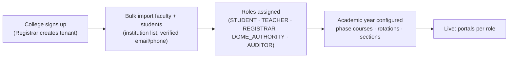
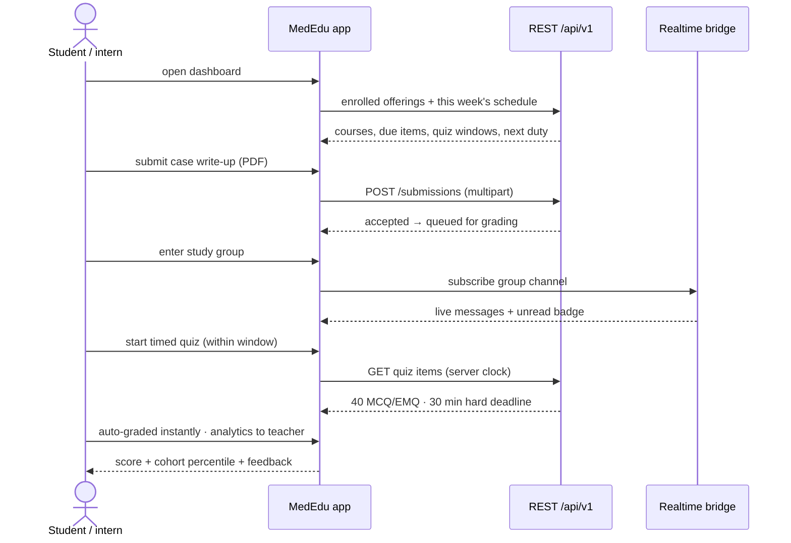
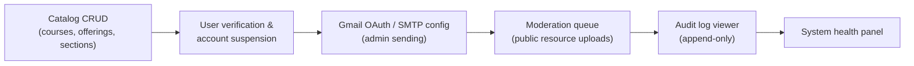
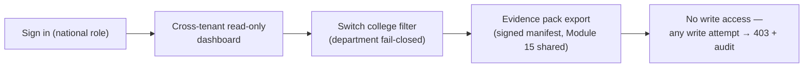
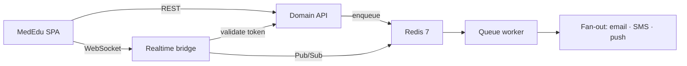
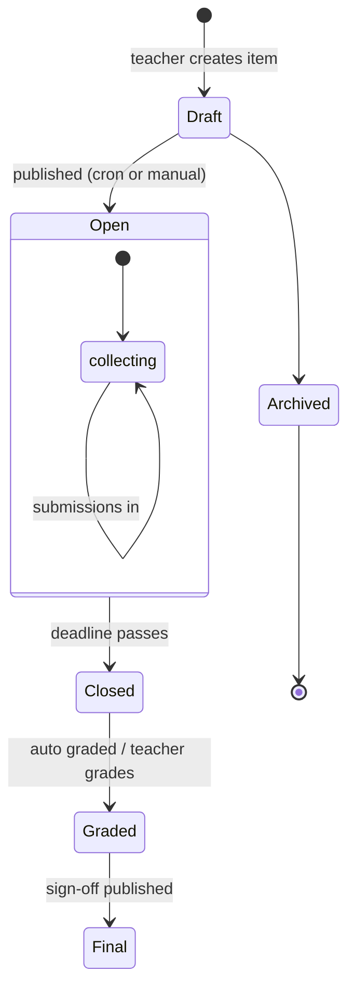
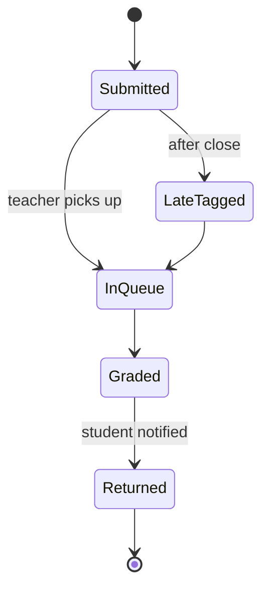

# 📲 MedEdu — App Flow

## Module 16 — EduSync for Medical Education (MedEdu)

Sequenced user journeys, one per portal, plus the async/real-time split (what EduSync gets right and MedEdu inherits).

---

## Table of Contents

- [Onboarding & Tenancy](#onboarding--tenancy)
- [Student Flow](#student-flow)
- [Teacher Flow](#teacher-flow)
- [Registrar / Super Admin Flow](#registrar--super-admin-flow)
- [DGME / BMEAC Authority Flow](#dgme--bmeac-authority-flow)
- [Real-time vs Async Split](#real-time-vs-async-split)
- [State Machines](#state-machines)

---

## Onboarding & Tenancy



**Login:** institution credentials + OTP fallback (SMS via the platformgateway). Students/interns who already use other CareLoop modules authenticate with the same identity — no second account.

---

## Student Flow



- **Quiz integrity:** server-authoritative clock, one active attempt, randomized item order per attempt, no tab-to-tab answers cached on device.
- **Duty roster:** the SCHEDULE (`routine`) view belongs only to the authenticated user (inherited invariant). Overlapping shifts of the same student/intern fire a friendly confirmation, never a silent conflict.

## Teacher Flow

```mermaid
sequenceDiagram
    actor T as Teacher
    participant APP as Teacher portal
    participant API as REST
    participant Q as Redis queue worker
    T->>APP: pick offering this week
    APP->>API: submissions grouped by assignment
    APP->>T: grading queue (oldest first, auto-batched)
    T->>APP: batch-grade from rubric · publish MCQ bank
    APP->>API: new quiz → durations + answer keys
    Q--)API: cron publishes quiz at open time (no manual run)
    T->>APP: upload lecture (recorded video / slide deck)
    API-->>T: multipart → object store; students notified
    APP->>T: monthly panel: averages, last-open items, redo rates
```

- **Assignment release/disable/close** are explicit — late submissions accepted but auto-tagged by penalty rule (§ 34 in EduSync).
- **Grading queue** deduplicates: a submission graded by TA-level role (REGISTRAR-created) requires teacher sign-off to unblock student notification (fan-out → queue email/notification).

## Registrar / Super Admin Flow



- Registrar is **invisible to ordinary People search** in MedEdu too — inherited § 80 invariant: a non-admin person-query for a registrar returns **404, not 403**.
- All admin writes append to `audit_logs`.

## DGME / BMEAC Authority Flow



## Real-time vs Async Split

Inherited 1:1 from EduSync — keep it:

| Concern | Engine | Why |
|---|---|---|
| HTTP / CRUD / forms / file uploads | REST `/api/v1` (Laravel in EduSync; FastAPI/NestJS on the CareLoop spine) | Transactional, type-safe, policy-checked |
| Live chat, presence, unread badges | **Node.js + Socket.IO bridge (:6002)** subscribing to **Redis Pub/Sub** | Non-blocking; Sanctum bearer-token validation |
| Email dispatch, notification fan-out (300+ students), reminder scheduling, late-penalty reaper | **Redis queue worker + cron** | Off the HTTP path; retries safely |



## State Machines





**Quiz attempt lifecycle:** `Ready → InProgress (started_at) → Completed | Expired (server clock past window) → Auto-graded → Feedback published`.

**Rotation credit hand-off:** rotation ends → Module 15 pulls the assignment/quiz grades + MedEdu completion data into the intern's competency ledger (same student record, year 5).
