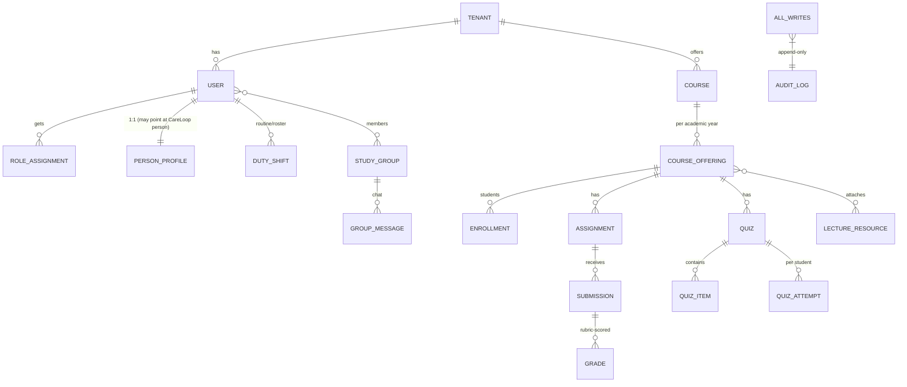
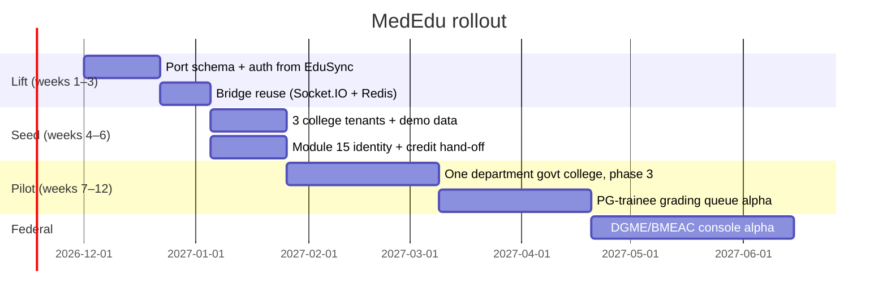

# 🛠️ MedEdu — Implementation Blueprint

## Module 16 — EduSync for Medical Education (MedEdu)

Technology plan, schema, API surface, security, rollout. Inherited from the working **EduSync** reference codebase, adapted to the CareLoop platform stack where they differ.

---

## Table of Contents

- [Reference Codebase](#reference-codebase)
- [Tech Stack](#tech-stack)
- [High-Level Topology](#high-level-topology)
- [Database Architecture](#database-architecture)
- [REST API Specification](#rest-api-specification)
- [Realtime Bridge Contract](#realtime-bridge-contract)
- [Security & Tenancy](#security--tenancy)
- [FHIR & Spine Interop](#fhir--spine-interop)
- [Rollout Roadmap](#rollout-roadmap)
- [Risks & Mitigations](#risks--mitigations)

---

## Reference Codebase

Every mechanism described here (except where marked *new*) exists today, working, in `C:\Users\Pritam\Downloads\edusnycdemo`:

| Component | Path in reference | Status |
|---|---|---|
| REST API, Sanctum, policies | `backend/app/Http/Controllers`, `Policies/` | working |
| Socket.IO bridge + Redis Pub/Sub | `realtime/server.js` | working |
| Queue workers & reminders | `backend/app/Jobs/` | working |
| Demo seeder (`edusync:demo`) | `backend/app/Console/Commands/` | working |
| Role portals React 19 SPA | `src/routes/{student,teacher,admin,authority}/` | working |

**Adoption strategy:** lift the schema for the modules below, port domain logic from Laravel to the CareLoop backend (or run a Laravel slice alongside it initially — see Alternatives), keep the Socket.IO bridge nearly as-is, and replace the generic demo data with 3 Bangladeshi medical-college tenants.

---

## Tech Stack

| Layer | EduSync (reference) | MedEdu (target) | Why |
|---|---|---|---|
| Frontend SPA | React 19 + TS + Vite + TanStack Query + Tailwind v4 | **same** (shared UI shell with the rest of CareLoop) | Code reuse; one auth context |
| REST API | Laravel 13 + Sanctum + Spatie RBAC | FastAPI/NestJS on CareLoop spine (Laravel slice possible as phase-in) | One platform policy + FHIR spine |
| Realtime | Node + Express + Socket.IO (:6002), Redis Pub/Sub | **identical pattern** | Non-blocking; proven at 300+ fan-out |
| DB | PostgreSQL 16 (`pg_trgm`, `tsvector`) | PostgreSQL 16 (shared cluster with spine) | § evidence compaction |
| Queue | Redis 7 queue + cron worker | same Redis instance (namespaced topics) | one ops footprint |
| Storage | MinIO / S3 | S3-compatible store shared with Module 02 reports | Lowest marginal cost |
| Auth | Sanctum bearer; username `@tenant.handle` | same token format; identities reuse Health-ID/Practitioner person records | One identity across hospital + campus |

---

## High-Level Topology

```mermaid
flowchart TB
    subgraph CLIENT["MedEdu SPA (React 19)"]
        S1["Student/intern portal"]
        S2["Teacher portal"]
        S3["Registrar portal"]
        S4["DGME/BMEAC authority"]
    end
    FE-->"Multipart / JSON HTTP"
    CLIENT -->|REST /api/v1/edu| API["Domain API (Campus)"]
    CLIENT -->|"ws :6002"| RT["Realtime bridge (Socket.IO)"]
    RT -->|Pub/Sub| REDIS["Redis 7"]
    API --> REDIS
    REDIS --> Q["Queue worker"]
    Q --> M["Mail / SMS fan-out · Cron (quiz windows ·<br/>late-penalty reaper · nightly Merkle root)"]
    API --> DB[("PostgreSQL 16<br/>multi-tenant")]
    API --> S3[("Object store<br/>lectures · submissions")]
    RT -->|token check| API
    API --> SPINE["CareLoop spine<br/>(Module 05 FHIR · identity reuses<br/>Person/Practitioner records)"]
```

---

## Database Architecture

Multi-tenant like EduSync: every academic table carries `tenant_id` (the medical college). Highlights (referenced schema details live in `docs/database-design.md` of the EduSync repo):



Key tables and indexes:

- `users(id UUID PK, username TEXT UNIQUE, tenant_id, status ENUM(...), suspended_at, suspended_reason)` — mirrors EduSync's §80 identity invariants.
- `course_offering(id, course_id, tenant_id, academic_year, section, teacher_id)` — unique `(course_id, year, section, tenant)`.
- `submissions(id, assignment_id, user_id, file_key, submitted_at, status, penalty_applied)` — partial index on `(assignment_id, status)` for the grading queue.
- `quiz_items(id, quiz_id, stem, options jsonb, answer_key, p_value, discrimination)` — analytics columns recomputed at quiz close.
- `quiz_attempts(id, quiz_id, user_id, started_at, expires_at, score_jsonb, status)` — one active per `(quiz_id, user_id)`; server clock authoritative.
- `duty_shifts(user_id, starts_at, ends_at)` — GiST index for overlap probe; half-open `[starts_at, ends_at)` semantics.
- `audit_logs(id, actor_id, action, subject, meta jsonb, at)` — append-only (no UPDATE/DELETE grant on the role).

## REST API Specification

Versioned `/api/v1/edu`, Sanctum bearer, policy-scoped:

```mermaid
flowchart LR
    A["auth: POST /login · /refresh"] --> B["people: GET /people · GET /people/{id} (404-rule)"]
    B --> C["courses: GET /offerings · POST /offerings · POST /enrollments"]
    C --> D["assignments: POST /assignments · POST /submissions ·<br/>GET /grading-queue · PATCH /grades/{id}"]
    D --> E["quizzes: POST /quizzes · POST /quizzes/{id}/items ·<br/>POST /attempts · POST /attempts/{id}/answer ·<br/>GET /attempts/{id}/result"]
    E --> F["resources: POST /resources · GET /resources ·<br/>POST /resources/{id}/moderate"]
    F --> G["groups & chat: POST /groups · POST /messages ·<br/>GET /messages (history)"]
    G --> H["routine: GET /my/routine · GET /my/duty ·<br/>POST /duty-shifts (conflict check)"]
    H --> I["admin & audit: GET /audit · POST /users/{id}/suspend ·<br/>POST /evidence-packs"]
```



- **Errors:** typed problem+json responses; every domain rejection carries a machine-readable code and the reason (mirror EduSync).
- **Pagination/caching:** TanStack Query with cursor pages; quiz items never cached.

## Realtime Bridge Contract

| Event | Direction | Payload |
|---|---|---|
| `edu:message` | server→client | group id, msg id, author, body, at |
| `edu:presence` | server→client | group id, user ids online |
| `edu:unread` | server→client | group id, count |
| `edu:submission.published` | server→client | submission id, score |
| `edu:quiz.window.open` | server→all-of-group | quiz id, closes_at |

Auth on connect: bearer → validate against REST (same session/token). Keep JOIN/PART/UNREAD **out of historical replay**; 30-day scrollback cap.

## Security & Tenancy

1. **Multi-tenant isolation:** every table has `tenant_id`; the API necessarily accepts an `on-behalf-of` only for cross-tenant national roles (DGME/BMEAC, `read_only`).
2. **Portal-scoped policies:** teacher CRUD only her offerings (`teacher_course_assignments`); students only their enrollments; everything else 403.
3. **404-vs-403 invariant:** registrar/Super-Admin identities excluded from People search — non-admin lookups return **404**, not 403.
4. **Append-only audit:** DB role has no `UPDATE/DELETE` on `audit_logs`; nightly Merkle root (same hash chain Module 15 uses).
5. **Suspension:** suspending a user invalidates sessions via Redis token denylist within one tick; future logins get the reason.
6. **PII minimalism:** MedEdu handles *academic* records, no PHI — the one bridge is Module 15 procedure logs which are **procedure type + date + optionally anonymized patient encounter ID** (never name/MR).

## FHIR & Spine Interop

The campus domain isn't patient-FHIR-native; MedEdu maps honestly:

| Local object | FHIR mapping | Fidelity note |
|---|---|---|
| Student/intern user | `Person` / `Practitioner` / `PractitionerRole` (student role) | spine identity, not clinical record |
| College tenant | `Organization` | one per medical college |
| Rotation (clinical) | `Encounter` + `EpisodeOfCare` | only ward/clinical rotations; classroom courses don't map and stay local |
| Procedure-linked submission | `Task` referencing Module 15 logbook entry | graded work ↔ competency evidence |
| Quiz/assignment results | local tables + exported `Observation`-like summaries in the intern ledger | assessment acts as documentation artifacts, not clinical data |

## Rollout Roadmap



**Hackathon note:** for the 3–5 Dec 2026 E-Health Hackathon demo, MedEdu is out of the 3-people/48h scope — it's the *platform pitch* for what comes after CareLoop wins attention: *"the campus half of digitization — already prototyped in the EduSync reference build."* A 10-minute walkthrough with the reference build is the demo artifact, not live code.

## Risks & Mitigations

| Risk | Impact | Mitigation |
|---|---|---|
| **Framework mismatch** (Laravel vs spine stack) | port cost | Port only the domain logic needed for v1 (assignments, quizzes, groups); schema carries over verbatim |
| **Faculty adoption inertia** | low usage | Start with the received pain point — the grading queue — not with uploads; work from a teacher request up |
| **Quiz integrity on shared phones** | exam fairness | Server clock + randomized order + attempt-lock + network variance for one-user-per-session |
| **PHI leakage via procedure-linked submissions** | privacy breach | No MRN/name/bed/phone in academic path; anonymized encounter IDs only |
| **Multi-tenant bleed** (cross-tenant queries) | data leak | tenant_id in every query; policy tests are part of CI, not code review |
| **Overpromise of "full EduSync"** | credibility | Demo the *working* reference for the campus slice; call out exactly which parts are ported vs planned |
