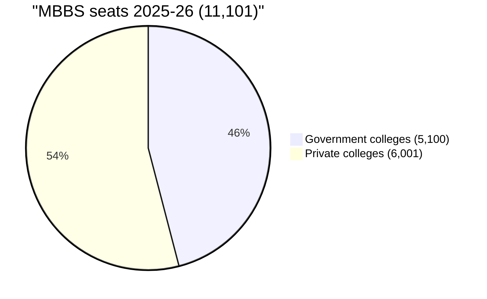
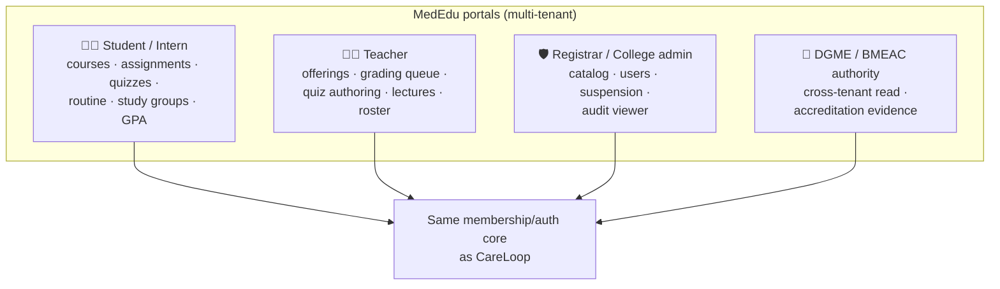

# 🎓 MedEdu — Medical Education & Campus Layer

## Module 16 — EduSync for Medical Education (MedEdu)

> **Tagline:** the entire medical college — courses, lectures, assessments, study groups, duty rosters and accreditation evidence — running as one portal on the CareLoop spine.
>
> **Origin:** adapted from the **EduSync** distributed campus platform (`C:\Users\Pritam\Downloads\edusnycdemo`) — 4 role-scoped portals (Student · Teacher · Admin · Authority), multi-tenant, real-time chat, queues and audit logs — specialised for MBBS/PGT medical education in Bangladesh.

---

## Table of Contents

- [Why a Campus Layer](#why-a-campus-layer)
- [The Education Gap in Numbers](#the-education-gap-in-numbers)
- [EduSync → MedEdu Feature Mapping](#edusync--mededu-feature-mapping)
- [Role Portals](#role-portals)
- [Stakeholder Matrix](#stakeholder-matrix)
- [Success Metrics](#success-metrics)
- [Cross-Module Dependencies](#cross-module-dependencies)
- [Sources & Notes](#sources--notes)

---

## Why a Campus Layer

The platform's competency layer is **Module 15 (InternLog)** — but a logbook tracks only the *intern year*. The other 4.5 years of MBBS (~103 colleges, 11,101 seats/yr), all postgraduate training (~3,500 seats vs >11,000 graduates/yr), and all faculty workflow still run on WhatsApp, photocopies, notice boards and handwritten mark-sheets.

**What's wrong with that in one line:** the teaching hospital is a *campus AND a hospital*, and the platform already digitizes the hospital — the campus is the missing half.

This module fills it by embedding an adapted **EduSync** into CareLoop:

- **Multi-tenant by design:** each medical college is a tenant; DGME/BMEAC is the cross-tenant authority. Strict academic boundaries (teacher only manages assigned offerings; student only submits to enrolled offerings) map 1:1 from EduSync's invariants.
- **Real-time layer:** the Node.js/Socket.IO + Redis Pub/Sub bridge from EduSync powers ward-round chats, study groups and grading notifications without loading the main API.
- **Audit-first:** EduSync's append-only `audit_logs` become accreditation evidence — the same evidence spine Module 15 exports to BMEAC.

## The Education Gap in Numbers

| Indicator | Ground statistic | Source |
|:---|:---|:---|
| Teaching posts vacant | **41–43%** (DGME: 2,459/5,920) | Daily Star · DGME |
| Signature-only assessment | **>66%** of interns; **~54%** no assessment after major rotations | BJME (8 colleges) |
| MBBS seats 2025–26 | **11,101** (5,100 govt + 6,001 private; 572 cut) | Daily Star |
| Colleges vs accreditation | **~103 colleges; only 2 BMEAC-accredited** | Daily Star |
| PG seats vs graduates | **~3,500 seats vs >11,000 graduates/yr (~1:10)** | Daily Star Campus |
| Colleges with no campus system | Effectively **all** — WhatsApp + notice board is the LMS | Direct observation [assumed] |
| Medical student burnout | **28.8%** depression (840 students) | PMC |

---

## EduSync → MedEdu Feature Mapping

| EduSync feature (as built) | MedEdu adaptation | Solves |
|---|---|---|
| Course offerings, sections, enrollment | MBBS phase courses, ward rotations as enrollable offerings | Paper enrollment, unclear eligibility |
| Assignments + submissions + late penalties + grading queues | Case write-ups, ward reports, logbook-linked submissions; auto-grading queue for busy faculty | Photocopied submissions, buried mark-sheets |
| **Timed auto-graded quizzes** | MCQ/EMQ banks timed like professional exams; instant analytics for teachers | Prep for exams with zero item quality feedback |
| Study groups + 1:1 real-time chat (Socket.IO) | Case-discussion circles, ward teams; same infra as clinical consultation rooms in other modules | WhatsApp chaos, closed access |
| Online lectures | Recorded lectures + live streams — the concrete mitigation for the 43% faculty vacancy | One teacher shortages hit thousands |
| Public resources distribution | Guidelines, past questions, protocols — versioned, per-tenant or public | Expired photocopies as canonical material |
| Routine (feature + §invariant: owned only by session user) | **Intern/PG duty rosters** + class routines; warning on half-open interval conflicts (shift overlaps) | Duty confusion, unsafe overlap of shifts |
| GPA/CGPA | Cumulative MBBS result tracking; feeds PG-shortlisting profile | Mark-sheet hunting at 1am |
| Authority portal (department-scoped, fail-closed) | DGME/BMEAC officer read-console across tenants | No university-level visibility |
| Super Admin invisibility + immutable audit logs | Registrar operations + append-only evidence chain for accreditation | Uneven auditability |
| Study-group live chat | Federates with clinical case discussions in ward teams | Knowledge stuck between batches |

---

## Role Portals

The **student and intern** are the same person across phases — Phase 1–4 student in MedEdu, rotatory intern with InternLog (Module 15) in year 5: one identity, one record of everything from first anatomy quiz to last supervised procedure.

---

## Stakeholder Matrix

| Stakeholder | Now | With MedEdu |
|---|---|---|
| Student/intern | WhatsApp for everything; photocopied quarterly exams | Courses, quizzes with item analysis, duty roster, transcript, study groups |
| Teacher | 300 students, no tooling, grading by hand | Submission queue, auto-graded MCQ/EMQ, lecture publishing |
| Registrar | Excel + emails | Tenant console: users, offering catalog, moderation queue, audit |
| DGME/BMEAC | No data at all | Cross-tenant dashboards + accreditation evidence packs |
| Hospital | Zero linkage between rotations and coursework | Rotation = enrollment; procedure log = credit; one profile |

---

## Success Metrics

| Metric | Baseline | Target (12 months of pilot) |
|---|---|---|
| Colleges running full course+assignment+quiz workflow | 0 | ☑ 3 (1 govt, 2 private) |
| Submissions graded ≥7 days after closing | "most" | < 20% |
| Quizzes with per-item analytics published to teachers | 0% | ≥ 80% |
| Lectures recorded & rewatched | 0 | ≥ 200 hrs/college |
| Duty roster collisions (half-open interval overlap) | unmeasured | 0 |
| Accreditation evidence packs generated on demand | 0 | all pilot colleges |

---

## Cross-Module Dependencies

- **Module 15 InternLog** — same student/intern identity; rotation credits flow into its e-logbook.
- **Module 07 Health Card / 05 Spine** — academic identity rides the Health-ID membership core (Practitioner/Person domain, not patient domain).
- **Module 10 YantraTrack** — same audit-chain pattern; lab/equipment fault reports can be routed through faculty case queues in MedEdu assignments.
- **Module 14 FeedbackLoop** — academic grievance channel fed into the same escalation pipeline (surface harassment concerns — see 67.3% workplace-violence prevalence among DMCH physicians).

## Sources & Notes

- DGME training-post vacancy data; Daily Star reporting on MBBS seats, BMEAC accreditation, PG seats ratio (see `hackathon-research/04_medical_education_and_institutions.md`).
- BJME logbook assessment surveys (see `modules/15-intern-log/README.md` — shared citations).
- EduSync platform internals: `C:\Users\Pritam\Downloads\edusnycdemo\README.md`, `CLAUDE.md`, `backend/`, `realtime/server.js`.
- Statistic **[assumed]** where marked: "WhatsApp as the LMS" is the observed norm, not a published survey number.
