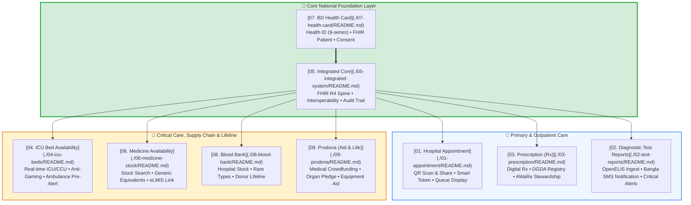
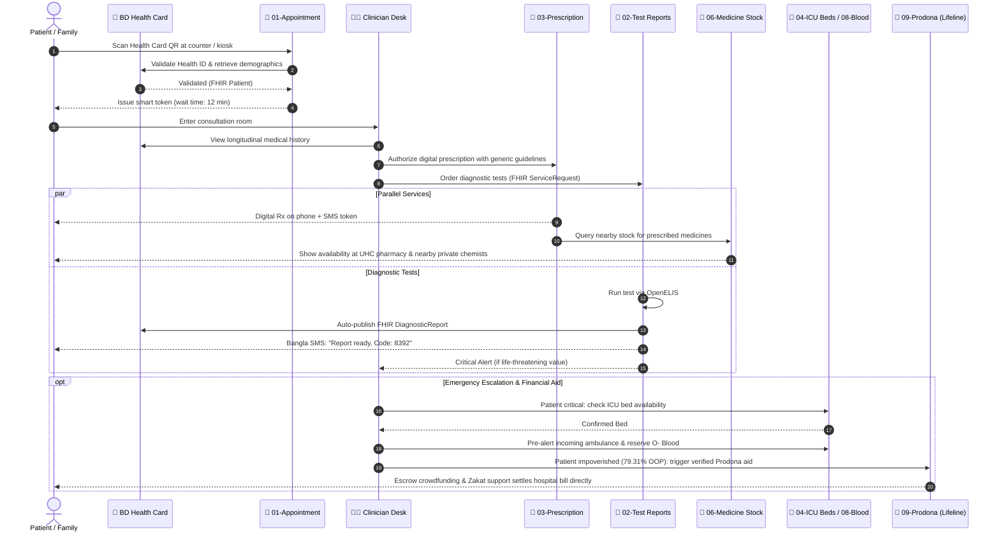

# 🇧🇩 Integrated Digital Healthcare Platform for Bangladesh (BD-HealthLoop)
## Complete Module Architecture & Specifications

Welcome to the comprehensive technical documentation for the **9 Core Healthcare Modules** designed specifically to solve Bangladesh's critical healthcare challenges.

---

## 🧭 Master Navigation & Module Matrix

Each module has its own dedicated folder containing **4 in-depth documents**:
- `README.md` — Problem analysis, local BD statistics, stakeholder impact, and comparative benchmarks
- `APP_FLOW.md` — Detailed step-by-step user journeys, sequence diagrams, and state machines
- `FEATURES.md` — Comprehensive functional catalog, edge case handling, and feature matrix
- `IMPLEMENTATION.md` — Tech stack, database ER diagrams, FHIR R4 resources, API specs, and rollout roadmap

---

## 📊 Summary of the 9 Modules

| # | Module Folder | Key Problem in Bangladesh | Proposed Digital Solution | Core FHIR Resources | Status |
|---|---|---|---|---|---|
| **01** | [`01-appointment`](./01-appointment/) | DMCH sees ~7,000 OPD/day; Keraniganj UHC 450–500/day on paper; 48s consultation time | Scan & Share QR check-in; instant numbered token; real-time queue screen; offline fallback | `Patient`, `Encounter`, `Appointment`, `Schedule`, `Slot` | Full Docs |
| **02** | [`02-test-reports`](./02-test-reports/) | OpenELIS in 100 hospitals lacks patient push; patients repeat tests; 52% diagnostic equipment idle | Auto-file to Health ID; Bangla SMS notification with PIN; physician critical value alert | `DiagnosticReport`, `Observation`, `ServiceRequest` | Full Docs |
| **03** | [`03-prescription`](./03-prescription/) | ~80% illegible handwriting; 45% antibiotics sold without Rx; Tk 600 crore counterfeit market | Tamper-proof QR digital Rx; DGDA drug registry sync; real-time drug interaction checks; WHO AWaRe audit | `MedicationRequest`, `Medication`, `MedicationDispense` | Full Docs |
| **04** | [`04-icu-beds`](./04-icu-beds/) | 1.7 ICU beds / 100,000; 38/64 districts have 0 ICU beds; 148% secondary bed occupancy | Verified real-time bed dashboard; nearest-route ambulance dispatch; anti-gaming audit logs | `Location`, `Encounter`, `Organization` | Full Docs |
| **05** | [`05-integrated-system`](./05-integrated-system/) | 51.4% paper records; hospital data silos; 59% tertiary self-referrals; 79.31% out-of-pocket spending | Unified longitudinal patient record; BD Core FHIR R4 interoperability layer; PDPO consent engine | Base FHIR R4 Server, `Bundle`, `AuditEvent` | Full Docs |
| **06** | [`06-medicine-stock`](./06-medicine-stock/) | 22% essential drug availability in public clinics; 84% patients return empty-handed; price hikes | Geolocation medicine finder; generic substitute advisor; public facility stock transparency; eLMIS bridge | `InventoryReport`, `MedicationKnowledge` | Full Docs |
| **07** | [`07-health-card`](./07-health-card/) | 5 pilot districts lack training & infrastructure; no unified patient identifier in active service | Unique 9-digit Health ID; durable QR card + offline PWA; proxy family access; emergency break-glass | `Patient`, `Consent`, `Person`, `RelatedPerson` | Full Docs |
| **08** | [`08-blood-bank`](./08-blood-bank/) | 1M+ bags needed/year, only ~30% voluntary; donor apps exist but hospital stock visibility is zero | Live hospital blood unit inventory (A/B/AB/O +/-); rare blood network (Bombay phenotype); FIFO expiry | Custom Blood Inventory + `SupplyDelivery` | Full Docs |
| **09** | [`09-prodona`](./09-prodona/) | 79.31% OOP spending driving millions into poverty; fake social media medical campaigns; severe cadaveric organ deficit | 100% verified medical crowdfunding with direct hospital billing; national organ & corneal donation pledge registry; circular medical equipment aid | `CoverageEligibilityRequest`, `Claim`, `Consent`, `Task` | Full Docs |

---

## 🧩 End-to-End Patient & Provider Lifecycle

---

## 🛠️ Technology Stack & Architecture

```mermaid
graph LR
    subgraph Client["📱 Frontend Clients (Bangla & English)"]
        PWA["Citizen PWA<br/>(React 19 + Vite + Tailwind)"]
        CLINIC["Provider Portal<br/>(Doctor/Nurse Web)"]
        KIOSK["Counter Scanner Kiosk<br/>(Android/HTML5-QR)"]
    end

    subgraph Gateway["🛡️ Gateway & Identity"]
        TRAEFIK["Traefik / Nginx Proxy"]
        AUTH["Auth0 / DGHS Health ID Auth"]
        CONSENT["PDPO Consent & Access Gateway"]
    end

    subgraph Services["⚙️ Backend Microservices"]
        CORE["05. Core Integration (FastAPI)"]
        APT_SRV["01. Appointment Service"]
        REP_SRV["02. Report Ingestion (Python)"]
        RX_SRV["03. Prescription Service"]
        ICU_SRV["04. Bed & Emergency (WebSocket)"]
        MED_SRV["06. Stock & Geo Service"]
        BLD_SRV["08. Blood Inventory Service"]
        PRO_SRV["09. Prodona Aid & Lifeline Service"]
    end

    subgraph Data["💾 Persistence & National Links"]
        PG[("PostgreSQL 16 + PostGIS")]
        REDIS[("Redis Cache & PubSub")]
        FHIR[("BD Core FHIR R4 Sandbox<br/>sandbox.fhir.dghs.gov.bd")]
        DHIS[("DHIS2 / DGHS eLMIS")]
    end

    Client --> Gateway
    Gateway --> Services
    Services --> Data
```

---

## 📂 Detailed Folder Contents

Explore the detailed specifications inside each module folder:

1. [**01-appointment/**](./01-appointment/)
   - [README.md](./01-appointment/README.md)
   - [APP_FLOW.md](./01-appointment/APP_FLOW.md)
   - [FEATURES.md](./01-appointment/FEATURES.md)
   - [IMPLEMENTATION.md](./01-appointment/IMPLEMENTATION.md)

2. [**02-test-reports/**](./02-test-reports/)
   - [README.md](./02-test-reports/README.md)
   - [APP_FLOW.md](./02-test-reports/APP_FLOW.md)
   - [FEATURES.md](./02-test-reports/FEATURES.md)
   - [IMPLEMENTATION.md](./02-test-reports/IMPLEMENTATION.md)

3. [**03-prescription/**](./03-prescription/)
   - [README.md](./03-prescription/README.md)
   - [APP_FLOW.md](./03-prescription/APP_FLOW.md)
   - [FEATURES.md](./03-prescription/FEATURES.md)
   - [IMPLEMENTATION.md](./03-prescription/IMPLEMENTATION.md)

4. [**04-icu-beds/**](./04-icu-beds/)
   - [README.md](./04-icu-beds/README.md)
   - [APP_FLOW.md](./04-icu-beds/APP_FLOW.md)
   - [FEATURES.md](./04-icu-beds/FEATURES.md)
   - [IMPLEMENTATION.md](./04-icu-beds/IMPLEMENTATION.md)

5. [**05-integrated-system/**](./05-integrated-system/)
   - [README.md](./05-integrated-system/README.md)
   - [APP_FLOW.md](./05-integrated-system/APP_FLOW.md)
   - [FEATURES.md](./05-integrated-system/FEATURES.md)
   - [IMPLEMENTATION.md](./05-integrated-system/IMPLEMENTATION.md)

6. [**06-medicine-stock/**](./06-medicine-stock/)
   - [README.md](./06-medicine-stock/README.md)
   - [APP_FLOW.md](./06-medicine-stock/APP_FLOW.md)
   - [FEATURES.md](./06-medicine-stock/FEATURES.md)
   - [IMPLEMENTATION.md](./06-medicine-stock/IMPLEMENTATION.md)

7. [**07-health-card/**](./07-health-card/)
   - [README.md](./07-health-card/README.md)
   - [APP_FLOW.md](./07-health-card/APP_FLOW.md)
   - [FEATURES.md](./07-health-card/FEATURES.md)
   - [IMPLEMENTATION.md](./07-health-card/IMPLEMENTATION.md)

8. [**08-blood-bank/**](./08-blood-bank/)
   - [README.md](./08-blood-bank/README.md)
   - [APP_FLOW.md](./08-blood-bank/APP_FLOW.md)
   - [FEATURES.md](./08-blood-bank/FEATURES.md)
   - [IMPLEMENTATION.md](./08-blood-bank/IMPLEMENTATION.md)

9. [**09-prodona/**](./09-prodona/)
   - [README.md](./09-prodona/README.md)
   - [APP_FLOW.md](./09-prodona/APP_FLOW.md)
   - [FEATURES.md](./09-prodona/FEATURES.md)
   - [IMPLEMENTATION.md](./09-prodona/IMPLEMENTATION.md)
